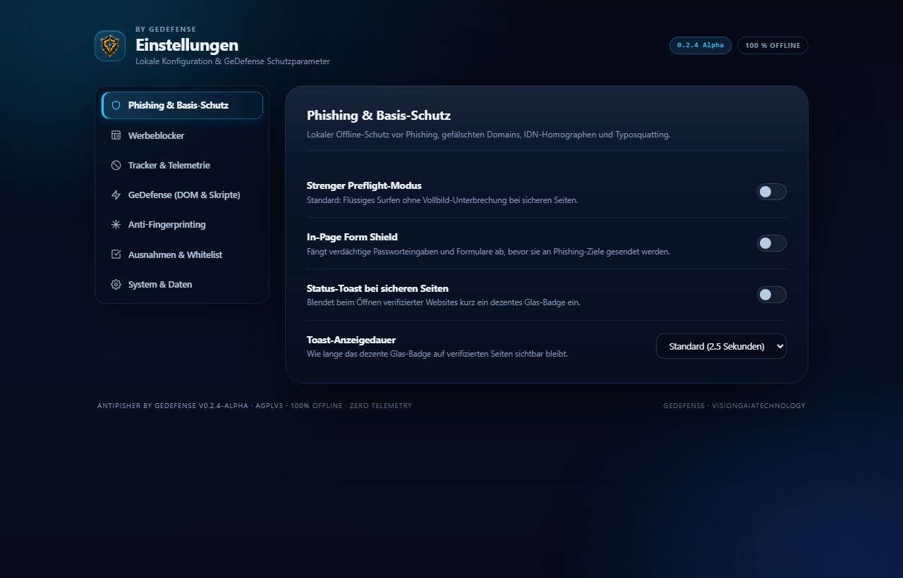
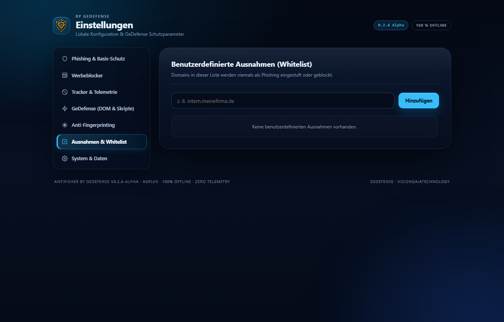
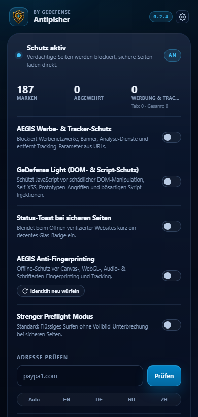
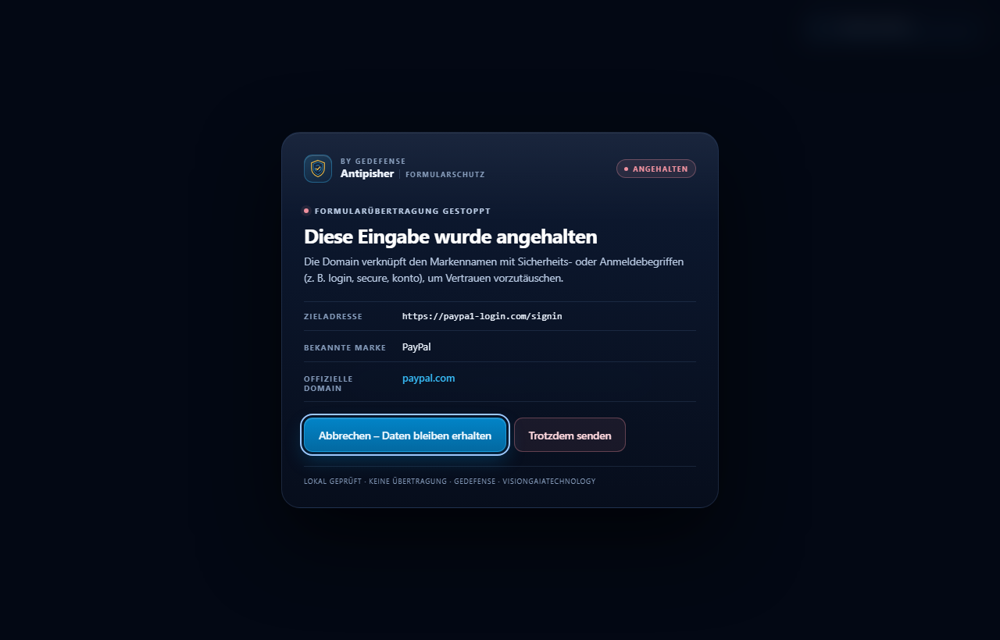
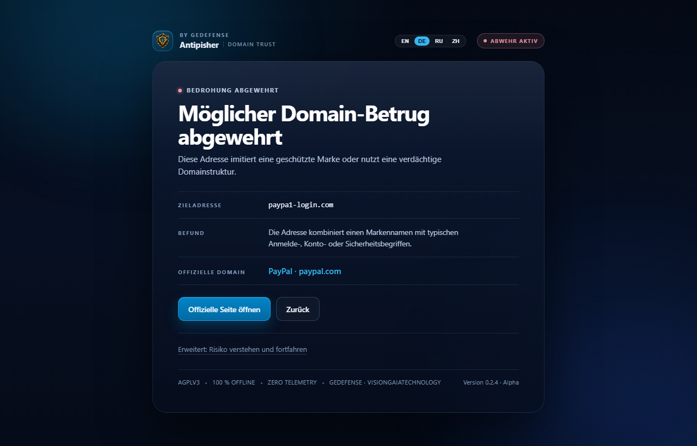
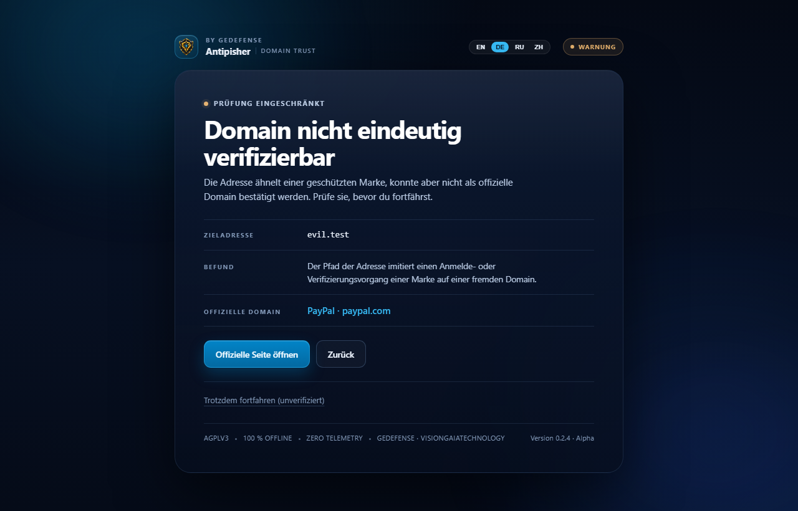
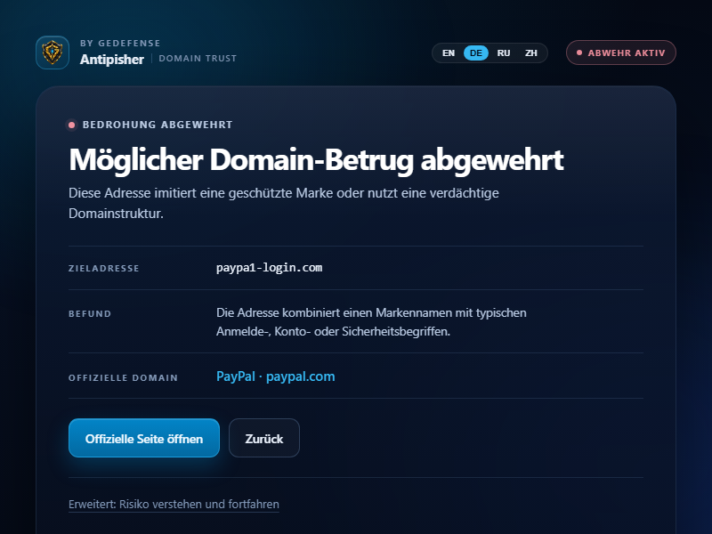
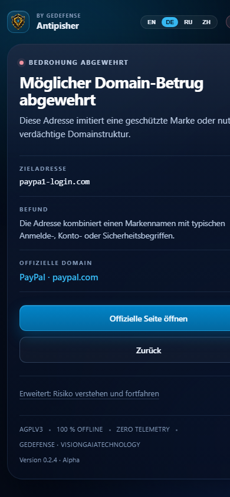

<div align="center">


# 🛡️ Antipisher by GeDefense `0.2.4` (Alpha)

**Offline-fähiger, hochpräziser Schutz vor Phishing, IDN-Homoglyphen, Supply-Chain-Skripten, Trackern & Werbung für Google Chrome & Mozilla Firefox**  
*Lizenziert unter der GNU Affero General Public License v3.0 (AGPLv3) · GeDefense / VisionGaiaTechnology*

[](LICENSE)
[](https://github.com/visiongaiatechnology/antipisher)
[](#tests--entwicklung)
[](#datenschutz--offline-garantien)
[](chrome/)
[](firefox/)

---

### 🌐 Select Language / Sprache wählen / Выберите язык / 选择语言

[🇬🇧 **English**](README.md) &nbsp;•&nbsp; [🇩🇪 **Deutsch**](README.de.md) &nbsp;•&nbsp; [🇷🇺 **Русский**](README.ru.md) &nbsp;•&nbsp; [🇨🇳 **中文**](README.zh.md)

---

</div>

> **Status:** `PLATIN` · Version `0.2.4` · Stand: 18.11.2026 · **Antipisher by GeDefense** Dark Navy Blue Edition, VGT-100 Security Hardened (`48/52 PASS, 0 FAIL`), GeDefense Light Supply-Chain & YouTube Playback Hardening.  
> **Kein finales Store-Produkt:** Browser-E2E-Tests, offizielle Store-Listung, signierte Update-Feeds und die vollständige V2-Graph-Engine sind laufende Entwicklungsziele (siehe [Bekannte Grenzen & Einschränkungen](#bekannte-grenzen--einschränkungen)).

### ⬇️ Direkt-Downloads (`v0.2.4-alpha`)

| Browser | Direkt-Download (ZIP · GitHub) | Prüfsummen, Releases & Mirror |
|---|---|---|
| **Google Chrome (MV3)** | [**Antipisher-Chrome-v0.2.4-alpha.zip herunterladen**](https://github.com/visiongaiatechnology/antipisher/releases/download/chrome-v0.2.4-alpha/Antipisher-Chrome-v0.2.4-alpha.zip) | [Chrome Release & SHA-256](https://github.com/visiongaiatechnology/antipisher/releases/tag/chrome-v0.2.4-alpha) |
| **Mozilla Firefox (MV3)** | [**Antipisher-Firefox-v0.2.4-alpha.zip herunterladen**](https://github.com/visiongaiatechnology/antipisher/releases/download/firefox-v0.2.4-alpha/Antipisher-Firefox-v0.2.4-alpha.zip) | [Firefox Release & SHA-256](https://github.com/visiongaiatechnology/antipisher/releases/tag/firefox-v0.2.4-alpha) |
| **Gesamt-Release & Mirror** | [**v0.2.4-alpha Release-Seite (GitHub)**](https://github.com/visiongaiatechnology/antipisher/releases/tag/v0.2.4-alpha) | [GitFlic Mirror & Releases](https://gitflic.ru/project/visiongaiatechnology/antipisher) · [`SHA256SUMS.txt`](SHA256SUMS.txt) · [`sbom.json`](sbom.json) |

---

## 🛡️ Sicherheitsupdates (`v0.2.3` – `v0.2.4`) & Praxisbeispiel (Supply-Chain-Angriff)

### 🎨 Neu in `0.2.4` (Antipisher by GeDefense)
- **Offizielles GeDefense-Branding & Tray-Icons:** Einheitliches **Antipisher by GeDefense**-Branding in Manifesten, 4-Sprachen-Locales (`EN/DE/RU/ZH`), Popup, Options, Guard-Page, Self-XSS-Konsolenbanner und In-Page Form Shield inkl. neuem GeDefense-Wappen in den Browser-Tray-Icons (`16×16`, `48×48`, `128×128`).
- **Dark Navy Blue Glass UI (`#040914` – `#0b1830`):** Tiefes GeDefense-Mitternachtsblau mit klaren Cyan-Blue-Akzenten (`#38bdf8` / `#0ea5e9`).

### 🔒 Sicherheits-Basis (`0.2.3` — Platin Security Hardened)
- **GeDefense Light Supply-Chain-, Magecart- & Crypto-Clipper-Festung (`shared/aegis-engine.js`):**
  - **Cross-Origin `<script>` & `<iframe>` Gatekeeper:** Abfang auf DOM-Prototyp-Ebene (`setAttribute`, `HTMLScriptElement.src`, `HTMLIFrameElement.src`, `appendChild`, `insertBefore`) gegen C2-Loader, Hochrisiko-TLDs (`.icu`, `.lol`, `.top`, `.click`, `.gq`, `.tk`), rohe IPv4-Skript-Hosts und verschleierte `eval(atob(...))`- / `window._k7`-Payloads.
  - **Anti-Magecart Exfiltration Guard:** Blockiert `navigator.sendBeacon` und `window.fetch` beim Versuch, Kreditkarten- oder Zahlungsdaten an Skimmer-Endpunkte (`/card.php`, `/hit.php`, `/skimmer.php` oder fremde Hochrisiko-Domains) abfließen zu lassen.
  - **Crypto-Clipper Guard:** Schützt `navigator.clipboard.writeText` vor dem stillen Austausch kopierter Krypto-Wallet-Adressen (BTC, ETH/EVM, TRON), indem die echte DOM-Markierung des Nutzers wiederhergestellt wird.
  - **Tracker- & IOC-Parität:** Synchronisiert `optimizely.com`, `logx.optimizely.com`, `1688360.cc`, `webshell.lol`, `linkforge.cc` und bekannte `.icu`-Exploit-Domains über Chrome DNR (`rulesets/trackers.json`) und Firefox `webRequestBlocking`.
- **VGT-100 Platin-Härtung (`48/52 PASS, 0 FAIL`):**
  - **RFC-1035 DoS-Budgets (`shared/detector.js`):** Strikte Host-/Label-/Pfad-Grenzen (`MAX_HOST_LEN=253`, `MAX_LABEL_LEN=63`) und Label-Vorberechnung drücken die Laufzeit eines `100.000`-Zeichen-Hostlabels von `2.753 ms` auf **`0,26 ms`** (**10.590× schneller**, reguläre `p95 = 0,39 ms`).
  - **30s Allow-Once-TTL & Queue-Mutex (`chrome/background.js`, `firefox/background.js`):** Einmal-Freigaben verfallen automatisch nach 30 Sekunden oder bei abweichender Navigation; `configure()`-Läufe sind per Queue-Mutex serialisiert.
  - **Fail-Closed Engine Guards & Zero-PII Event-Ringpuffer:** Fehlende/werfende Detektor-Engines leiten fail-closed auf `guard.html` um und schreiben max. 50 URL-freie Diagnose-Events (`securityEvents`).
  - **Build-Allowlist & CycloneDX 1.5 SBOM (`build.py`, `build_sites.py`):** Positivliste `ALLOWED_PACKAGE_FILES`, RFC-1123-Domain-Validierung, bit-identische ZIPs und [`sbom.json`](sbom.json).
- **YouTube Ad Accelerator Bugfix:** Behebt den Fehler, bei dem nach Werbeende leer im DOM verbleibende `.ytp-ad-player-overlay`-Container normale Videos ans Ende springen ließen; Wiedergabegeschwindigkeit (`1.0x`) und Ton werden nach Werbeende sauber wiederhergestellt.

### 🔥 Praxisbeispiel: Optimizely Supply-Chain-Angriff vom 16. November 2026 (178 Websites)
Am 16. November 2026 schleusten Angreifer über kompromittiertes `projectJS` bei Optimizely schädlichen JavaScript-Code auf 178 namhafte Webseiten (darunter GitLab, Salesforce, IKEA, Zoom, CNN, BBC und Ledger). Nachgeladen wurden u. a. `1688360.cc/track.js`, `webshell.lol`, `eval(atob(...))`-Fallbacks, Magecart-Zahlungsskimmer (`sendBeacon('/card.php')`), Krypto-Wallet-Clipper und `.icu`-iOS-Exploit-Kits.

| Angriffsphase | Vorher (`v0.2.2`) | Jetzt (`v0.2.3` Platin) |
|---|---|---|
| **1. Optimizely / C2-Skript-Nachladung** | Teilweise Tracker-Blockade (`optimizely.com`); dynamisch per `appendChild`/`setAttribute` nachgeladene `<script src="https://1688360.cc/track.js">` oder `.icu`-Exploit-iFrames wurden auf Prototyp-Ebene nicht abgefangen | **Doppelt blockiert:** Netzwerk-DNR / `webRequestBlocking` sperrt `optimizely.com`, `1688360.cc`, `webshell.lol`, `.icu`-IOCs; GeDefense Light blockiert Cross-Origin-`<script>`/`<iframe>`-Injektionen an `setAttribute`/`src`/`appendChild`/`insertBefore` |
| **2. Verschleierte Fallback-Loader (`eval(atob(...))`)** | `innerHTML` / `javascript:` entschärft, aber `window._k7` / `data-channel-code` Inline-C2-Loader nicht gezielt erkannt | **Entschärft:** Verschleierte Inline-C2-Loader und verdächtige `eval(atob(...))`-Payloads werden vor Ausführung abgefangen |
| **3. Zahlungs-Skimming (`sendBeacon('/card.php')`)** | Telemetrie-`sendBeacon` blockiert, aber `fetch`-Exfiltration an Skimmer-Pfade nicht gesperrt | **Abgewehrt:** Anti-Magecart Guard blockiert sowohl `navigator.sendBeacon` als auch `window.fetch` zu Skimmer-Endpunkten (`/card.php`, `/skimmer.php` etc.) |
| **4. Wallet-Diebstahl (Crypto-Clipper)** | Nicht abgedeckt | **Abgewehrt:** Crypto-Clipper Guard erkennt stilles Austauschen kopierter Wallet-Adressen in `navigator.clipboard.writeText` und bewahrt die echte Nutzer-Markierung |

---

## ⚡ Kernfunktionen & Architektur-Module

### 🛡️ 1. Phishing-, Marken- & Domain-Schutz
- **187 kuratierte Marken / 353 offizielle Domains:** Umfassende Offline-Datenbank für Finanzinstitute (Sparkasse, Volksbank, ING, DKB, Deutsche Bank etc.), Behörden (Bund, Elster), Krypto-Börsen, Cloud/KI-Infrastruktur, Logistik (DHL, Hermes) sowie internationale Plattformen in [`shared/sites.js`](shared/sites.js).
- **Heuristische Multi-Vektor-Erkennungs-Engine:**
  - **Tippfehler- & Buchstabendreher-Schutz:** Damerau-Levenshtein 1 & 2 Distanz fängt Vertauschungen benachbarter Buchstaben ab (`amzaon.com`, `goolge.com`, `paypla.com`).
  - **1-Bit Bitsquatting (`isBitFlip`):** Erkennt Bit-Flips durch Hardware- oder DNS-Speicherübertragungsfehler (`amaxon.com` → Amazon, `microsmft.com` → Microsoft, `gongle.com` → Google).
  - **Visuelle Ligaturen & Zwillingszeichen:** Deckt optische 2-Edit-Ähnlichkeiten auf (`arnazon.com` durch `rn→m`, `rnicrosoft.com`, `vv→w`, `cl→d`).
  - **Unicode-Homoglyphen & Diakritika:** Identifiziert gemischte Schriftsysteme aus Kyrillisch, Griechisch, eingekreisten Zeichen und lateinischen Diakritika (`páypal.com`, `päypal.com`, `mïcrosoft.com`, `amazön.com`), ohne echte Begriffe wie `über.de` fälschlicherweise zu blockieren.
  - **Bidirektionale Steuerzeichen (UTS #39 / RFC 8264):** Blockiert unsichtbare RTL/LTR-Richtungswechsler zur Verschleierung von Dateiendungen und Domains (`\u202E`, `\u202A`–`\u202E`, `\u2066`–`\u2069`).
  - **Marken- & Credential-Ködersubstantive:** Fängt ungegliederte Keyword-Kombinationen ab (`paypalsupport.com`, `binancelogin.com`, `paypal-rechnung.com`, `dhl-sendung.de`, `sparkasse-kontoauszug.de`).
  - **Subdomain-Impersonation:** Erkennt missbrauchte Markennamen auf fremden Domains (`apple.attacker.com`, `paypal.evil.test`).
  - **RFC 3986 Userinfo-Täuschung:** Blockiert irreführende Benutzerinformations-Präfixe (`https://paypal.com@evil.com/`).
- **Ebene 3: Pfad- & Query-Prüfung:** Erkennt gezielten Identitätsdiebstahl in URL-Pfaden auf fremden Hosts (z. B. `https://unrelated.com/paypal/login`, `https://phish-host.org/paypal.com/verify`), schützt jedoch legitime Entwickler-Dokumentationen, API-Referenzen und Nachrichtenartikel (`/docs/`, `/news/`, `/blog/`).
- **Isolation von Shared-Hosting-Namespaces:** Public-Suffix- und Multi-Tenant-Domains (`force.com`, `github.io`, `vercel.app`, `netlify.app`, `wordpress.com` etc.) werden isoliert und niemals als exklusive Marken-Roots gewertet (`paypal.force.com` geblockt, Plattform-Root bleibt sicher erreichbar).
- **Offizielle Länder-TLD-Intelligenz:** Erkennt offizielle Ländervertretungen globaler Marken als legitim an (`google.co.jp`, `amazon.se`, `ing.nl`, `visa.de`); warnt informativ bei uneindeutigen TLDs und blockiert strikt verdächtige generische TLDs.
- **In-Page Content Shield (`shared/shield-content.js`):**
  - Schließt die POST-Navigationslücke von Chrome MV3 declarativeNetRequest (DNR).
  - Fängt Formularabsendungen (`submit`-Event in der DOM-Capture-Phase) ab, bevor Zugangsdaten den Browser verlassen können.
  - Rendert ein manipulationssicheres Glass-2100-Warn-Modal in einem geschlossenen Shadow DOM (`attachShadow({ mode: 'closed' })`), immun gegen CSS-Resets und Skriptangriffe der Hostseite.
  - Hebt Passwortfelder auf verdächtigen Domains automatisch mit einem dezenten Schutz-Badge hervor.

### 🚫 2. Tracker- & Telemetrie-Abwehr (AEGIS Tracker Shield)
- **Lokale deklarative Netzwerksperren:** Native deklarative Regelsätze (`rulesets/trackers.json`) zur Blockade kommerzieller Werbe-, Analyse- und Telemetrienetzwerke in Chrome MV3 (DNR) und Firefox (webRequest).
- **Dynamische Skript-Surrogates (uBlock-Prinzip):** In-Page Funktions-Ersatz für `window.ga`, `window.dataLayer`, `window.fbq`, `window.ttq`, `window.clarity`, `window.hj` und `navigator.sendBeacon`. Verhindert das Einfrieren von Checkouts, Formularen und Logins bei vollständiger Unterbindung von Telemetriedaten.
- **URL-Tracking-Parameter-Sanitizer:** Bereinigt kommerzielle Tracking-Tokens (`utm_source`, `utm_medium`, `fbclid`, `gclid` etc.) automatisch und nahtlos via `history.replaceState`.
- **Echtzeit Live-Tracker-Zähler:** Toolbar-Icon-Badge und Popup zeigen in Echtzeit geblockte Tracker (`Tab: X · Gesamt: Y`) und erfassen präzise auch dynamisch oder asynchron nachladende Tracker-Skripte.

### 🛑 3. Werbeblocker & YouTube-Abwehr (VGT Ad Shield)
- **Zero-Flicker kosmetische Filterung (Element Hiding):** Injiziert direkt bei `document_start` via `adoptedStyleSheets`, blendet Banner, Werbeslots und Werbe-iFrames nahtlos und ohne Layoutverschiebungen (CLS) aus.
- **YouTube Video-Werbung-Abwehr & Fast-Forward-Beschleuniger:**
  - `window.ytInitialPlayerResponse`-Property-Trap tilgt `adPlacements`, `playerAds` und `adSlots` direkt bei der Initialisierung.
  - In-Flight JSON-Pruning fängt `fetch`- und `XMLHttpRequest`-Aufrufe für `/youtubei/v1/player` und `/reel_watch_sequence` ab.
  - Autonomer Video-Ad-Beschleuniger schaltet verbleibende Werbespots sofort stumm (`video.muted = true`), spult mit 16-facher Geschwindigkeit an das Ende (`duration`) und betätigt Überspringen-Schaltflächen in Millisekunden.
  - Beseitigt Anti-Adblock-Meldungen (`ytd-enforcement-message-view-model`) und setzt die Wiedergabe automatisch fort.
- **Anti-Adblock-Entschärfung & Honeypot-Neutralisierung:** Täuscht für Köder-Elemente (`.adsbox`, `.pub_300x250`, `.ad-test`) echte Abmessungen vor (`offsetHeight: 250`, `offsetWidth: 300`) und neutralisiert Adblock-Erkennungs-Flags.
- **Popunder-Abwehr:** Blockiert unaufgeforderte Popup-/Popunder-Aufrufe (`window.open`) zu Werbenetzwerken.

### ⚡ 4. DOM- & Skript-Sicherheit (GeDefense Light)
- **Self-XSS Konsole-Schutz:** Warnt Anwender in den Entwicklertools mit einer deutlichen Sicherheitswarnung vor Social-Engineering-Paste-Attacken.
- **Cognitive Fast-Path Engine:** Extrem performante Heuristik-Prüfung auf potenziell schädliche Tags (`<script>`, `<iframe>`) ohne unnötigen DOM-Parsing-Overhead.
- **Dynamische Injektions- & Protokoll-Neutralisierung:** Entschärft gefährliche Script- und Iframe-Injektionen, entfernt Inline-Handler (`onerror`, `onclick`) und unterbindet `javascript:` URI-Ausführungen auf Prototyp-Ebene (`Element.prototype.setAttribute`).
- **TrustedHTML / CSP-Härtung:** Funktioniert nahtlos auf Seiten mit strikter Trusted-Types-CSP (`require-trusted-types-for 'script'`) ohne `TrustedHTML`-Fehler.

### 🎭 5. Privatsphäre & Anti-Fingerprinting
- **Canvas & WebGL Cloaking:** Injiziert subtiles, unmerkliches 1-Bit-Rauschen bei Canvas-Ausleseoperationen und maskiert WebGL-Renderer-Strings gegen geräteübergreifendes Fingerprinting.
- **Screen-Geometrie-Fuzzing:** Normalisiert und fuzzt Bildschirmmaße zur Verhinderung hardwarebasierter Geräte-Wiedererkennung.
- **Rotierender digitaler Identitäts-Seed:** Generiert eine kryptografische Sitzungsidentität mit 1-Klick-Neu-Würfeln direkt im Popup oder Einstellungsmenü.
- **100 % Offline & Null Telemetrie:** Keine externen HTTP-Aufrufe, keine Cloud-Abhängigkeiten, keine API-Schlüssel, keine Speicherung des Browserverlaufs.

### ⚙️ 6. Benutzerfreundlichkeit, Einstellungen & Whitelist
- **Dediziertes Einstellungsmenü (`options.html`):** Vollständiges Glass-2100-Options-Dashboard, erreichbar über das Zahnrad-Symbol im Popup oder die Browser-Erweiterungsverwaltung, mit dedizierten Reitern für Werbeblocker, Tracker, GeDefense, Anti-Fingerprinting und Whitelist.
- **Benutzerdefinierte Domain-Whitelist:** Schnelles Pflegen vertrauenswürdiger Domains und Intranet-Portale (z. B. Firmen-SSO), mit sofortiger lokaler Freigabe ohne externe Abfragen.
- **Leises sicheres Surfen & Glass 2100 Status-Toast:** Saubere, verifizierte Webseiten öffnen direkt ohne zusätzliche Latenz (0 ms) und ohne störende Vollbild-Unterbrechungen. Beim Aufrufen verifizierter Webseiten erscheint kurz ein dezenter, schwebender Glass-2100-Status-Toast (*„Domain verifiziert · Antipisher“*), der sanft ausblendet, ohne Klicks zu blockieren (`pointer-events: none`).
- **Standard- vs. Strenger Preflight-Modus:** Der Standard-Modus ermöglicht flüssiges Surfen mit gezielter Phishing-Abwehr; der optionale strenge Modus schaltet eine vollständige Vollbild-Vorabprüfung vor jeden GET-Aufruf.
- **4 Muttersprachen:** 100 % Parität in Deutsch (`de`), Englisch (`en`), Russisch (`ru`) und Chinesisch (`zh`), automatische Erkennung der Browsersprache mit manuellem Override.

### 🏗️ 7. Architektur, Barrierefreiheit & Build-Integrität
- **Chrome MV3 Preflight & Beseitigung von Fail-Open:** Führt GET-Anfragen über DNR; bei einem DNR-Konfigurationsfehler schaltet Antipisher sofort in einen klar signalisierten Degraded-Modus mit Observer-Fallback. Beseitigt willkürliche URL-Längenbeschränkungen.
- **Firefox MV3 Konformität:** Synchrones `webRequestBlocking` + In-Page Shield mit deklarierten `web_accessible_resources` und `data_collection_permissions: {"required":["none"]}` gemäß MDN- und AMO-Richtlinien.
- **Glass 2100 Design System:** Gemeinsame Design-Tokens (`shared/design-tokens.css`), WCAG-AA-konforme Kontrastwerte (≥ 4.5:1), vollständige Tastatursteuerung mit 2px Fokusringen, ARIA `alertdialog`, Unterstützung für Prefers-Reduced-Motion und Forced-Colors.
- **100 % bit-identische reproduzierbare Builds:** Deterministische ZIP-Erstellung mit festen Zeitstempeln via `build.py` und zentrale Prüfsummen in [`SHA256SUMS.txt`](SHA256SUMS.txt).

---

## 📸 Benutzeroberfläche & Screenshots

| Einstellungs-Menü (v0.2.1) | Benutzerdefinierte Whitelist (v0.2.1) |
|:---:|:---:|
|  |  |

| Erweiterungs-Popup (v0.2.1) | In-Page Content Shield (Formular-Schutz) |
|:---:|:---:|
|  |  |

| Bedrohung abgefangen (Block-Interstitial) | Unklare Domain (Warn-Interstitial) |
|:---:|:---:|
|  |  |

| Kompakt-Ansicht (500px) | Mobile Ansicht (390px) |
|:---:|:---:|
|  |  |

---

## 📊 Gemessene Erkennungsleistung

| Test-Korpus | Benchmark-Ergebnis |
|---|---|
| Unabhängiges 296-Fälle Holdout (Audit-Verifier) | **292/296 = 98,65 %** Genauigkeit; **0/166 False Negatives (100 % TPR)**, 4/121 False Positives (`p50 = 0,16 ms`, `p95 = 0,39 ms`) |
| Frischer unkalibrierter 44-Fälle Sanity-Korpus | **44/44 = 100 %** (`tiktok-coin.com` und `ledger-live.com` werden nun erkannt) |
| Security-Audit-Korpus (`probe02`, 788 Fälle) | **42/43 Angriffe erkannt (97,7 %)**, **0/745 Benign-False-Positives (0,0 %)** |
| Adversarial Lead Probe (66 Fälle) | **0/26 False Positives (0 %)**, **0/40 False Negatives (0 %)** — 100 % bestanden |
| Node.js Unit-, Security-Negativ- & Regressionstests | **91/91 bestanden (100 %)** in 13 Suiten |
| VGT-100 Security-Audit (`validate_audit.py`) | **48/52 anwendbare Kontrollen PASS, 0 FAIL** ([`AUDIT_SECURITY.md`](audit/security/AUDIT_SECURITY.md)) |

> [!NOTE]
> Diese Zahlen spiegeln empirische Testergebnisse wider und stellen keine absolute Garantie dar. Der kontinuierliche Ausbau hin zu vollständigen UTS-39-Tabellen und graphenbasierten Markenmodellen ist für V2 geplant.

---

## 🏛️ Architektur-Vergleich nach Browser

| Dimension | Google Chrome (MV3) | Mozilla Firefox (MV3) |
|---|---|---|
| **Top-Level GET-Navigation** | DNR-Preflight-Redirect → Lokales `guard.html` → Heuristische Einstufung | Synchrones `webRequestBlocking` vor dem Absenden der Anfrage |
| **POST / Formular-Absendungen** | In-Page Content Shield (Abfangen in DOM-Capture-Phase) | Synchrones `webRequestBlocking` + In-Page Content Shield |
| **DNR-Fehlerverhalten** | Explizite „Degraded“-Meldung im Popup + Fallback-Beobachtermodus | Nicht zutreffend (natives `webRequestBlocking` aktiv) |
| **Offline First** | Ja (100 % offline, null Netzwerkverkehr) | Ja (100 % offline, null Netzwerkverkehr) |
| **Browser E2E-Ausführung** | Manuelle Verifikation via entpackter Erweiterung (Chrome 155 CLI-Restriktion) | Manuelle Verifikation via `about:debugging` |

---

## 🔒 Datenschutz & Offline-Garantien

- **Keinerlei Netzwerkaktivität:** Verbindet sich niemals mit externen Servern, Cloud-Diensten oder Analyse-Tools.
- **Reiner Lokalspeicher:** Speichert ausschließlich Zählerstände, Konfigurations-Flags (`strictMode`) und die Sprachpräferenz (`user_locale`).
- **Keine Protokollierung des Verlaufs:** Besuchte Adressen werden weder gespeichert noch übertragen. Einmalige Freigaben gelten ausschließlich für den spezifischen Tab und die aktuelle Sitzung.
- **Integrität des DOM-Shields:** Liest bei Formularabsendungen nur die Ziel-URL und prüft auf das Vorhandensein von Passwortfeldern — **Passwörter selbst werden zu keinem Zeitpunkt ausgelesen, protokolliert oder gespeichert**.

---

## ⚠️ Bekannte Grenzen & Einschränkungen

1. **POST-Shield Abdeckung:** Formularübermittlungen, die rein programmatisch über `form.submit()` ohne auslösendes Event, in verschachtelten Cross-Origin-iFrames oder manuell über `fetch`/XHR erfolgen, können nicht im DOM abgefangen werden. Chrome MV3 DNR bleibt laut Spezifikation rein auf GET beschränkt.
2. **Chrome Global-Redirect-Ablauf:** Chrome-GET-Navigationen durchlaufen die lokale Guard-Zwischenseite und erfordern temporäre Einzelfreigaberegeln.
3. **Datenabdeckung:** Der Markenkatalog umfasst derzeit 187 kuratierte Entitäten. Nicht enthaltene Marken werden nicht aktiv überwacht.
4. **Verbleibende Randfälle:** Generische Wörterbuch-Subdomains auf Drittanbieter-Servern oder ungekannte Wortkombinationen (`tiktok-coin`) erfordern einen weiteren Ausbau des heuristischen Vokabulars.
5. **Kein Cloud-Update-Feed:** Aktualisierungen der Markendatenbank erfolgen über neue Releases des Erweiterungspakets.

---

## 🚀 Installation & Lokales Testen

Antipisher wird derzeit als **Alpha-Version** über GitHub bereitgestellt:

```bash
# 1. Release-Archiv aus GitHub Releases herunterladen oder lokal bauen:
python build.py

# 2. Integrität der Archive verifizieren:
# Unter Windows:
powershell -ExecutionPolicy Bypass -File scripts/verify-release.ps1
# Unter Linux/macOS:
bash scripts/verify-release.sh
```

### Google Chrome
1. Öffne `chrome://extensions`.
2. Aktiviere den **Entwicklermodus** (Schalter oben rechts).
3. Klicke auf **Entpackte Erweiterung laden** und wähle das Verzeichnis [`chrome/`](chrome/) aus.

### Mozilla Firefox
1. Öffne `about:debugging#/runtime/this-firefox`.
2. Klicke auf **Temporäres Add-on laden…**.
3. Wähle die Datei [`firefox/manifest.json`](firefox/manifest.json) aus.
*(Eine dauerhafte Installation außerhalb des Entwicklermodus erfordert das unlisted Signieren über AMO; siehe [`docs/ALPHA-INSTALL.md`](docs/ALPHA-INSTALL.md)).*

---

## 🧪 Tests & Entwicklung

Antipisher verfügt über eine vollständig automatisierte Test-Suite ohne externe Abhängigkeiten:

```bash
# Alle 91 Unit-, Security-Negativ- und Regressionstests (13 Suiten) ausführen
node --test tests/*.test.cjs

# JavaScript-Syntax aller Kernkomponenten validieren
node --check shared/detector.js
node --check shared/shield-content.js
node --check shared/i18n.js
node --check chrome/background.js
node --check firefox/background.js

# Unabhängige Holdout- und Sanity-Prüfungen durchführen
node audit/verify/holdout/run_holdout.cjs
node audit/verify/fix/fresh_sanity.cjs
node audit/lead/lead_probe.cjs

# Deterministische, bit-identische Release-Archive erstellen
python build.py
```

---

## 📜 Referenzen & Standards

- **Unicode-Sicherheit:** [Unicode Technical Standard #39 (UTS #39)](https://www.unicode.org/reports/tr39/)
- **Chrome Extensions:** [DeclarativeNetRequest API](https://developer.chrome.com/docs/extensions/reference/api/declarativeNetRequest)
- **Mozilla Add-ons:** [MDN webRequest API](https://developer.mozilla.org/en-US/docs/Mozilla/Add-ons/WebExtensions/API/webRequest/onBeforeRequest)
- **Public Suffixes:** [Public Suffix List (PSL)](https://publicsuffix.org/)
- **Store-Richtlinien:** [Chrome Web Store Program Policies](https://developer.chrome.com/docs/webstore/program-policies/policies)

---

## 📄 Lizenz & Urheberrecht

Lizenziert unter der **GNU Affero General Public License v3.0 (AGPLv3)**.  
Den vollständigen Lizenztext findest du in [`LICENSE`](LICENSE).

Copyright © 2026 VisionGaiaTechnology. Alle Rechte vorbehalten.
