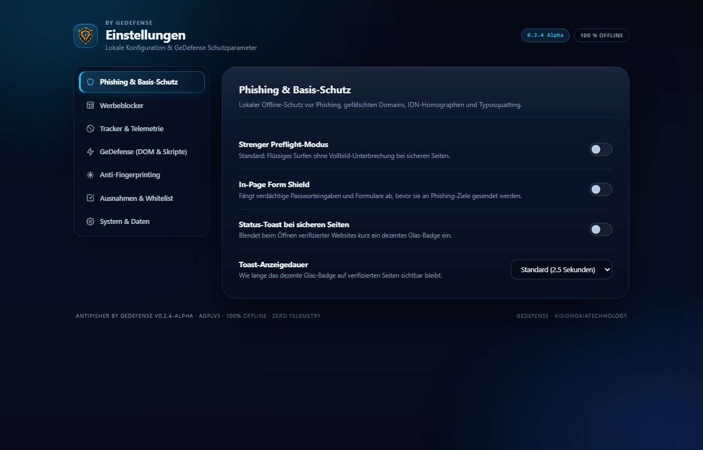
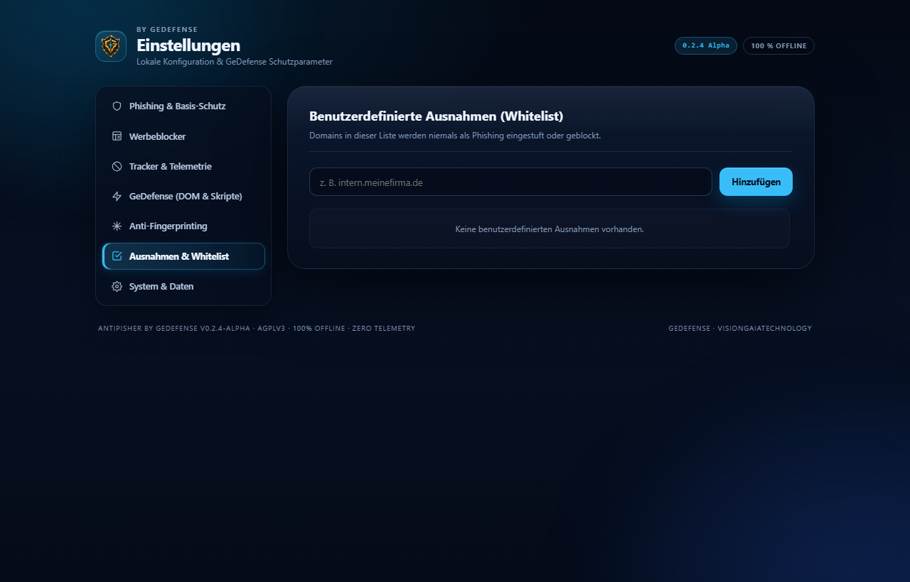
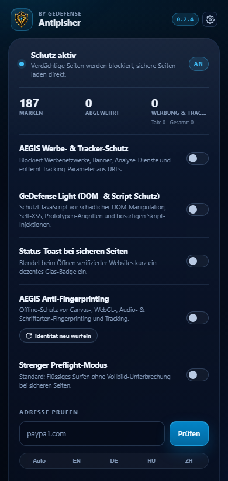
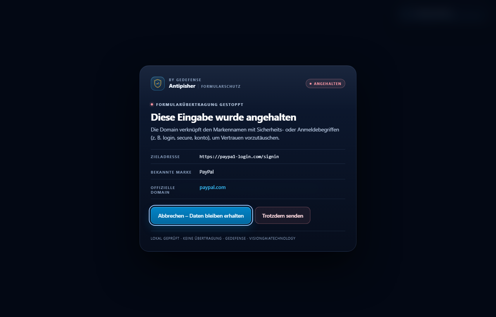
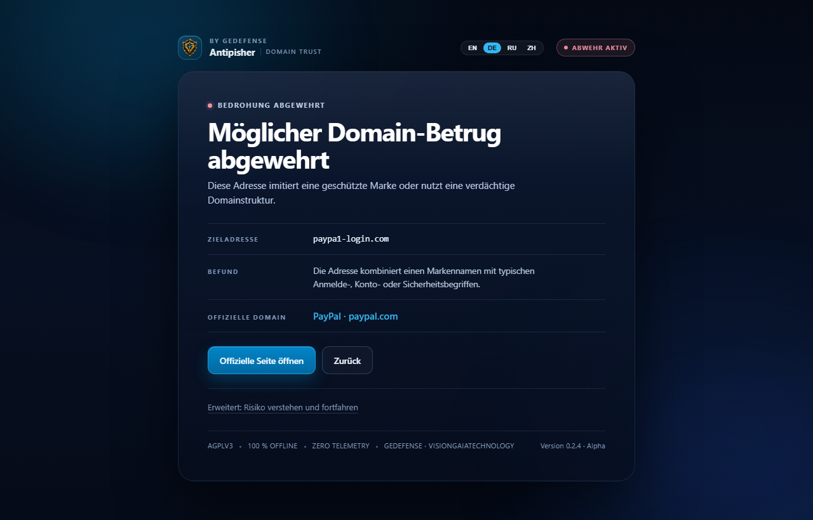
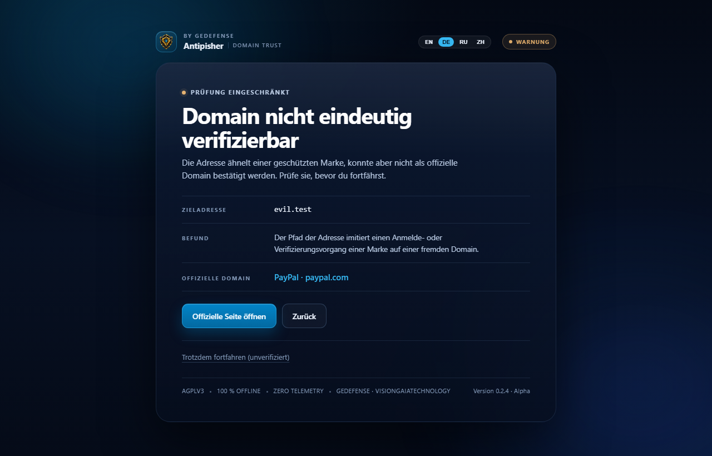
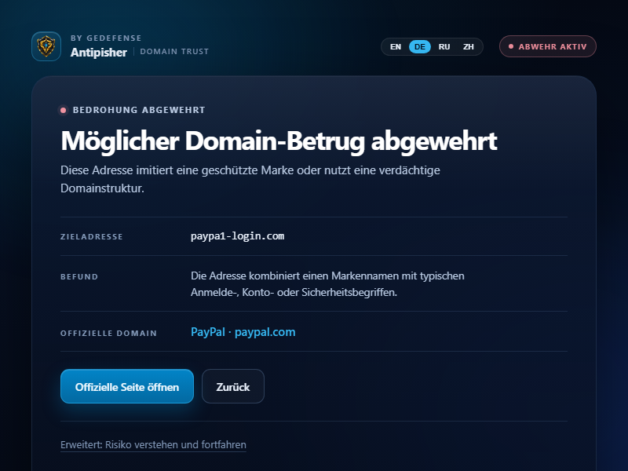
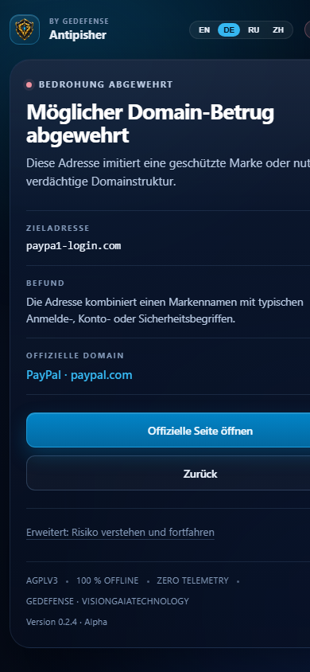

<div align="center">


# 🛡️ Antipisher by GeDefense `0.2.4` (Alpha)

**Offline, High-Precision Anti-Phishing, IDN Homograph, Supply-Chain, Tracker & Ad Protection for Google Chrome & Mozilla Firefox**  
*Licensed under the GNU Affero General Public License v3.0 (AGPLv3) · GeDefense / VisionGaiaTechnology*

[](LICENSE)
[](https://github.com/visiongaiatechnology/antipisher)
[](#tests--development)
[](#privacy)
[](chrome/)
[](firefox/)

---

### 🌐 Select Language / Sprache wählen / Выберите язык / 选择语言

[🇬🇧 **English**](README.md) &nbsp;•&nbsp; [🇩🇪 **Deutsch**](README.de.md) &nbsp;•&nbsp; [🇷🇺 **Русский**](README.ru.md) &nbsp;•&nbsp; [🇨🇳 **中文**](README.zh.md)

---

</div>

> **Status:** `PLATIN` · Version `0.2.4` · As of 18.11.2026 · **Antipisher by GeDefense** Dark Navy Blue Edition, VGT-100 Security Hardened (`48/52 PASS, 0 FAIL`), GeDefense Light Supply-Chain & YouTube Playback Hardening.  
> **Not a store-release product:** Browser E2E, official store submission, signed update feeds, and full V2 graph engine are ongoing milestones (see [Known Boundaries & Limitations](#known-boundaries--limitations)).

### ⬇️ Direct Downloads (`v0.2.4-alpha`)

| Browser | Direct ZIP Download (GitHub) | Checksums, Releases & Mirrors |
|---|---|---|
| **Google Chrome (MV3)** | [**Download Antipisher-Chrome-v0.2.4-alpha.zip**](https://github.com/visiongaiatechnology/antipisher/releases/download/chrome-v0.2.4-alpha/Antipisher-Chrome-v0.2.4-alpha.zip) | [Chrome Release & SHA-256](https://github.com/visiongaiatechnology/antipisher/releases/tag/chrome-v0.2.4-alpha) |
| **Mozilla Firefox (MV3)** | [**Download Antipisher-Firefox-v0.2.4-alpha.zip**](https://github.com/visiongaiatechnology/antipisher/releases/download/firefox-v0.2.4-alpha/Antipisher-Firefox-v0.2.4-alpha.zip) | [Firefox Release & SHA-256](https://github.com/visiongaiatechnology/antipisher/releases/tag/firefox-v0.2.4-alpha) |
| **Full Release & Mirrors** | [**v0.2.4-alpha Release Page (GitHub)**](https://github.com/visiongaiatechnology/antipisher/releases/tag/v0.2.4-alpha) | [GitFlic Mirror & Releases](https://gitflic.ru/project/visiongaiatechnology/antipisher) · [`SHA256SUMS.txt`](SHA256SUMS.txt) · [`sbom.json`](sbom.json) |

---

## 🛡️ Release Updates (`v0.2.3` – `v0.2.4`) & Supply-Chain Case Study

### 🎨 What's New in `0.2.4` (Antipisher by GeDefense)
- **Official GeDefense Branding & Tray Icons:** Rebranded across extension manifests, locales (`EN/DE/RU/ZH`), Popup, Options, Guard interstitial, Self-XSS console banner, and Shadow-DOM Form Shield, powered by crisp GeDefense crest tray icons (`16x16`, `48x48`, `128x128`).
- **Dark Navy Blue Glass UI (`#040914` – `#0b1830`):** Unified GeDefense midnight navy aesthetic paired with `#38bdf8` cyan-blue controls and glass highlights.

### 🔒 Security Highlights (`0.2.3` Platin Foundation)
- **GeDefense Light Supply-Chain, Magecart & Crypto-Clipper Fortress (`shared/aegis-engine.js`):**
  - Cross-Origin `<script>` & `<iframe>` Gatekeeper at DOM prototype level (`setAttribute`, `HTMLScriptElement.src`, `HTMLIFrameElement.src`, `appendChild`, `insertBefore`) blocking malicious C2 loaders, high-risk TLDs (`.icu`, `.lol`, `.top`, `.click`, `.gq`, `.tk`), raw IPv4 script hosts, and obfuscated `eval(atob(...))` / `window._k7` payloads.
  - **Anti-Magecart Exfiltration Guard:** Intercepts `navigator.sendBeacon` and `window.fetch` payloads attempting to exfiltrate payment/card data (`/card.php`, `/hit.php`, `/skimmer.php`, or suspicious third-party endpoints).
  - **Crypto-Clipper Guard:** Protects `navigator.clipboard.writeText` against silent replacement of copied BTC/ETH/TRON wallet addresses by restoring the user's real DOM selection.
  - **Tracker & IOC Parity:** Synchronized `optimizely.com`, `logx.optimizely.com`, `1688360.cc`, `webshell.lol`, `linkforge.cc`, and known `.icu` exploit domains across Chrome DNR (`rulesets/trackers.json`) and Firefox `webRequestBlocking`.
- **VGT-100 Platin Security Hardening (`48/52 PASS, 0 FAIL`):**
  - **RFC-1035 DoS Bounds (`shared/detector.js`):** Strict host/label/path length limits (`MAX_HOST_LEN=253`, `MAX_LABEL_LEN=63`) and label precomputation cut `100k`-host classification from `2,753 ms` down to **`0.26 ms`** (**10,590x faster**, regular `p95 = 0.39 ms`).
  - **30s Allow-Once TTL & Queue-Mutex (`chrome/background.js`, `firefox/background.js`):** Single-use bypasses auto-expire after `30s` or on any different navigation; `configure()` calls are serialized via queue mutex.
  - **Fail-Closed Engine Guards & Zero-PII Event Ring-Buffer:** Missing/throwing detector engines redirect fail-closed to `guard.html` and log up to 50 URL-free security events (`securityEvents`).
  - **Build Allowlist & CycloneDX 1.5 SBOM (`build.py`, `build_sites.py`):** Enforces `ALLOWED_PACKAGE_FILES`, RFC-1123 domain validation, deterministic ZIPs, and [`sbom.json`](sbom.json).
- **YouTube Ad Accelerator Bugfix:** Fixed an issue where persistent empty `.ytp-ad-player-overlay` containers caused normal videos to jump to the end; playback rate (`1.0x`) and mute state now restore cleanly after ads end.

### 🔥 Case Study: Nov 16, 2026 Optimizely Supply-Chain Attack (178 Websites)
On November 16, 2026, attackers compromised Optimizely's `projectJS` delivery to inject malicious JavaScript across 178 high-profile websites (including GitLab, Salesforce, IKEA, Zoom, CNN, BBC, and Ledger), loading `1688360.cc/track.js`, `webshell.lol`, `eval(atob(...))` fallbacks, Magecart payment skimmers (`sendBeacon('/card.php')`), crypto wallet clippers, and `.icu` iOS exploit kits.

| Attack Stage | Before (`v0.2.2`) | Now (`v0.2.3` Platin) |
|---|---|---|
| **1. Optimizely / C2 Script Delivery** | Partial tracker blocking (`optimizely.com` only); dynamically injected `<script src="https://1688360.cc/track.js">` or `.icu` exploit iframes were not gated at prototype level | **Blocked at 2 layers:** Network DNR / `webRequestBlocking` blocks `optimizely.com`, `1688360.cc`, `webshell.lol`, `.icu` IOCs; GeDefense Light blocks dynamic cross-origin `<script>`/`<iframe>` injections via `setAttribute`/`src`/`appendChild`/`insertBefore` |
| **2. Obfuscated Fallback (`eval(atob(...))`)** | `innerHTML`/`javascript:` neutralized, but `window._k7` / `data-channel-code` inline C2 loaders were not specifically matched | **Neutralized:** Inline obfuscated C2 loader patterns and suspicious `eval(atob(...))` injections are intercepted before execution |
| **3. Payment Skimming (`sendBeacon('/card.php')`)** | `sendBeacon` telemetry dropped for analytics, but `fetch` exfiltration to skimmer paths was not blocked | **Blocked:** Anti-Magecart Guard intercepts both `navigator.sendBeacon` and `window.fetch` targeting skimmer endpoints (`/card.php`, `/skimmer.php`, etc.) |
| **4. Wallet Address Hijacking (Crypto-Clipper)** | Not covered | **Blocked:** Crypto-Clipper Guard detects silent wallet address swaps in `navigator.clipboard.writeText` and preserves the user's selected address |

---

## ⚡ Key Capabilities & Architecture Modules

### 🛡️ 1. Phishing & Brand Impersonation Defense
- **187 Curated Brands & 353 Official Domains:** Comprehensive offline database covering global and European financial institutions, government portals, crypto exchanges, cloud/AI infrastructure, logistics, and major platforms in [`shared/sites.js`](shared/sites.js).
- **Multi-Vector Heuristic Detection Engine:**
  - **Typo- & Transposition Defense:** Damerau-Levenshtein 1 & 2 distance detection catches adjacent letter transpositions (`amzaon.com`, `goolge.com`, `paypla.com`).
  - **1-Bit Bitsquatting (`isBitFlip`):** Detects single-bit memory corruption and DNS transmission errors (`amaxon.com` → Amazon, `microsmft.com` → Microsoft, `gongle.com` → Google).
  - **Visual Ligatures & Twin Characters:** Uncovers 2-edit visual lookalikes (`arnazon.com` via `rn→m`, `rnicrosoft.com`, `vv→w`, `cl→d`).
  - **Unicode Homoglyphs & Diacritics:** Identifies mixed-script Cyrillic, Greek, circled alphanumerics, and Latin diacritics (`páypal.com`, `päypal.com`, `mïcrosoft.com`, `amazön.com`) without false-flagging legitimate terms like `über.de`.
  - **Bidirectional Control Characters (UTS #39 / RFC 8264):** Blocks invisible RTL/LTR override characters used to mask file and domain extensions (`\u202E`, `\u202A`–`\u202E`, `\u2066`–`\u2069`).
  - **Brand & Credential Bait Concatenation:** Catches unseparated keyword mashups (`paypalsupport.com`, `binancelogin.com`, `paypal-rechnung.com`, `dhl-sendung.de`, `sparkasse-kontoauszug.de`).
  - **Subdomain Impersonation:** Intercepts brands weaponized as subdomains on foreign roots (`apple.attacker.com`, `paypal.evil.test`).
  - **RFC 3986 Userinfo Deception:** Blocks deceptive userinfo schemes (`https://paypal.com@evil.com/`).
- **Layer 3: Path & Query Inspection:** Identifies targeted brand impersonation in URL paths on foreign hosts (`https://unrelated.com/paypal/login`, `https://phish-host.org/paypal.com/verify`) while preserving legitimate developer documentation, API tutorials, and news articles (`/docs/`, `/news/`, `/blog/`).
- **Shared-Hosting Namespace Isolation:** Public-suffix / customer multi-tenant domains (`force.com`, `github.io`, `vercel.app`, `netlify.app`, `wordpress.com`, etc.) are isolated and never treated as exclusive brand roots (`paypal.force.com` blocked, platform root safe).
- **Official ccTLD Intelligence:** Validates recognized national branches of global brands (`google.co.jp`, `amazon.se`, `ing.nl`, `visa.de`); raises informational warnings on ambiguous ccTLDs and enforces strict blocks on suspicious generic TLDs.
- **In-Page Content Shield (`shared/shield-content.js`):**
  - Intercepts form submissions (`submit` event in DOM capture phase) before credentials leave the browser, closing the Chrome MV3 DNR POST gap.
  - Renders a tamper-proof Glass 2100 warning modal in a closed Shadow DOM (`attachShadow({ mode: 'closed' })`), completely immune to host-page CSS resets and script tampering.
  - Automatically highlights password input fields on suspicious domains with a non-intrusive warning badge.

### 🚫 2. Tracker & Telemetry Defense (AEGIS Tracker Shield)
- **Local Declarative Network Blocking:** Native declarative ruleset (`rulesets/trackers.json`) blocking commercial analytics, ads, and telemetry networks in Chrome MV3 (declarativeNetRequest) and Firefox (webRequest).
- **Dynamic Script Surrogates (uBlock-Inspired):** In-page script surrogate defusers for `window.ga`, `window.dataLayer`, `window.fbq`, `window.ttq`, `window.clarity`, `window.hj`, and `navigator.sendBeacon`. Guarantees checkouts, forms, and logins never stall while terminating third-party telemetry.
- **URL Tracking Parameter Sanitizer:** Automatically strips commercial tracking tokens (`utm_source`, `utm_medium`, `fbclid`, `gclid`, etc.) via seamless `history.replaceState`.
- **Live Real-Time Tracker Counter:** Browser toolbar badge and extension popup display live metrics (`Tab: X · Total: Y`), actively updating even when third-party tracker scripts are injected dynamically or loaded asynchronously.

### 🛑 3. Ad Blocking & YouTube Defense (VGT Ad Shield)
- **Zero-Flicker Cosmetic Filtering (Element Hiding):** Injected directly at `document_start` via `adoptedStyleSheets` to collapse banner ad slots, promotional containers, and ad iframes without layout shifts (CLS).
- **YouTube Video Ad Defense & Fast-Forward Accelerator:**
  - `window.ytInitialPlayerResponse`-Property-Trap strips `adPlacements`, `playerAds`, and `adSlots` directly at page initialization.
  - In-flight JSON pruning intercepts `fetch` and `XMLHttpRequest` calls for `/youtubei/v1/player` and `/reel_watch_sequence`.
  - Autonomous Video Ad Accelerator instantly mutes (`video.muted = true`), fast-forwards ads at 16x speed to `duration`, and programmatically triggers skip buttons in milliseconds.
  - Dismisses anti-adblock modals (`ytd-enforcement-message-view-model`) and unpauses video playback automatically.
- **Anti-Adblock Defusers & Honeypot Neutralizer:** Spoofs dimensions for decoy elements (`.adsbox`, `.pub_300x250`, `.ad-test`) to return authentic dimensions (`offsetHeight: 250`, `offsetWidth: 300`) and neutralizes detection flags.
- **Popunder Defense:** Intercepts unsolicited popup/popunder triggers (`window.open`) targeting advertising networks.

### ⚡ 4. DOM & Script Security (GeDefense Light)
- **Self-XSS Console Defense:** Displays an authoritative developer-console warning banner to protect users from social-engineering copy-paste attacks.
- **Cognitive Fast-Path Engine:** Ultra-low-overhead heuristic scanner that validates safe HTML without unnecessary DOM tree re-parsing.
- **Dynamic Injection & Protocol Neutralization:** Disarms dangerous `<script>` and `<iframe>` injections, strips inline event handlers (`onerror`, `onclick`), and neutralizes `javascript:` URI execution schemes at the prototype level (`Element.prototype.setAttribute`).
- **TrustedHTML / CSP Hardening:** Seamlessly handles sites enforcing Trusted Types CSP (`require-trusted-types-for 'script'`) without throwing `TrustedHTML` errors.

### 🎭 5. Privacy & Anti-Fingerprinting
- **Canvas & WebGL Cloaking:** Injects subtle, imperceptible 1-bit noise into HTML5 Canvas readbacks and masks WebGL renderer strings to defeat cross-site fingerprinting.
- **Screen Geometry Fuzzing:** Normalizes and fuzzes available screen resolution metrics to prevent cross-profile device hardware tracking.
- **Rotating Digital Identity Seed:** Generates a cryptographic session seed with a 1-click "Re-roll Identity" button in the popup and options dashboard.
- **100% Offline & Zero Telemetry:** Zero external HTTP requests, zero cloud dependencies, no API keys, and no recording of user browsing history.

### ⚙️ 6. User Experience, Settings & Whitelist
- **Dedicated Options Dashboard (`options.html`):** Comprehensive Glass 2100 preferences center accessible via the popup gear icon or extension management with dedicated tabs for Ad Blocking, Trackers, GeDefense, Anti-Fingerprinting, and Whitelist.
- **Custom Domain Whitelist:** Instant, local management of trusted domains and internal portals (e.g., enterprise intranets), immediately bypassing detection without remote queries.
- **Quiet Safe Browsing & Glass 2100 Status Toast:** Clean, verified websites load immediately with zero added latency (0 ms) and without any disruptive full-screen interstitials. A sleek, floating Glass 2100 status toast (*"Domain verified · Antipisher"*) briefly appears in the screen corner and gently auto-fades without blocking mouse interactions (`pointer-events: none`).
- **Standard vs. Strict Preflight Mode:** Standard mode provides smooth, direct browsing with on-demand threat interception; Strict mode offers an optional full-screen pre-request gate for high-risk threat environments.
- **4 Native Languages:** 100% complete key parity across English (`en`), Deutsch (`de`), Русский (`ru`), and 中文 (`zh`), automatically matching the browser locale with manual override.

### 🏗️ 7. Architecture, Accessibility & Reproducibility
- **Chrome MV3 Preflight & Fail-Open Elimination:** Preflight GET requests via declarativeNetRequest; if DNR configuration encounters an error, Antipisher persists a degraded state and falls back to observer mode with clear UI indication. Eliminates arbitrary URL length limits.
- **Firefox MV3 Strict Conformance:** Synchronous `webRequestBlocking` + In-Page Shield with explicit `web_accessible_resources` and `data_collection_permissions: {"required":["none"]}` in compliance with AMO and MDN standards.
- **Glass 2100 Design System:** Shared design tokens (`shared/design-tokens.css`), dark mineral glass aesthetics, visible 2px keyboard focus rings, WCAG-AA compliant contrast (≥ 4.5:1), ARIA `alertdialog`, reduced-motion, and forced-colors support.
- **Deterministic Reproducible Builds:** Bit-identical ZIP generation with fixed timestamps via `build.py` and repository-level verification via [`SHA256SUMS.txt`](SHA256SUMS.txt).

---

## 📸 Interface & Visual Preview

| Options Dashboard (v0.2.1) | Custom Domain Whitelist (v0.2.1) |
|:---:|:---:|
|  |  |

| Extension Popup Menu (v0.2.1) | In-Page Content Shield (Form Interception) |
|:---:|:---:|
|  |  |

| Threat Interception (Block Interstitial) | Ambiguous Domain (Warning Interstitial) |
|:---:|:---:|
|  |  |

| Compact View (500px) | Mobile View (390px) |
|:---:|:---:|
|  |  |

---

## 📊 Measured Detection Performance

| Test Corpus | Benchmark Result |
|---|---|
| Independent 296-case Holdout (Audit-Verifier) | **292/296 = 98.65%** accuracy; **0/166 False Negatives (100% TPR)**, 4/121 False Positives (`p50 = 0.16 ms`, `p95 = 0.39 ms`) |
| Fresh Uncalibrated 44-case Sanity Corpus | **44/44 = 100%** (`tiktok-coin.com` and `ledger-live.com` now detected) |
| Security Audit Corpus (`probe02`, 788 cases) | **42/43 attacks detected (97.7%)**, **0/745 benign false positives (0.0%)** |
| Adversarial Lead Probe (66 cases) | **0/26 False Positives (0%)**, **0/40 False Negatives (0%)** — 100% pass |
| Node.js Unit, Negative Security & Regression Suite | **91/91 passing (100%)** across 13 suites |
| VGT-100 Security Audit (`validate_audit.py`) | **48/52 applicable controls PASS, 0 FAIL** ([`AUDIT_SECURITY.md`](audit/security/AUDIT_SECURITY.md)) |

> [!NOTE]
> These figures reflect empirical testing and do not constitute an absolute guarantee. Continued expansion toward full machine-readable UTS-39 tables and graph-based brand models is scheduled for V2.

---

## 🏛️ Browser Architecture Comparison

| Dimension | Google Chrome (MV3) | Mozilla Firefox (MV3) |
|---|---|---|
| **Top-Level GET Navigation** | DNR preflight redirect → Local `guard.html` → Heuristic classification | Synchronous `webRequestBlocking` prior to request dispatch |
| **POST / Form Submissions** | In-Page Content Shield (capture-phase DOM submission interception) | Synchronous `webRequestBlocking` + In-Page Content Shield |
| **DNR Failure Mode** | Explicit "Degraded" status in popup + fallback observer mode | Not applicable (native `webRequestBlocking` available) |
| **Offline First** | Yes (100% offline, zero network requests) | Yes (100% offline, zero network requests) |
| **Browser E2E Execution** | Unpacked extension manual verification (Chrome 155 CLI limitation) | `about:debugging` manual testing |

---

## 🔒 Privacy & Offline Guarantees

- **Zero Network Activity:** Never connects to external servers, cloud services, or remote analytics.
- **Local Storage Only:** Persists only block counters, configuration flags (`strictMode`), and preferred locale (`user_locale`).
- **No Browsing History Persistence:** Visited URLs are never written to disk or transmitted. Single-use bypasses are bound exclusively to the specific tab and session.
- **DOM Shield Integrity:** Reads current action URLs during submission and checks for the existence of password inputs — **never records, logs, or stores password values**.

---

## ⚠️ Known Boundaries & Limitations

1. **POST Shield Coverage:** Form submissions triggered programmatically via `form.submit()` (without firing a submit event), nested cross-origin iframes, or manual `fetch`/XHR calls cannot be intercepted by DOM listeners. Chrome MV3 DNR remains GET-only by specification.
2. **Chrome Global Redirect Flow:** Chrome GET navigations traverse the local guard interstitial, requiring single-use temporary bypass rules.
3. **Data Completeness:** The brand list contains 187 curated entities. Brands outside this catalog are not actively protected.
4. **Residual Edge Cases:** Generic dictionary subdomains on third-party hosts or unlisted brand combinations (`tiktok-coin`) require continued expansion of the heuristic vocabulary.
5. **No Cloud Update Feed:** Domain updates are delivered via extension package releases.

---

## 🚀 Installation & Local Testing

Antipisher is currently distributed as an **Alpha Release** via GitHub:

```bash
# 1. Download the release archive from GitHub Releases or build locally:
python build.py

# 2. Verify archive integrity:
# On Windows:
powershell -ExecutionPolicy Bypass -File scripts/verify-release.ps1
# On Linux/macOS:
bash scripts/verify-release.sh
```

### Google Chrome
1. Navigate to `chrome://extensions`.
2. Enable **Developer mode** (top right toggle).
3. Click **Load unpacked** and select the [`chrome/`](chrome/) directory.

### Mozilla Firefox
1. Navigate to `about:debugging#/runtime/this-firefox`.
2. Click **Load Temporary Add-on…**.
3. Select the [`firefox/manifest.json`](firefox/manifest.json) file.
*(Permanent installation outside developer mode requires AMO unlisted signing; see [`docs/ALPHA-INSTALL.md`](docs/ALPHA-INSTALL.md)).*

---

## 🧪 Tests & Development

Antipisher includes a comprehensive automated test suite with zero external dependencies:

```bash
# Run all 91 unit, negative security, and regression tests (13 test suites)
node --test tests/*.test.cjs

# Verify JavaScript syntax across all files
node --check shared/detector.js
node --check shared/shield-content.js
node --check shared/i18n.js
node --check chrome/background.js
node --check firefox/background.js

# Execute independent adversarial holdout & sanity probes
node audit/verify/holdout/run_holdout.cjs
node audit/verify/fix/fresh_sanity.cjs
node audit/lead/lead_probe.cjs

# Build deterministic, bit-identical release archives
python build.py
```

---

## 📜 References & Specifications

- **Unicode Security:** [Unicode Technical Standard #39 (UTS #39)](https://www.unicode.org/reports/tr39/)
- **Chrome Extensions:** [DeclarativeNetRequest API](https://developer.chrome.com/docs/extensions/reference/api/declarativeNetRequest)
- **Mozilla Add-ons:** [MDN webRequest API](https://developer.mozilla.org/en-US/docs/Mozilla/Add-ons/WebExtensions/API/webRequest/onBeforeRequest)
- **Public Suffixes:** [Public Suffix List (PSL)](https://publicsuffix.org/)
- **Store Policies:** [Chrome Web Store Program Policies](https://developer.chrome.com/docs/webstore/program-policies/policies)

---

## 📄 License & Attribution

Licensed under the **GNU Affero General Public License v3.0 (AGPLv3)**.  
See [`LICENSE`](LICENSE) for full legal text.

Copyright © 2026 VisionGaiaTechnology. All rights reserved.
