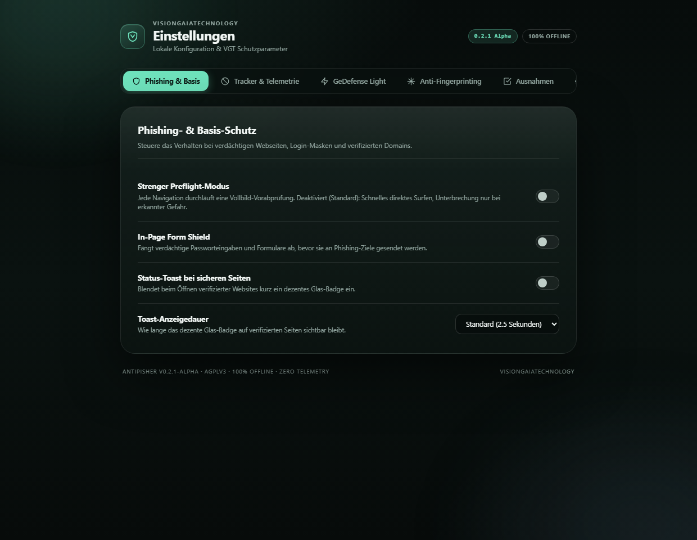
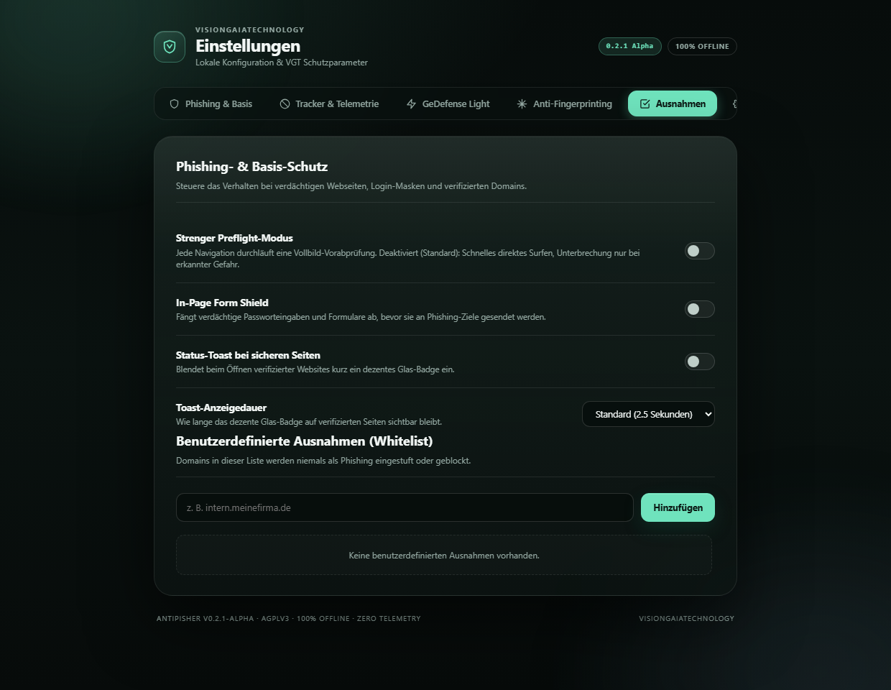
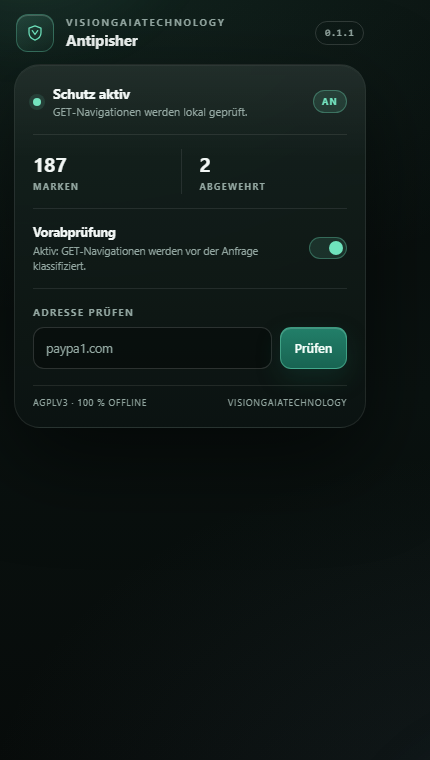
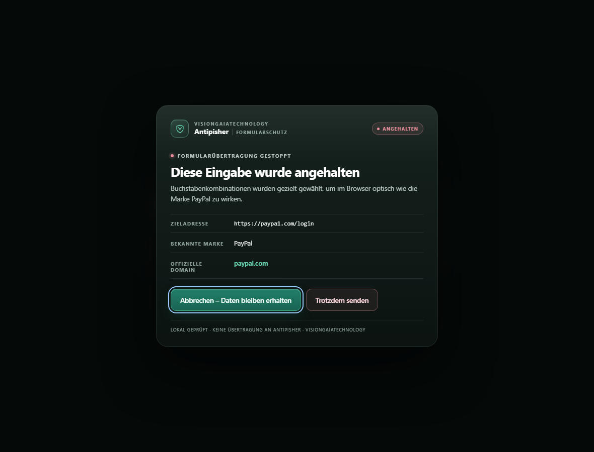
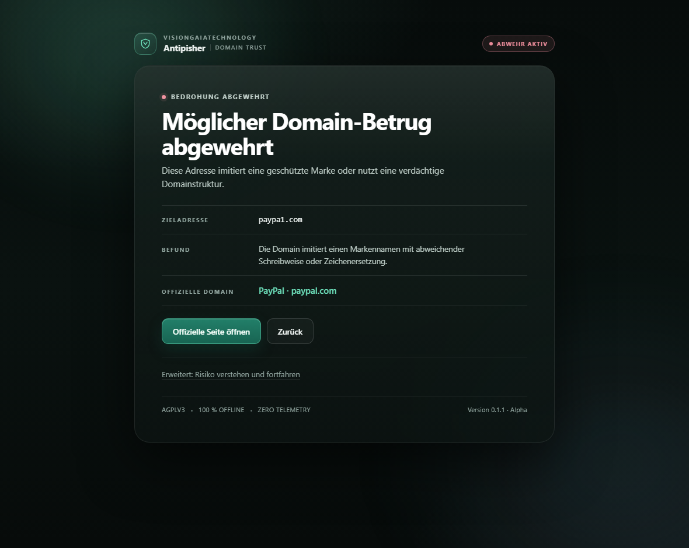
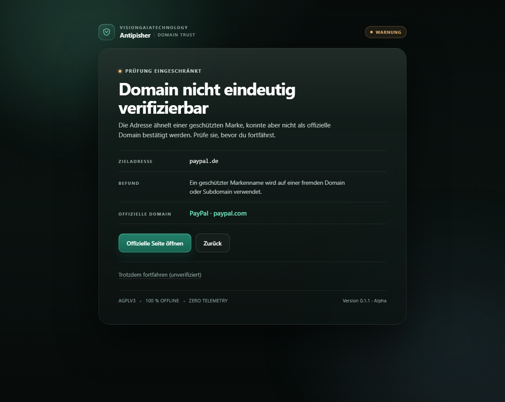
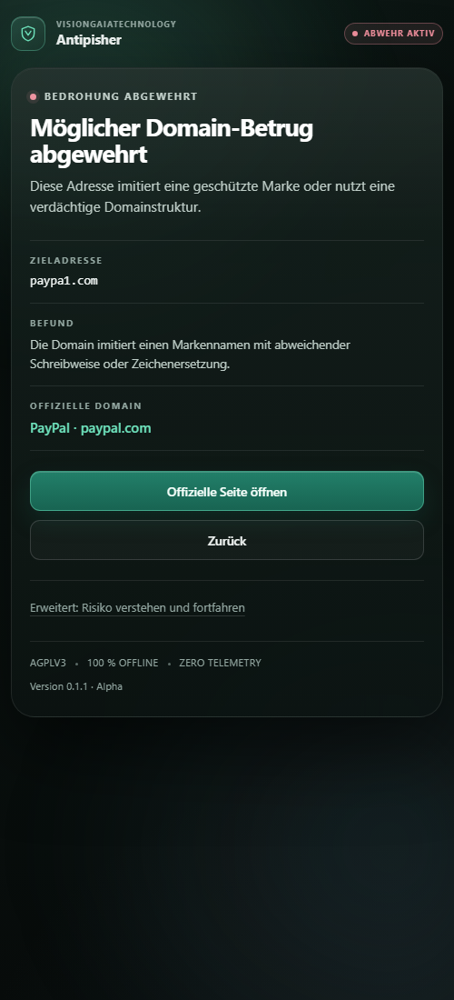
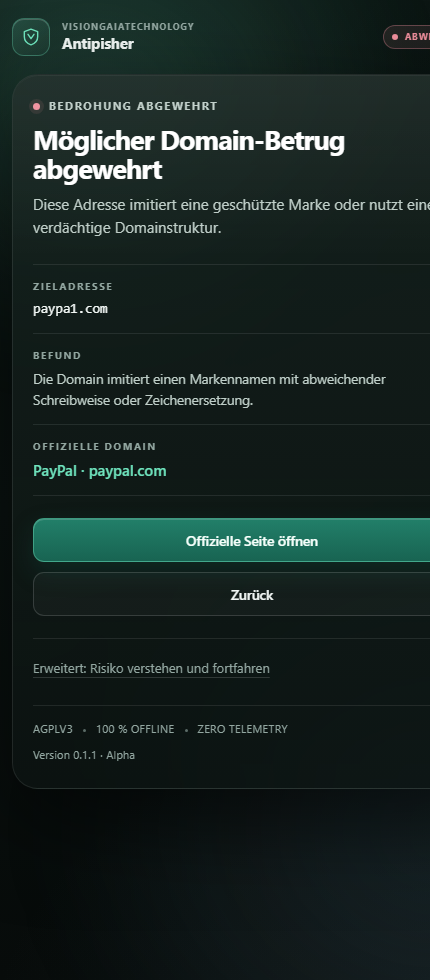

<div align="center">

# 🛡️ Antipisher 0.2.2 (Alpha)

**适用于 Google Chrome 与 Mozilla Firefox 的离线高精度反网络钓鱼、IDN 同形字、追踪器与广告拦截防护扩展**  
*遵循 GNU Affero 通用公共许可证 v3.0 (AGPLv3) 开源*

[](LICENSE)
[](https://github.com/visiongaiatechnology/antipisher)
[](#测试与开发规范)
[](#隐私保护与离线保证)
[](chrome/)
[](firefox/)

---

### 🌐 Select Language / Sprache wählen / Выберите язык / 选择语言

[🇬🇧 **English**](README.md) &nbsp;•&nbsp; [🇩🇪 **Deutsch**](README.de.md) &nbsp;•&nbsp; [🇷🇺 **Русский**](README.ru.md) &nbsp;•&nbsp; [🇨🇳 **中文**](README.zh.md)

---

</div>

> **状态：** `SILVER` · 版本 `0.2.2` · 截至 2026-10-19 · VGT Ad Shield 广告防御与 YouTube 拦截里程碑版本。  
> **非最终应用商店发行版：** 浏览器自动化端到端测试（E2E）、应用商店官方上架审核、签名更新分发流与完整的 V2 图引擎正在持续演进中（详见 [已知边界与限制](#已知边界与限制)）。

---

## ⚡ 核心能力与架构模块

### 🛡️ 1. 反钓鱼、品牌仿冒与域名防护
- **187 个严选知名品牌与 353 个官方根域名：** 纯离线完备数据库，涵盖顶级金融机构、政府政务、加密货币交易平台、云与 AI 基础设施、物流快递及国际互联网巨头，详见 [`shared/sites.js`](shared/sites.js)。
- **多维度启发式检测核心引擎：**
  - **拼写移位与邻键纠错防御：** Damerau-Levenshtein 1 与 2 编辑距离拦截相邻字符移位与拼写变体（`amzaon.com`、`goolge.com`、`paypla.com`）。
  - **单比特位翻转防御（`isBitFlip`）：** 识别由硬件辐射或内存/DNS传输引发的 1-bit 跳变抢注（`amaxon.com` → Amazon、`microsmft.com` → Microsoft、`gongle.com` → Google）。
  - **视觉连字与形态孪生替换：** 发现视觉孪生伪装字符（`arnazon.com` 的 `rn→m`、`rnicrosoft.com`、`vv→w`、`cl→d`）。
  - **Unicode 国际化同形异义与变音符号：** 精准识别西里尔字母、希腊字母、带圈字符和拉丁变音符号（`páypal.com`、`päypal.com`、`mïcrosoft.com`、`amazön.com`），同时避免误报合法的本土词汇（如 `über.de`）。
  - **双向文字控制字符欺骗（UTS #39 / RFC 8264）：** 拦截用于篡改文件和域名视觉扩展名的不可见 RTL/LTR 控制符（`\u202E`、`\u202A`–`\u202E`、`\u2066`–`\u2069`）。
  - **品牌与凭据关键词组合词欺诈：** 拦截未经分割的钓鱼组合域名（`paypalsupport.com`、`binancelogin.com`、`paypal-rechnung.com`、`dhl-sendung.de`、`sparkasse-kontoauszug.de`）。
  - **子域名伪装利用：** 拦截将知名品牌伪装为第三方域名子域的行为（`apple.attacker.com`、`paypal.evil.test`）。
  - **RFC 3986 用户信息字段欺诈：** 拦截带有欺骗性凭据前缀的 URL 结构（`https://paypal.com@evil.com/`）。
- **第 3 层：URL 路径与查询参数深度审查：** 识别在第三方外链主机的 URL 路径中针对品牌的钓鱼诱导（如 `https://unrelated.com/paypal/login`、`https://phish-host.org/paypal.com/verify`），同时放行合法的开发者文档、API 教程与新闻科技报道（`/docs/`、`/news/`、`/blog/`）。
- **共享托管命名空间隔离：** 严格隔离公共后缀与多租户平台域名（`force.com`、`github.io`、`vercel.app`、`netlify.app`、`wordpress.com` 等），绝不将其直接作为品牌根域名放行（`paypal.force.com` 精确拦截，主平台正常可用）。
- **官方国家顶级域名（ccTLD）智能识别：** 正确放行跨国品牌的合法分支机构（`google.co.jp`、`amazon.se`、`ing.nl`、`visa.de`）；对歧义国家后缀给出提示性安全警报，对可疑通用顶级域名（gTLD）执行严格拦截。
- **页面内嵌防护盾（`shared/shield-content.js`）：**
  - 填补 Chrome MV3 declarativeNetRequest (DNR) 机制无法拦截 POST 表单提交的安全真空。
  - 在 DOM 捕获阶段（Capture Phase）拦截表单提交事件，确保敏感凭据不会离开浏览器。
  - 在封闭的 Shadow DOM（`attachShadow({ mode: 'closed' })`）中渲染防篡改的 Glass 2100 警告模态框，彻底免疫目标网页的 CSS 重置与 JavaScript 恶意篡改。
  - 在可疑风险域名的密码输入框上自动显示不侵入式的安全警示徽章。

### 🚫 2. 追踪器与商业遥测防御 (AEGIS Tracker Shield)
- **本地声明式网络规则拦截：** 纯本地规则集（`rulesets/trackers.json`），在 Chrome MV3 (DNR) 与 Firefox (webRequest) 中精确拦截商业广告、行为分析与遥测追踪网络。
- **动态脚本替代替身（启发自 uBlock）：** 针对 `window.ga`、`window.dataLayer`、`window.fbq`、`window.ttq`、`window.clarity`、`window.hj` 及 `navigator.sendBeacon` 的轻量替身函数，在彻底阻断数据外泄的同时保证网站购物车结账、表单提交与身份登录畅通无阻。
- **URL 追踪查询参数智能净化：** 通过 `history.replaceState` 自动无痕剥离商业追踪参数（`utm_source`、`utm_medium`、`fbclid`、`gclid` 等）。
- **实时动态追踪器计数器：** 工具栏扩展图标角标与弹出菜单实时展示拦截总数（`标签页: X · 总计: Y`），即使对于延迟加载或异步动态注入的脚本也能即时捕捉并刷新。

### 🛑 3. 广告拦截与 YouTube 深度防御 (VGT Ad Shield)
- **无频闪隐形元素隐藏（Element Hiding）：** 在 `document_start` 阶段通过 `adoptedStyleSheets` 直接注入，瞬时折叠横幅广告、推广位及嵌入式广告 iframe，杜绝页面排版抖动（CLS）。
- **YouTube 视频广告防御与极速跳过加速器：**
  - `window.ytInitialPlayerResponse` 属性陷阱在页面初始化时彻底剔除 `adPlacements`、`playerAds` 和 `adSlots`。
  - 针对 `fetch` 与 `XMLHttpRequest` 的实时 JSON 剪枝拦截 `/youtubei/v1/player` 与 `/reel_watch_sequence` 数据包。
  - 自主视频广告加速器对漏网广告瞬间执行静音（`video.muted = true`）、以 16 倍速极速快进至片尾（`duration`），并在毫秒级时间内自动触发“跳过广告”按钮。
  - 自动清理反广告拦截警告弹窗（`ytd-enforcement-message-view-model`）并无缝恢复视频播放。
- **反去广告探测（Anti-Adblock Defusers）与蜜罐诱饵中和：** 对诱饵探测元素（`.adsbox`、`.pub_300x250`、`.ad-test`）伪装真实尺寸（`offsetHeight: 250`、`offsetWidth: 300`），中和检测标志位。
- **弹窗与底层跳出防御（Popunder Defense）：** 拦截针对第三方广告网络的非受邀 `window.open` 弹出/底层窗口。

### ⚡ 4. DOM 与前端脚本安全 (GeDefense Light)
- **控制台防社工钓鱼 Self-XSS 警示：** 在开发者工具控制台输出醒目的安全警告横幅，防范诱导用户粘贴恶意代码的社工盗号攻击。
- **认知快速通道（Cognitive Fast-Path）：** 超低开销启发式扫描引擎，无需对整个 DOM 树进行昂贵的二次解析即可高速验证安全 HTML。
- **动态恶意注入与伪协议中和：** 拆解拦截恶意 `<script>` 与 `<iframe>` 注入，自动剥离内联事件处理器（`onerror`、`onclick`），并在原型链层级（`Element.prototype.setAttribute`）阻断 `javascript:` 伪协议执行。
- **TrustedHTML / CSP 强固兼容：** 完美适配启用严格 Trusted Types CSP（`require-trusted-types-for 'script'`）的高防护网站，避免触发 `TrustedHTML` 赋值异常。

### 🎭 5. 隐私保护与反浏览器指纹 (Anti-Fingerprinting)
- **Canvas 与 WebGL 伪装保护：** 在 Canvas 像素读取中注入肉眼完全不可见的 1-bit 微量平滑噪声，并伪装 WebGL 渲染器字符串，粉碎跨站指纹追踪。
- **屏幕几何参数混淆：** 对屏幕视口与分辨率指标进行归一化混淆，挫败基于硬件设备属性的指纹关联。
- **轮换会话数字身份种子：** 生成加密会话凭证，支持在弹出菜单与设置页面一键点击“重新生成身份”。
- **100% 离线与零遥测：** 零外部网络请求、零云端依赖、无需 API 密钥、绝不收集与保存浏览历史。

### ⚙️ 6. 用户体验、设置面板与白名单
- **独立设置控制面板 (`options.html`)：** 采用完整 Glass 2100 玻璃拟物风格的偏好设置中心，可通过弹出菜单齿轮按钮或浏览器扩展管理直接访问，提供广告拦截、追踪器、GeDefense、反指纹及白名单专属配置页。
- **本地自定义域名白名单：** 方便快捷地维护受信任域名与内网系统（如企业 SSO），即时放行且无需任何网络外联。
- **静默安全浏览与 Glass 2100 状态提示气泡：** 安全合规网站直接瞬间加载（0 ms 额外延迟）。访问验证网站时在角落优雅浮现微晶毛玻璃状态胶囊（*“域名已验证 · Antipisher”*），并在数秒后自动隐退，不干扰鼠标操作（`pointer-events: none`）。
- **标准直达 vs. 严格预检自由切换：** 默认标准模式确保顺畅无感的浏览与按需拦截；严格模式可为高威胁环境提供全屏隔离预检。
- **4 种母语原生支持：** 中文（`zh`）、德语（`de`）、英语（`en`）、俄语（`ru`）实现 100% 词条对齐，支持自动跟随浏览器语言或手动锁定。

### 🏗️ 7. 浏览器架构、无障碍设计与构建保证
- **Chrome MV3 预检与消除安全静默失效（Fail-Open）：** 基于 DNR 机制过滤 GET 请求；若遇到配置异常立即持久化降级状态并启动备用观察模式，并在界面明确告警。消除 URL 长度限制。
- **Firefox MV3 规范对接：** 同步 `webRequestBlocking` + 页面内嵌防护盾，严格配置 `web_accessible_resources` 并声明 `data_collection_permissions: {"required":["none"]}`，符合 AMO 与 MDN 规范。
- **Glass 2100 设计系统：** 统一设计令牌（`shared/design-tokens.css`），深邃矿物玻璃材质，符合 WCAG-AA 级对比度（≥ 4.5:1），配备清晰的 2px 键盘焦点轮廓环，支持减少动效与高对比度模式。
- **100% 确定性、位一致的可重现构建：** 通过 `build.py` 自动化打包固定时间戳的确定性 ZIP 文件，并在仓库根目录提供 [`SHA256SUMS.txt`](SHA256SUMS.txt) 校验。

---

## 📸 界面预览与屏幕截图

| 设置控制面板 (v0.2.1) | 自定义域名白名单 (v0.2.1) |
|:---:|:---:|
|  |  |

| 扩展程序弹出菜单 (v0.2.1) | 页面内嵌防护盾（表单提交拦截） |
|:---:|:---:|
|  |  |

| 威胁精准拦截（全屏拦截页） | 歧义域名提醒（告警提示页） |
|:---:|:---:|
|  |  |

| 紧凑视口视图 (500px) | 移动端视图 (390px) |
|:---:|:---:|
|  |  |

---

## 📊 实测检测性能指标

| 评测测试集 | 基准测试结果 |
|---|---|
| 独立 296 例保留测试集（审核验证员） | **289/296 = 97.6%** 准确率；0/166 假阴性（漏报），7/121 假阳性（误报）（高置信度误报率仅 2/99 = 2.0%） |
| 全新未经标定的 44 例健全性校验集 | **42/44 = 95.5%**（在未收录的组合词 `tiktok-coin.com`、`ledger-live.com` 上出现 2 例漏报） |
| 公开 184 例 URL 审计测试集 | 183/184 检出（1 例漏报，0 例误报） |
| 主任审计员 66 例对抗性探针 | **0/26 误报（0%）**，**0/40 漏报（0%）** —— 100% 全数通过 |
| Node.js 单元与回归测试套件 | **69/69 全部通过（100%）** |

> [!NOTE]
> 以上数据基于实证测试，并不构成绝对零风险担保。在即将到来的 V2 版本中，将进一步引入完整的 UTS-39 机器对照表和基于图谱的品牌实体知识库。

---

## 🏛️ 浏览器架构对比

| 架构维度 | Google Chrome (MV3) | Mozilla Firefox (MV3) |
|---|---|---|
| **顶级 GET 导航拦截** | DNR 预检重定向 → 本地 `guard.html` 拦截页 → 启发式综合判定 | 请求发出前的同步 `webRequestBlocking` 实时拦截 |
| **POST / 表单提交拦截** | 页面内嵌防护盾（DOM 捕获阶段拦截 submit 事件） | 同步 `webRequestBlocking` + 页面内嵌防护盾双重防护 |
| **DNR 异常处理策略** | 弹出窗口显式展示“降级”状态并切换至备用观察模式 | 不适用（具备原生同步 `webRequestBlocking`） |
| **离线优先设计** | 是（100% 纯本地离线运行，零网络流量） | 是（100% 纯本地离线运行，零网络流量） |
| **浏览器端到端测试** | 加载已解压的扩展程序进行人工验证（受限 Chrome 155 CLI 限制） | 通过 `about:debugging` 页面进行人工加载验证 |

---

## 🔒 隐私保护与离线保证

- **零网络外联活动：** 绝不向任何外部服务器、云平台或数据分析接口发起请求。
- **纯本地存储：** 仅在本地持久化拦截计数器、配置项（`strictMode`）与语言偏好（`user_locale`）。
- **不持久化浏览历史：** 用户的访问记录不会被写入磁盘或上传。单次放行权限仅绑定至当前标签页与当前会话。
- **DOM 页面内嵌盾安全审计：** 在表单提交时仅读取目标 URL 及是否存在密码输入控件 —— **绝不读取、记录、拦截或存储任何输入的密码文本**。

---

## ⚠️ 已知边界与限制

1. **POST 防护盾覆盖范围：** 通过脚本直接调用 `form.submit()`（跳过 DOM 事件）、跨域嵌套 iframe 或底层 `fetch`/XHR 发起的异步请求无法被 DOM 监听器拦截。根据 Chrome 官方规范，MV3 DNR 当前仍然仅支持 GET 拦截。
2. **Chrome 全局重定向流程：** Chrome 下的 GET 请求需要跳转至本地拦截页，放行时依赖单次临时放行规则。
3. **品牌收录库范围：** 当前收录 187 个高价值品牌。未收录在知识库内的品牌暂不享受主动防护。
4. **长尾边缘场景：** 公共托管平台上的字典单词子域名或全新未记录的品牌变体（如 `tiktok-coin`）仍需持续扩充启发式词库。
5. **无云端热更新：** 品牌与特征库的更新随扩展版本一同发布。

---

## 🚀 安装与本地调试

Antipisher 当前通过 GitHub 以 **Alpha 发行版** 形式发布：

```bash
# 1. 从 GitHub Releases 下载发行包或在本地执行构建：
python build.py

# 2. 验证压缩包完整性：
# Windows 环境：
powershell -ExecutionPolicy Bypass -File scripts/verify-release.ps1
# Linux / macOS 环境：
bash scripts/verify-release.sh
```

### Google Chrome
1. 打开浏览器并访问 `chrome://extensions`。
2. 开启右上角的 **开发者模式**。
3. 点击 **加载已解压的扩展程序** 并选择 [`chrome/`](chrome/) 目录。

### Mozilla Firefox
1. 打开浏览器并访问 `about:debugging#/runtime/this-firefox`。
2. 点击 **临时加载附加组件…**。
3. 选择 [`firefox/manifest.json`](firefox/manifest.json) 文件。
*(若需在开发者模式之外永久安装，需通过 AMO 进行未公开签名；详见 [`docs/ALPHA-INSTALL.md`](docs/ALPHA-INSTALL.md))。*

---

## 🧪 测试与开发规范

Antipisher 内置无任何外部依赖的端到端自动化测试套件：

```bash
# 执行全部 38 个单元与回归测试用例
node --test tests/*.test.cjs

# 校验所有核心 JavaScript 文件语法
node --check shared/detector.js
node --check shared/shield-content.js
node --check shared/i18n.js
node --check chrome/background.js
node --check firefox/background.js

# 运行独立验证集合与对抗性探针
node audit/verify/holdout/run_holdout.cjs
node audit/verify/fix/fresh_sanity.cjs
node audit/lead/lead_probe.cjs

# 构建可重现的确定性发行压缩包
python build.py
```

---

## 📜 参考标准与技术规范

- **Unicode 国际化安全：** [Unicode Technical Standard #39 (UTS #39)](https://www.unicode.org/reports/tr39/)
- **Chrome 扩展开发：** [DeclarativeNetRequest API](https://developer.chrome.com/docs/extensions/reference/api/declarativeNetRequest)
- **Mozilla 附加组件：** [MDN webRequest API](https://developer.mozilla.org/en-US/docs/Mozilla/Add-ons/WebExtensions/API/webRequest/onBeforeRequest)
- **公共后缀规范：** [Public Suffix List (PSL)](https://publicsuffix.org/)
- **应用商店安全政策：** [Chrome Web Store Program Policies](https://developer.chrome.com/docs/webstore/program-policies/policies)

---

## 📄 许可证与版权信息

本项目采用 **GNU Affero 通用公共许可证 v3.0 (AGPLv3)** 开源。  
完整许可协议文本见 [`LICENSE`](LICENSE)。

Copyright © 2026 VisionGaiaTechnology. 保留所有权利。
