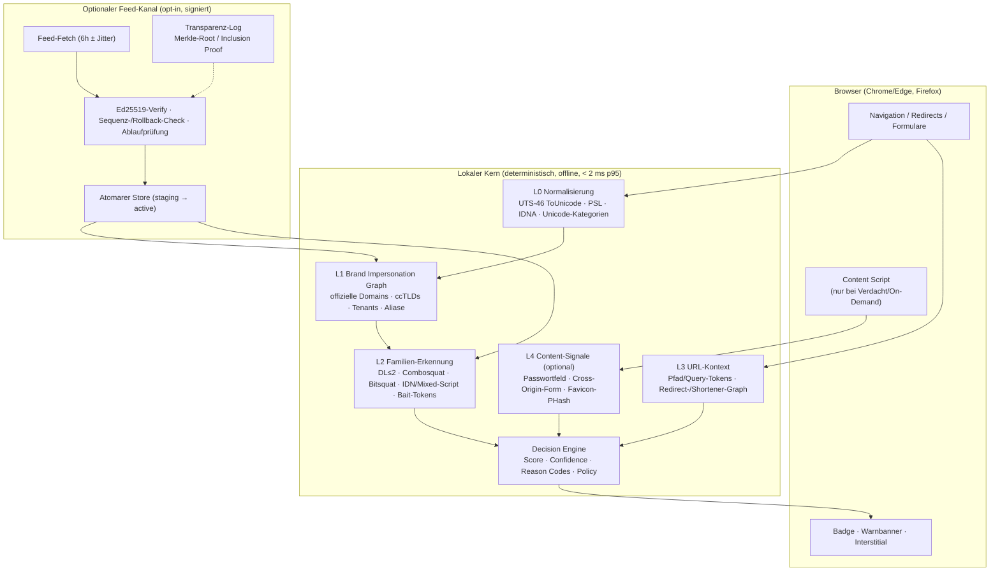
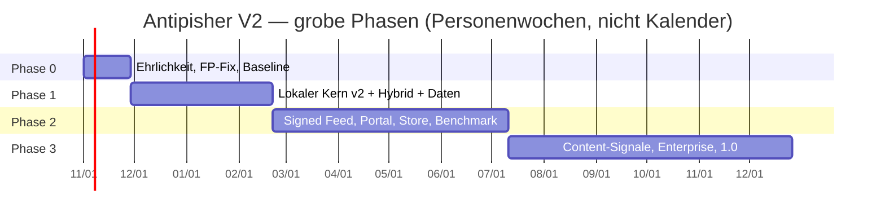

# V2_BLUEPRINT — Antipisher V2: Revolutionärer, privacy-first Marken-Impersonations-Schutz für den deutschsprachigen Raum

**Projekt:** Antipisher (vormals VGT DomainGuard)
**Ist-Version:** 0.1.0 Alpha (Chrome MV3 + Firefox MV3)
**Dokumenttyp:** Produkt-/Technologie-Blueprint für V2 (AUDIT-/RESEARCH-Modus; **keine Quellcodeänderung in diesem Auftrag**)
**Stand:** 18.10.2026
**Verfasser:** Produkt-/Technologie-Strategie (Teammitglied `product-strategist`)
**Basis:** Ist-Zustands-Analyse des Repos + [`SOTA_RESEARCH.md`](./SOTA_RESEARCH.md) (30+ verifizierte Quellen)
**Status dieses Dokuments:** Strategieempfehlung. Es beschreibt **Zielbilder**, keine bereits implementierten Features.

**Legende:** **FAKT** = durch Code/Quelle belegt; **EMPFEHLUNG** = Vorschlag mit Begründung; **ANNAHME** = plausible, nicht belegte Annahme; **UNSICHER** = zu prüfen; **NOT_TESTED** = nicht geprüft.

---

## 0. Management Summary (für den Lead in 90 Sekunden)

**Ist-Zustand (FAKT, belegt):** Antipisher 0.1 ist ein ehrlicher, lokal arbeitender Prototyp mit drei Stärken (deterministisch/erklärbar, keine Telemetrie, 165 kuratierte Marken) und fünf strukturellen Schwächen: (1) die Chrome-Integration leitet **jede** GET-Hauptnavigation über eine Extension-Seite um (UX-, History-, Store- und OAuth-Risiko), (2) die PSL-/Länderedomain-Behandlung erzeugt **systematische False Positives** bei echten Marken-Domains (`paypal.de`, `www.visa.de`, `www.bundid.de`), (3) die Erkennung ist eine **binäre DL-1-Heuristik**, die wichtige Familien (Path-Phishing, Redirects, Combosquatting, Bitsquatting, `rn`→`m`, Bidi-Zeichen) verfehlt, (4) es gibt **keinen Update-Kanal** für Marken-/Bedrohungsdaten, (5) die Markenpflege ist ein 165-Einträge-JSON ohne Provenienz, Review oder Claim-Prozess.

**Zielbild V2 (EMPFEHLUNG):** Antipisher wird der **erklärbare, datensparsame Marken-Schutz für den deutschsprachigen Raum** — lokal-deterministischer Kern (vollständige UTS-39/46-Daten, echte PSL, Brand-Impersonation-Graph, gewichtetes Scoring), **hybride Browser-Integration** (DNR nur für High-Confidence, Content-Script-Warnbanner, Interstitial — kein globaler Redirect), **optionaler signierter Feed-Kanal** (Ed25519, Rollback-Schutz, Transparenz-Log, reine Daten ohne Remote-Code) und ein **belastbarer Benchmark-/FP-Prozess**. Positionierung: **Ergänzung zu Safe Browsing/SmartScreen, kein Ersatz, kein „100 % Schutz“**; Open Source (AGPLv3) als Vertrauensanker; EU-Hosting/DSGVO by design; kommerzielle Edition nur mit geklärter ToS-/CRA-Basis.

**Die 5 Differenzierer (Detail in §13):**
1. **Deutsche/EU-Markenabdeckung außerhalb der Browser-Top-500** (Sparkassen, Volksbanken, Versicherer, Behörden, Energieversorger, Paketdienste) inkl. ccTLD-/Tenant-/Subdomain-Wissen.
2. **Erklärbarkeit**: Jede Warnung nennt Marke, offizielle Domain, auslösende Merkmale und Score — keine Blackbox.
3. **Lokal-first, keine Cloud-Abhängigkeit**: Grundschutz funktioniert offline; Cloud/Feed nur opt-in und signiert.
4. **Signierte, transparente Updates** (Ed25519 + Merkle-Transparenz-Log): nachprüfbar, wann welche Blockier-/Markendaten kamen.
5. **Open Source + EU-Datenhaltung + kein Datenverkauf**: der vertrauenswürdige Gegenentwurf zu US-Cloud-Security-Suiten.

**Kritische Lücken, die vor jeder „revolutionär“-Kommunikation geschlossen werden müssen:** Chrome-Integration entschärfen, FP-Klassen eliminieren, Benchmark-Methodik aufbauen, Claims in README/Next.md korrigieren, Update-/Signaturkonzept implementieren. Reihenfolge in §14 (P0/P1/P2).

**Aufwand grob (EMPFEHLUNG, begründet in §12):** Alpha→Beta (Phase 0+1) ≈ **18–20 Personenwochen**, Beta→1.0 (Phase 2+3) ≈ **38–50 Personenwochen** (1 FTE Entwicklung + 0,3 FTE Security/Privacy + Markenpflege); **keine** Investitionsentscheidung ohne separaten Business-Case.

---

## 1. Ausgangslage: Source Identity und geprüfter Ist-Zustand

### 1.1 Source Identity (VGT-SID-001)

| Merkmal | Befund | Beleg |
|---|---|---|
| Produkt | Antipisher (vormals VGT DomainGuard) | `chrome/manifest.json`, `firefox/manifest.json`, README |
| Version | `0.1.0` (Manifest) / „Alpha 0.1“ | Manifeste |
| Lizenz | AGPLv3 | `LICENSE` |
| Plattformen | Chrome MV3, Firefox MV3 | Manifeste |
| Marken | **165** Einträge | lokal ausgezählt aus `shared/sites.js` |
| Tests | JS-Unit-Tests vorhanden; „13/13 PASS“ aus `Next.md` **von mir nicht nachgeprüft** (separates Audit-Team) | `tests/*`, `Next.md` |
| Build | `build.py` kopiert Shared-Dateien nach `chrome/`/`firefox/`, packt ZIPs | `build.py` |

**Hinweis:** `Next.md` behauptet „PLATIN VGT SUPREME“ und „reproduzierbare Builds“. Beides ist für V2-Planung **nicht** als bewiesen anzunehmen: Build-ZIPs enthalten Zeitstempel, ein Git-Repo ist nicht erkennbar, die Datei `ARCHITECTURE_AND_SECURITY_REVIEW.md` wird in `Next.md` referenziert, liegt im Wurzelverzeichnis aber nicht vor. Das ist ein **Dokumentationsintegritäts-Risiko** (separates UX-/Release-Audit).

### 1.2 Geprüfte Kernlogik (`shared/detector.js`)

| Bestandteil | Umsetzung | Zeilen | Grenze |
|---|---|---|---|
| Homoglyphen | handkuratierte Map (~150 Zuordnungen, inkl. Leetspeak) | 13–43 | keine vollständige UTS-39-`confusables.txt`; keine Mixed-/Whole-Script-Erkennung |
| Unsichtbarzeichen | Regex auf ZWSP, Soft-Hyphen, Word-Joiner, BOM u. a. | 46 | enthält **keine Bidi-Steuerzeichen** (U+202A–U+202E, U+2066–U+2069, U+200E/200F, U+061C) |
| Punycode | eigener Decoder | 69–121 | keine UTS-46-Konformität/Testvektoren |
| Skelett | NFKD + Lowercase + Homoglyph-Map | 123–130 | unvollständige Map ⇒ systematische Lücken |
| Edit-Distanz | Damerau-Levenshtein ≤ 1 (nur Basis-Label, Markenlänge ≥ 5) | 133–169, 323–329 | 34 von 165 Marken (< 5 Zeichen) sind **komplett außerhalb** der Typosquat-Erkennung; `rnicrosoft.com` (rn→m, Distanz 2) bleibt unentdeckt |
| PSL | Heuristik: 2-Buchstaben-TLD + `co/com/org/net/ac/edu/gov/gv/priv`, plus 13 Multi-Tenant-Suffixe | 63–67, 175–189 | keine echte PSL ⇒ ccTLD-/Second-Level-Fehler |
| Foreign-Domain | `host.startsWith(domain + '.')` bzw. `.domain.` | 259–268 | erfasst nicht `sso-paypal.com.evil.tld` (Marke nicht als eigenes Label vor offizieller Domain) |
| Credential-Bait | feste 58-Wort-Liste, Segment-/Nachbar-Label-Prüfung | 52–60, 302–320 | keine Token-Graphen, kein Combosquatting wie `paypalhelp.com` |
| Userinfo | `paypal.com@evil.com` wird erkannt | 207–223 | gut |
| URL-Pfad/Query | **wird ignoriert** | 201–345 | `evil.com/paypal/login` bleibt „safe“ |
| Redirects/Shortener | **nicht vorhanden** | – | `bit.ly/…` bleibt „safe“ |

### 1.3 Lokale Messung (FAKT, ausgeführt 18.10.2026; keine Datei geändert)

Methode: `node` mit `shared/sites.js` + `shared/detector.js` im `vm`-Kontext (`URL` injiziert), Aufruf `Antipisher.classify(url)`.

| Eingabe | Ergebnis | Kategorie |
|---|---|---|
| `https://paypal.de/` | **block** (foreign-domain) | FP-Kandidat (offizielle PayPal-Länderedomain; im Marken-Datenmodell nicht abgebildet) |
| `https://paypal.co.uk/`, `https://paypal.co.jp/` | **block** | FP-Kandidat (Länderedomains) |
| `https://microsoft.co.jp/`, `https://coinbase.de/`, `https://visa.fr/`, `https://www.visa.de/` | **block** | FP-Kandidaten; `www.visa.de` ist die deutsche Visa-Präsenz (UNSICHER: im Markenpflegeprozess verifizieren) |
| `https://www.bundid.de/` | **block** | FP-Kandidat: BundID ist der offizielle deutsche Online-Ausweisdienst; die Liste führt nur `id.bund.de`/`bund.de` |
| `https://deutschebank.de/` | **block**, während `https://deutsche-bank.de/` safe ist | inkonsistente offizielle Domainpflege |
| `https://box.example.com/`, `https://chase.example.com/`, `https://signal.example.com/` | **block** | FP durch generische Markenwörter als Subdomain (nur 6 Wörter sind als „generic“ entschärft) |
| `https://evil.com/paypal/login` | safe | FN: Pfad-Phishing |
| `https://bit.ly/abc` | safe | FN: Shortener/Redirect |
| `https://rnicrosoft.com/` | safe | FN: Zwei-Zeichen-Tippfehler (rn↔m) |
| `https://sso-paypal.com.evil.tld/` | safe | FN: Marke im Subdomain-Label vor offizieller Domain |
| `https://paypa1.com/`, `https://pаypal.com/`, `https://xn--pypal-4ve.com/`, `https://аpple.com/`, `https://paypal.com.attacker.com/`, `https://paypal.com@evil.com/` | block | Stärken des Ist-Zustands (korrekt) |
| `https://amazon.co.jp/`, `https://sparkasse.de/`, `https://elster.de/`, `https://ing.de/` | safe | korrekt, weil offizielle Domains gepflegt sind |

**Bewertung:** Die Erkennung ist für die kuratierte Kern-Menge solide, aber die **Fehlerklassen sind systematisch** und für ein Sicherheitsprodukt nicht tolerierbar: Ein Produkt, das `visa.de` oder `bundid.de` blockiert, verliert das Vertrauen genau der Nutzer, die es schützen soll. Ein Produkt, das `evil.com/paypal/...` und `bit.ly/...` nicht sieht, deckt einen großen Teil moderner Kampagnen nicht ab.

---

## 2. Ehrlicher Gap-Vergleich: Ist-Zustand vs. State of the Art

### 2.1 Erkennungs-Gap nach Angriffsklassen

| Angriffsklasse | Ist 0.1 | SOTA-Anspruch (V2-Ziel) | Priorität |
|---|---|---|---|
| Tippfehler (Deletion/Insertion/Substitution, DL ≤ 1) | teilweise (nur Basis-Label, Marken ≥ 5 Zeichen) | vollständig, gewichtet, auch DL ≤ 2 mit Kontext | **P0** |
| Transposition (Damerau) | ja | ja, in gewichtetem Modell | erledigt |
| Leetspeak/Ziffern | ja (Map) | ja + Mixed-Number-Detection | P1 |
| Homoglyphen/IDN (Teilmenge) | teilweise | vollständige UTS-39-Daten + Mixed-Script + Whole-Script | **P0** |
| Invisible/Bidi-Control | teilweise (ohne Bidi) | vollständige Unicode-Kategorie inkl. Bidi | P1 |
| Combosquatting (`paypalhelp.com`) | teilweise/fest Wortliste | Token-Graph (Marke + DE/EN-Baitwörter + Produktbegriffe) | **P0** |
| Bitsquatting | teilweise (DL 1 zufällig) | eigenes Bit-Flip-Modell | P2 |
| TLD-Swap / ccTLD | erzeugt FP | Trennung „offiziell erlaubt“ vs. „verdächtig“ (Marken-Graph) | **P0** |
| Subdomain-/Tenant-Impersonation | teilweise, FP bei generischen Wörtern | echte PSL + Tenant-Modell + generische-Wort-Regeln | **P0** |
| Pfad-/Query-Phishing | **nein** | URL-Kontext-Analyse (Host + Pfad-Tokens + Referer) | P1 |
| Redirect-Ketten/Shortener | **nein** | Redirect-Graph, Shortener-Erkennung, Hop-Klassifikation | P1 |
| Formular-/Credential-Signale | **nein** | lokale Formularanalyse (Passwortfeld, Cross-Origin-Action) bei Verdacht | P1 |
| Logo/Favicon | **nein** | lokaler Perceptual-Hash-Vergleich (on-demand) | P2 |
| Visuelle/KI-Analyse | nein | optional Cloud/On-Demand (nicht 1.0) | P2 |
| User-Feedback/FP-Meldung | **nein** | Melde-Flow + Triage + SLA | P1 |
| Marken-Aktualität/Updates | **nein** (statisch) | signierter Feed-Kanal | **P0/P1** |

### 2.2 Architektur-Gap

| Dimension | Ist 0.1 | V2-Ziel |
|---|---|---|
| Erkennungsmodell | binär (block/safe) | **Score + Confidence + Reason Codes**, Schwellen pro Aktion |
| Chrome-Integration | globaler DNR-Redirect aller GET-Navigationen | Hybrid: DNR nur Known-Bad/High-Confidence + Content-Script-Banner + Interstitial (bestätigungsbedürftig) |
| Firefox-Integration | `webRequestBlocking` main_frame → Guard-Seite | beibehalten, aber mit Guard-UI v2 und allow-once-Härtung |
| POST/Formulare | Chrome: nicht klassifiziert (POST umgeht Redirect) | Content-Script/Formular-Signale, POST-Navigations-Schutz wo technisch möglich |
| Inhalte/Subressourcen | nur main_frame | optional iframe/sub_frame + Formularziele |
| Datenmodell Marken | `{name, brand, domains[]}` | Graph mit Proteindaten: Typen, Provenienz, Verified-Datum, Reviewer, Aliase, Tenants, Keywords |
| Pflegeprozess | manuell, ohne Review | Intake → Verifikation → 2-Augen-Review → signierte Publikation → Monitoring → Claim |
| Update-Kanal | keiner | signierter Feed + Transparenz-Log + Rollback-Schutz |
| Datenschutz | gute Offline-Position, aber `tabs`-Permission | Consent-Architektur, Datenminimierung, DPIA, EU-Hosting, Store-Disclosure |
| Erklärbarkeit | Reason-Strings in Guard-Page | Feature-Attribution + Score-Zerlegung + optionales Debug-/Export-Log (lokal) |
| Test/Benchmark | Unit-Tests (Detektor) | reproduzierbarer TPR/FPR-Benchmark, Tranco-FP-Korpus, Evasion-Suite, Browser-E2E |

### 2.3 Systematische False-Positive-/False-Negative-Quellen (FAKT)

**FP-Quellen:**
1. Länderedomains/Regionalpräsenzen nicht in `domains[]` ⇒ `foreign-domain`-Block (Belege §1.3).
2. Generische Markenwörter als Subdomain (`box`, `chase`, `signal`), weil `genericSubdomains` nur 6 Wörter enthält.
3. Ähnliche, aber legitime Drittseiten/Reseller (z. B. `paypal-community`-artige Foren, `sparkasse-giessen.de` mit Bindestrich — im Test safe, aber `deutschebank.de` blockiert).
4. IDN-Mehrdeutigkeiten (ß/ς/ZWJ) durch fehlende UTS-46-Konformität.

**FN-Quellen:**
1. Pfad-/Query-/Fragment-Phishing (`evil.com/paypal/...`).
2. Redirects/Shortener (kein Netzwerk-/History-Zugriff).
3. Marken < 5 Zeichen ohne Typosquat-Erkennung (34/165).
4. Tippfehler mit Distanz 2 (rn→m, `paypalhelp.com`).
5. Bidi-/weiterer Unsichtbarzeichen.
6. Neue Marken außerhalb der 165er-Liste (statisch, kein Update).
7. POST-/Formular-basierte Angriffe auf unauffälligen Hosts.
8. Seiten, die erst nach Login/Redirect Markeninhalte zeigen (Content-Ebene fehlt).

### 2.4 Vertrauens-/Produkt-Gap

- Keine Quelle für „warum ist diese Domain verdächtig“ außer einem statischen Reason-String.
- Kein Prozess, wie eine Marke in die Liste kommt (Vertrauenswürdigkeit der Daten).
- Kein Weg für Markeninhaber, Fehleinträge zu melden → Reputationsrisiko.
- Keine unabhängige Wirksamkeitsmessung → Marketingclaims wären unbelegt.
- Keine Update-Mechanik → Veraltung innerhalb weniger Wochen.

---

## 3. Produktvision und Positionierung (EMPFEHLUNG)

### 3.1 Vision

> **„Antipisher zeigt dir, wenn eine Webadresse eine Marke nachahmt — verständlich, lokal und nachprüfbar. Es ersetzt keinen Browserschutz, aber es erklärt, was der Browser nicht erklärt.“**

### 3.2 Positionierung

| Dimension | Positionierung |
|---|---|
| Kernnutzen | Schutz vor **gefälschten Marken-Domains** (Typos, IDN, Combos, Subdomains, Tenants) mit **Erklärung** und **Sicherheitsempfehlung** (offizielle Domain) |
| Zielgruppen | (a) deutschsprachige Verbraucher:innen, (b) Banken/Sparkassen/Versicherer als B2B-Partner (White-Label/Managed), (c) KMU/Behörden mit eigenem Markenschutzbedarf |
| Abgrenzung | **Ergänzung** zu Safe Browsing/SmartScreen; **kein** Antivirus, **kein** VPN, **kein** vollständiger Schutz, **keine** Cloud-Pflicht |
| Beweisversprechen | nicht „100 %“, sondern: „**gemessen** (TPR/FPR), **erklärbar**, **offline**, **keine Telemetrie**, **Open Source**“ |
| Preis-/Geschäftsmodell (Vorschlag) | kostenloser Open-Source-Kern (AGPLv3) + kostenpflichtige Enterprise-Edition (Management, Feed-SLA, Brand-Portal, Support) — **keine** Datenmonetarisierung |
| Sprache/Region | Deutsch zuerst (DE/AT/CH), dann EN; EU-Hosting; EU-Marken stark |

**Wichtig (rechtlich):** Safe Browsing darf ohne separate Google-Vereinbarung **nicht kommerziell** genutzt werden (vgl. SOTA §5.1/§9.6). Eine kommerzielle Edition muss daher entweder auf eigenen/ lizenzierten Feeds + Web-Risk-Vertrag basieren oder die Safe-Browsing-Anbindung auf die nicht-kommerzielle Open-Source-Edition beschränken. **UNSICHER:** endgültige Bewertung nur durch Rechtsprüfung.

### 3.3 Nicht-Ziele (bewusst)

- Kein „100-%-Schutz“-Versprechen, keine Garantie gegen kompromittierte Originalseiten.
- Kein Ersatz für Browser-/OS-Sicherheitsupdates, MFA, Passwortmanager.
- Keine Inhaltsfilterung/Adblocking (Single-Purpose-Risiko).
- Keine Cloud-Pflicht für Grundfunktionen.
- Kein Safari-Support in 1.0 (nicht untersucht, NOT_TESTED).
- Keine Takedown-/Brand-Protection-Dienstleistung (Partner-Option, nicht Kern).

---

## 4. V2-Zielarchitektur (mehrschichtig, lokal-first)

### 4.1 Überblick (Mermaid)



### 4.2 Layer 0 — Normalisierung und Domain-Parsing (FAKT-Basis: UTS-46, PSL)

**Aufgaben:**
1. URL robust parsen (WHATWG `URL`), IDN via **UTS #46 `ToUnicode`** (nicht-transitional), Punycode-Ausgabe separat behalten.
2. **Echte PSL** (ICANN + Private) bündeln; `registrableDomain` exakt berechnen; Multi-Tenant-Suffixe aus der PSL-Private-Sektion ableiten (statt 13 handgepflegter Suffixe).
3. Unicode-Kategorien: `Default_Ignorable`, Bidi-Control, Combining-Mark-Sequenzen, Mixed-Number; UTS-39 `Identifier_Status`.
4. Kanonisierung: Casefold, NFC, Trailing-Dot, Prozent-Dekodierung nur für Vergleiche (keine Umgehung von Checks).

**Deterministische Regeln (High-Confidence, sofort blockier-/warnbar):**
- Bidi-/Default-Ignorable-Zeichen in einem Label (außerhalb legitimer IDN-Kontexte) → Warnung.
- Mixed-Script mit Latin+Cyrillic/Greek in einem Label, das einer geschützten Marke ähnelt → Warnung.
- Offizielle Domain als Subdomain eines Fremdhosts (`paypal.com.attacker.tld`) → Block.
- Userinfo-Trick → Block.
- Exakte offizielle Domain in falscher Position (`paypal.evil.tld`) → Warnung.

### 4.3 Layer 1 — Brand Impersonation Graph (BIG) (EMPFEHLUNG)

**Idee:** Marken sind keine Strings, sondern **Graphen** aus offiziellen Domains, Subdomains, Tenants, Produkt-/Bait-Tokens, ccTLDs und Beziehungen. Die Erkennung fragt: „Sieht dieser Host aus wie ein Knoten, der zu Marke X gehört, ist es aber nicht?“

**Knoten/Edge-Typen:**
- `brand` (id, name, aliases, products, sector, country)
- `official_domain` (registrable, official_subdomain, support, oauth/identity, api)
- `tenant` (Hosting-Suffix + verifizierter Tenant, z. B. `paypal.github.io` nur wenn verifiziert)
- `cctld_variant` (z. B. `paypal.de`, `visa.de`) mit **Politik**: `redirect_to_canonical` (nicht blocken) vs. `unrelated` (blocken)
- `bait_token` (login, konto, tan, photoTAN, freischalten, entsperren, sicherheit, bundID, elster, …; DE/EN)
- `visual` (Favicon-pHash, Logo-Farbe) — nur Metadaten für P2
- `provenance` (Quelle, Verifikationsdatum, Reviewer, Claim-Status)

**Warum Graph statt Liste?** (FAKT-Grundlage: Combosquatting-Studie, SOTA §4) Edit-Distanz erfasst Token-Kombinationen und Subdomain-Strukturen nicht; ccTLD/Regionalpräsenzen erfordern Wissen über „offiziell, aber anders benannt“; Tenants erfordern Wissen über Hosting-Plattformen. Der Graph macht diese Entscheidungen explizit und testbar.

### 4.4 Layer 2 — Familien-Erkennung mit gewichtetem Scoring

**Familien-Module:**
1. **Edit-Distanz:** DL ≤ 2 mit Längen-/Kontext-Gewichtung; kurze Marken (< 5) brauchen Sonderregeln (z. B. `visa`→`vlss`? nein — stattdessen Token-/Vokal-Muster + TLD-Kontext; diese Marken sind bewusst **konservativ** zu behandeln, um FP zu vermeiden).
2. **Bitsquatting:** Bit-Flip-Distanz 1 auf ASCII-Labels (`m`↔`n`, `i`↔`j`, `o`↔`k` …) mit Whitelist legitimer Einzelzeichen-Wörter.
3. **Combosquatting:** Tokenisierung an `[-_.]`; Marke + Bait-Token (DE/EN) in beliebiger Reihenfolge; Score nach Token-Semantik (Bank/Bait stärker als „shop“).
4. **IDN/Mixed-Script:** UTS-39-Skeleton-Vergleich gegen Marken-Skelette + Mixed-Script-/Whole-Script-Checks (mit TLD-Kontext wie Chrome).
5. **Leetspeak/Ziffern:** Normalisierung + Mixed-Number-Check.
6. **Subdomain-/Tenant-Impersonation:** Marke als Label auf fremdem registrierbarem Domain; Ausnahme generischer Wörter nur bei expliziter Kontextprüfung (z. B. `office.example.com` ist generisch, `office.example.com/login?bank=...` verstärkt Score).
7. **TLD-/ccTLD-Politik:** exakt gegen BIG prüfen; „offizielle Regionaldomain“ nie blocken, nur ggf. dezent auf kanonische Domain hinweisen (Policy-Entscheidung, siehe §4.6).
8. **URL-Kontext:** Marke/Bait in Pfad/Query/Fragment (`/paypal/login`, `?brand=sparkasse`), kurze Pfade, Base64-/Hex-Pfade, `@`/`%2F`-Tricks.
9. **Userinfo/Port/IP/IDN-Edgecases:** IP-Hosts, `xn--`-Kombinationen, trailing dot, doppelte Punkte.

**Scoring (Beispiel, Kalibrierung folgt in Beta):**

```
score = Σ (feature_weight_i × feature_confidence_i) − allowlist_penalty
action =
  BLOCK_PREVENT  (score ≥ 80, confidence high)   → DNR/Interstitial
  WARN_OVERLAY   (score ≥ 55)                     → Banner + Badge
  NOTIFY_LOW     (score ≥ 35)                     → Badge/Info, kein Block
  PASS           (score < 35)
```

**Wichtig:** Gewichte und Schwellen sind **Produktentscheidungen**, die gegen den Benchmark kalibriert werden (siehe §11). Die Zahlen oben sind **ANNAHME/Startwerte**, keine belegten Optima.

### 4.5 Layer 3 — Redirect-Ketten und Shortener (EMPFEHLUNG; P1)

- Firefox: `webRequest.onBeforeRedirect`/`onBeforeRequest` beobachten Ketten; Chrome: `webNavigation.onBeforeNavigate`/`onCommitted`/`onBeforeRedirect` (soweit verfügbar) + `tabs.onUpdated`.
- Kurz-URL-Hosts (bit.ly, t.co, tinyurl, lnkd.in, youtu.be? — Liste pflegen) werden **nicht** als verdächtig geblockt, sondern: „Ziel unbekannt, wird geprüft“; beim Auflösen (falls der Browser den Hop ohnehin macht) wird die Ziel-URL klassifiziert und ggf. Banner/Interstitial gezeigt.
- **Kein** aktives Auflösen durch die Extension per Netzwerk (Privacy-Kosten, Rate-Limits, Tracking durch Shortener). Optional: Nutzeraktion „Link-Ziel anzeigen“ mit lokalem HEAD-Request nur nach Klick (Consent).
- Wichtig: Ein Großteil der Phishing-Kampagnen nutzt Redirects; SOTA-Systeme (Phishpedia/PhishIntention) nutzen Redirect-/CT-Daten serverseitig. Lokal ist die Hop-Beobachtung der pragmatische Ersatz.

### 4.6 Layer 4 — Content-/Formular-/Visual-Signale (EMPFEHLUNG; P1/P2)

**Nur bei erhöhtem URL-Score oder auf expliziten Nutzerwunsch** (Performance/Privacy/Store-Review):
1. **Passwortfeld vorhanden** + Domain nicht offiziell für die im DOM/Title genannte Marke → starkes Signal.
2. **Formular-Action cross-origin** (`<form action="https://…">` auf anderem registrierbarem Domain) bei Markenkontext.
3. **Marken-Signale im DOM**: Titel, `h1`, Alt-Texte, Meta, Copyright, Impressumsangaben (z. B. „Sparkasse“, „Deutsche Bank“, „paypal“).
4. **Favicon-pHash** gegen BIG-`visual`-Hashes (nur lokal; Toleranz für CDN-Varianten).
5. **Keine Screenshots/kein DOM-Versand an Server** — die Analyse bleibt lokal. (Wenn später Cloud-Vision kommt: separater Opt-in, DSGVO-Folgeprüfung.)

**Grenzen (ehrlich):** Lokale Vision ist deutlich schwächer als Phishpedia/PhishIntention (USENIX 2021/2022). Diese Systeme benötigen Referenz-Screenshots, Modelle und/oder Cloud-Ressourcen. V2 sollte **keine** vergleichbaren Wirksamkeitsclaims machen, solange kein eigener Benchmark vorliegt.

### 4.7 Decision Engine und Erklärbarkeit

**Ausgabe pro Entscheidung (lokales Objekt, nicht persistiert):**

```json
{
  "host": "paypa1.com",
  "registrable": "paypa1.com",
  "score": 86,
  "confidence": "high",
  "action": "block_prevent",
  "brand": {"id": "paypal", "name": "PayPal", "official": "paypal.com"},
  "reasons": [
    {"code": "typosquat_dl1", "weight": 40, "detail": "paypa1 ≈ paypal (1 Zeichen)"},
    {"code": "official_mismatch", "weight": 30},
    {"code": "login_bait_path", "weight": 16, "detail": "/login"}
  ],
  "explanation_de": "Die Adresse paypa1.com unterscheidet sich nur durch ein Zeichen von paypal.com und enthält einen Anmelde-Pfad. Das ist ein typisches Muster für gefälschte Bank-/Bezahldienste.",
  "policy": "block"
}
```

**Regeln:**
- Keine Warnung ohne verständlichen Grund (Reason-Codes + deutscher Textbaustein).
- „Offizielle Seite öffnen“ immer als primäre sichere Aktion.
- Kein „Ignore“ ohne bewussten zweiten Schritt (bestehendes Guard-Design beibehalten, aber Texte/Logik überarbeiten).
- Optional: „Details für Profis“ (Score-Zerlegung), standardmäßig eingeklappt.
- **Fail-open vs. fail-closed:** Bei interner Unsicherheit (z. B. Feed nicht verifizierbar) gilt: Grundschutz lokal weiter, Warnungen mit „Datenstand veraltet“-Hinweis; nie stillschweigend blocken und nie stillschweigend alles erlauben.

---

## 5. Bessere Browser-Integration (Kern der V2-Technikentscheidung)

### 5.1 Warum der globale DNR-Redirect nicht bleiben darf (FAKT + Bewertung)

**FAKT (Code):** `chrome/background.js` Zeilen 27–40 registriert eine dynamische DNR-Regel mit `regexFilter: "^(https?://.+)$"`, `resourceTypes: ["main_frame"]`, `requestMethods: ["get"]` und `redirect.regexSubstitution` auf `guard.html#\1`. Damit wird **jede GET-Hauptnavigation** zuerst auf die Extension-Seite umgeleitet; `shared/guard.js` klassifiziert und leitet bei „safe“ automatisch per `allow-once` + `location.replace` weiter (Zeilen 50–55).

**Folgen (FAKT/ANNAHME):**
- Doppelte Navigation für praktisch jede Seite (Latenz, History-/Referer-/Timing-Verhalten; FAKT: DNR-Redirect ersetzt den Request).
- Funktionsstörungen bei OAuth-/Redirect-/Fragment-Flows sind plausibel (im README selbst als Risiko genannt) — **ANNAHME**, muss reproduzierbar getestet werden (Browser-E2E, §11).
- Store-Review-Risiko: ein „unerwartetes“ Verhalten für alle Seiten ist ein Policy-Risiko (CWS „Misleading or Unexpected Behavior“, SOTA §9.4).
- POST-Hauptnavigationen werden **gar nicht** klassifiziert (DNR-Regel nur GET; `webNavigation`-Fallback nur außerhalb des Strict-Modus) → Schutz-Lücke.
- Kein differenziertes Verhalten (kein „niedriges Risiko = Banner“).

### 5.2 Zielbild: Hybrid-Integration (EMPFEHLUNG)

**Drei Aktionskanäle, nach Confidence:**

| Kanal | Technik | Einsatz | Chrome/Edge | Firefox |
|---|---|---|---|---|
| **Prevent** (High-Confidence) | DNR-`redirect` auf Interstitial (nur exakte, signierte Known-Bad-Domains/Regeln; kein „alle URL“-Regex) | wenige, sicher bekannte Fälle | DNR dynamisch/statisch aus Feed; `web_accessible_resources` nur Interstitial | `webRequestBlocking` redirect (wie heute) |
| **Warn** (Medium) | Content-Script-Banner + Action-Badge + `tabs`-Titel-Hinweis | verdächtige, aber nicht sichere Fälle | `scripting` + `content_scripts` (nur auf verdächtigen Seiten injizieren, nicht global) | gleich |
| **Notify** (Low) | Badge/Notification, Popup-Detail | Score 35–54 | `action`-Badge | gleich |

**Zusätzlich:**
- **Kein globales Redirect**; im Guard-/Options-UI eine **experimentelle** „strenger Modus“-Option mit klarer Warnung (Opt-in, Default aus) — nur für Power-User/Tests, nicht Default für Store-Builds.
- **Best-effort-Interstitial** bei mittlerem Score: `webNavigation.onBeforeNavigate` → `tabs.update` auf Warnseite, wenn möglich (Chrome); klar als „best effort“ dokumentieren.
- **Content-Script nicht global**: `content_scripts.matches` kann nicht dynamisch pro URL gesetzt werden; Alternative: `scripting.executeScript` nur nach Background-Entscheidung (erfordert `scripting`-Permission + Host-Permission) — Store-konform begründbar („nur auf als verdächtig klassifizierten Seiten“). **UNSICHER:** endgültige Review-Bewertung; Alternative ist ein statisches Content-Script, das beim Start eine Botschaft vom Background erfragt und sich sonst passiv verhält (höherer Fußabdruck).
- **POST-Formulare:** Formular-Submissions können per Content-Script (`submit`-Event) geprüft und ggf. mit `preventDefault` + Warnung abgefangen werden, wenn das Formularziel nicht zur offiziellen Domain passt. Das ist die einzige realistische Chrome-Möglichkeit ohne globalen Redirect. **P1**.
- **Firefox** behält die präventive Blockade (beste Technik) und bekommt dieselbe Guard-/Banner-UX.

### 5.3 Guard-/Interstitial-UX (Weiterentwicklung)

**Beibehalten:** Glass-Design, klare „Warum“-Erklärung, „Offizielle Seite öffnen“-Button, „Zurück“.
**Ändern:**
- „Weiter trotzdem“ nur mit expliziter Bestätigung (bestehend); zusätzlich **Grund der Warnung** und **Empfehlung** (z. B. „Tippen Sie paypal.com direkt in die Adressleiste“).
- Bei **ccTLD-/Regionaldomains**: kein Block, sondern Hinweis-Banner („Dies ist die offizielle Regionaldomain; wir empfehlen die kanonische Seite“) — nur wenn BIG das bestätigt.
- Bei **veraltetem Feed**: sichtbarer „Datenstand“-Hinweis, kein stilles Blocken.
- **Barrierefreiheit:** Warnungen als `role="alert"`, Fokusführung, Tastaturbedienung, Screenreader-Texte; keine Farb-only-Signale (GLASS 2100 bleibt).

### 5.4 Berechtigungen (Minimierung, Store-Begründung)

| Permission | Zweck | Begründung im Store |
|---|---|---|
| `host_permissions: http/https *` | Domainklassifikation jeder Hauptseite | Kernfunktion; ohne Host-Zugriff keine Navigationprüfung |
| `declarativeNetRequest` | High-Confidence-Prevent (Feed-Regeln) | nur für exakte Known-Bad-Regeln, kein globaler Redirect |
| `webNavigation` | Navigations-/Redirect-Beobachtung | Erkennung von Redirect-Ketten/Interstitial |
| `storage` | Einstellungen, Zähler, Feed-Cache, Consent | lokal, keine Übertragung |
| `scripting` (neu, falls Banner) | Warnbanner nur auf verdächtigen Seiten | minimale Injektion; kein globales Content-Script |
| `tabs` (ggf. reduzieren) | Tab-Bezug für Allow-once | prüfen, ob ohne `tabs` möglich (nur `webNavigation`/`activeTab`) — **UNSICHER** |
| `alarms` (neu) | Feed-Update-Scheduling | periodische Updates |

**EMPFEHLUNG:** `tabs`-Permission hinterfragen (Datensparsamkeit/Store-Review); `web_accessible_resources` auf das Interstitial beschränken (bereits im Ist-Zustand so).

---

## 6. Signed-Update-Konzept (Feed, Transparenz, Rollback)

### 6.1 Grundsatz

- **Code** wird ausschließlich über Chrome Web Store/AMO signiert und ausgeliefert.
- **Daten** (Marken, Known-Bad-Domains, Heuristik-Parameter) dürfen **remote geladen** werden, aber nur als **reine Daten** (JSON/MessagePack), niemals als Code (`eval`, Interpreter, Remote-`<script>` sind CWS-verboten — SOTA §9.4).
- Jeder Datenstand ist **signiert, versioniert, ablaufend und rückrollgeschützt**.

### 6.2 Feed-Format (EMPFEHLUNG)

```json
{
  "schema": 2,
  "feed_seq": 10457,
  "generated_at": "2026-10-18T12:00:00Z",
  "expires_at": "2026-10-25T12:00:00Z",
  "min_extension_version": "0.3.0",
  "key_id": "feed-2026-1",
  "payload_sha256": "…",
  "prev_root": "…",
  "brand_data_version": "2026.10.3",
  "sets": [
    {"id": "brands", "encoding": "json+gzip", "sha256": "…", "bytes": 812345},
    {"id": "known_bad_domains", "encoding": "binary-quotient-filter", "sha256": "…", "elements": 42000},
    {"id": "typosquat_params", "encoding": "json", "sha256": "…"}
  ],
  "signature": {"alg": "Ed25519", "value": "base64url…", "signed_over": "canonical-envelope-sans-signature"}
}
```

**Verifikationskette im Client (Reihenfolge ist verbindlich):**
1. TLS-Validierung (System) + optionaler Certificate-Pin für Feed-Host.
2. `key_id` gegen eingebettete Public-Key-Liste prüfen (Rotation: max. 2 gültige Keys).
3. Ed25519-Signatur über kanonisches Envelope (deterministisch serialisiert; kein JSON-Reordering).
4. `payload_sha256` je Set + Gesamtgröße/Limit prüfen (DoS-Schutz: max. 10 MB, max. Elemente).
5. `feed_seq` **> lokal gespeicherte Sequenz** (Rollback-Schutz); `generated_at` nicht in der Zukunft (± 5 min Toleranz); `expires_at` > jetzt.
6. `min_extension_version` ≤ installierte Version (sonst Feed verwerfen, Warnung „Update nötig“).
7. Atomar: in Staging schreiben (IndexedDB/OPFS), nach vollständiger Prüfung aktivieren; alte Version max. 2 Generationen als Fallback behalten.
8. **Transparenz:** Merkle-Root/Inclusion-Proof gegen signiertes Tree-Head prüfen (optional, P2-Härtung; im ersten Schritt nur Root speichern und auf Website veröffentlichen).

**Fehlerverhalten:** Bei fehlgeschlagener Verifikation → alten gültigen Feed weiterverwenden (fail-safe), sichtbarer Datenstand, **kein** Löschen der letzten gültigen Daten, **kein** Blockieren des Grundschutzes.

### 6.3 Schlüssel und Rotation

- **Offline-Root-Key** (Ed25519, air-gapped/HSM/YubiKey) signiert nur Key-Rotationen und Transparenz-Tree-Heads.
- **Online-Signing-Key** (Ed25519, im HSM/Server mit minimalen Rechten) signiert Feed-Envelope; Gültigkeit z. B. 12 Monate, Rotation mit Overlap.
- Public Keys im Extension-Code eingebettet; Rotation erfordert Extension-Release (kein Remote-Key-Tausch!). Dokumentierter Key-Ceremony-Prozess, 2-Personen-Regel, öffentliches Key-Archiv im Repo.
- **Ed25519 in WebCrypto:** Verfügbarkeit ist plattform-/versionsabhängig (UNSICHER; vor Implementierung Feature-Detection). Fallback: gebündelte, auditierte JS-Implementierung (z. B. `@noble/ed25519`/`noble-curves`, als Abhängigkeit im Repo, keine Remote-Ausführung). Verifikation ist ohnehin offline-fähig.
- **Release-Integrität:** reproduzierbare Builds, Checksummen/Signaturen (z. B. Sigstore/minisign) für ZIPs, SBOM (CycloneDX), Changelog, Source-ZIP zusätzlich in Releases (CRA-Vorbereitung).

### 6.4 Transparenz-Log (P2, aber von Beginn an mitdenken)

- Append-only Merkle-Baum über Feed-Einträge/Generationen.
- Täglich signierter Tree-Head (`root_hash`, `tree_size`, `timestamp`, `key_id`) auf öffentlicher Website + Repo.
- Extension prüft: `tree_size` wächst monoton, Inklusion des aktuellen Feed-Hashes, Konsistenz zum vorherigen Root (Consistency Proof).
- Nutzen: Nutzer/Auditoren können erkennen, ob unterschiedlichen Clients unterschiedliche Blocklisten untergeschoben werden (Split-View) — Vertrauensanker für ein Sicherheitsprodukt, das „lokal & transparent“ verspricht.

---

## 7. Datenmodell, Markenpflege und False-Positive-Prozess

### 7.1 Brands-Datenmodell v2 (Beispiel)

```json
{
  "schema_version": 2,
  "id": "paypal",
  "name": "PayPal",
  "aliases": ["paypal"],
  "sector": "payment",
  "countries": ["global", "DE"],
  "official": [
    {"domain": "paypal.com", "type": "registrable", "sources": ["https://www.paypal.com/"], "verified_at": "2026-09-30", "reviewers": ["r1", "r2"]},
    {"domain": "paypal.me", "type": "registrable"},
    {"domain": "paypalobjects.com", "type": "support"}
  ],
  "cctld_policy": [
    {"domain": "paypal.de", "policy": "redirect_to_canonical", "verified_at": "2026-09-30"},
    {"domain": "paypal.co.uk", "policy": "redirect_to_canonical"},
    {"domain": "paypal.co.jp", "policy": "redirect_to_canonical"}
  ],
  "verified_tenants": [
    {"suffix": "github.io", "tenant": "paypal", "verified_at": "2026-09-30"}
  ],
  "products_tokens": ["paypal", "paypal-credit"],
  "bait_tokens_de": ["login", "konto", "freischalten", "sicherheit", "tan", "photoTAN", "bestaetigen"],
  "claim": {"method": "dns-txt", "record": "_antipisher.paypal.com", "value": "brand-id=paypal"},
  "status": "active",
  "notes": "ccTLDs redirect to paypal.com; allow with informational banner."
}
```

**Regeln:**
- Jede offizielle Domain braucht **Quelle + Verifikationsdatum + 2 Reviewer**.
- `cctld_policy` trennt „offiziell, aber regional“ von „fremd“ → verhindert die aktuelle FP-Klasse.
- Generische Wörter (`box`, `chase`, `signal`) bekommen `context_required: true`: Subdomain-Treffer nur bei zusätzlichem Kontext (Bait-Pfad, Formular, abweichende TLD), nicht als Einzelsignal.
- `verified_tenants` nur nach Nachweis (DNS-TXT/Repo-Owner/Brand-Kontakt).

### 7.2 Markenpflege-Prozess

```
Intake (APWG/OpenPhish-Meldungen, BSI/Verbraucherzentralen, Banken-Kontakt,
        User-Reports, Tranco-/Marketing-Recherche)
  → Triage (Duplikat? Branchenrelevanz DE? Markenrechtslage?)
  → Verifikation (offizielle Website/Impressum, RDAP-Registrant soweit zulässig,
                  Presse/IR-Meldung, DNS-TXT-Claim des Markeninhabers)
  → Review (2 Personen, Checkliste: Quellen, ccTLDs, Tenants, Bait-Tokens)
  → Daten-PR → CI (Schema-Validierung, Benchmark-Regression) → signierter Feed
  → Monitoring (neue Kampagnen, Fehlermeldungen, Store-Reviews)
  → Quartals-Review (veraltete Domains, neue Marken, tote Einträge)
```

**Aufwand (ANNAHME/belegt durch Markenanzahl):** 5–10 Min. Verifikation + 5 Min. Review pro Marke im Idealfall, plus Recherche; bei 300 Marken in Beta ≈ 60–100 Personen-Stunden (2–3 Personenwochen), bei 1.000 Marken ≈ 200–350 Stunden. Das ist der **unterschätzte Hauptkostenblock** eines solchen Produkts.

### 7.3 False-Positive-/False-Negative-Feedback-Loop

- **In-UI:** „Das ist meine Seite / Falschmeldung“ und „Diese Seite ist Phishing“.
- **Default lokal:** Snapshot der Entscheidung (Host, Score, Reason-Codes, Extension-Version, Feed-Sequenz) wird **nicht** automatisch gesendet.
- **Opt-in-Versand** (explizite Einwilligung, Zweck, Empfänger, Datenschutzerklärung): HTTPS an EU-Endpoint; Domain/URL ist personenbeziehbar → Datenminimierung (nur Host, kein Pfad/Query, optionale Freitext-Hinweise getrennt), Löschung nach 90 Tagen, keine Weitergabe an Dritte.
- **Alternative ohne Backend:** „Als JSON exportieren“ + E-Mail an Support (Datenschutz-freundlich, Beta-tauglich).
- **SLA (Ziel):** Triage ≤ 24 h, Fix/Whitelist ≤ 72 h, öffentliches Changelog.
- **Abuse-Schutz:** Rate-Limits, signierte Reports? (P2), keine automatische Whitelist durch bloße Meldung.
- **Zwei-Wege-Kommunikation für Markeninhaber:** DNS-TXT-Claim + Brand-Portal (Phase 2/3).

---

## 8. Privacy- und Consent-Architektur (DSGVO by Design)

### 8.1 Grundsätze

1. **Local-first:** Grundschutz ohne Netzwerk.
2. **Datenminimierung:** keine URLs/Verlauf/Telemetrie an Dritte; keine Nutzerkonten für Grundfunktion.
3. **Zweckbindung:** Feed-Daten = Blockierdaten; Reports = Qualitätssicherung; nichts anderes.
4. **Transparenz:** Datenschutzerklärung im Store + in der Extension; Datenstand sichtbar; Quellen dokumentiert.
5. **Widerruf:** jede Einwilligung (Feed, Reports, Diagnose) ein-/ausschaltbar, Wirkung sofort.
6. **EU-Hosting/Souveränität:** Backend in EU (z. B. Hetzner/OVH — Auswahl offen), AVV, Subprozessoren-Liste; keine US-Cloud ohne SCC/Transfer-Folgenabschätzung.
7. **Sicherheit (Art. 32):** TLS, Signaturprüfung, minimale Rechte, kein Klartext-Log von URLs, Löschkonzept.

### 8.2 Einwilligungs-Matrix

| Funktion | Default | Rechtsgrundlage (Vorschlag) | Hinweis |
|---|---|---|---|
| Lokale Domainklassifikation | an | Art. 6 Abs. 1 lit. f (berechtigtes Interesse Sicherheit) bzw. Vertrag/Service; **Rechtsprüfung** | keine Übertragung |
| Lokale Speicherung Einstellungen/Zähler | an | Art. 6 lit. b/f; ePrivacy Art. 5(3) „strikt erforderlich“ **UNSICHER** | TDDDG § 25 prüfen |
| Signierter Feed-Abruf | **aus (opt-in)** | Art. 6 lit. a (Einwilligung) | Abruf der Feed-Datei = Verbindung mit IP an Feed-Host; keine URL-Übermittlung |
| FP/FN-Report | **aus (opt-in, pro Report)** | Art. 6 lit. a | Domain personenbeziehbar; Löschfrist |
| Diagnose/Crash | **aus** | Art. 6 lit. a | maximal datenminimiert |
| Telemetrie/Analytics | **nie** | – | nicht vorgesehen |

### 8.3 Pflichtdokumente (Beta-vorbereitend)

- Datenschutzerklärung (DE/EN) inkl. Empfänger, Retention, Rechte, Kontakt, Aufsichtsbehörde.
- Verzeichnis der Verarbeitungstätigkeiten (Art. 30), TOMs (Art. 32).
- **DPIA** (Art. 35), sobald URL-/Domain-Reporting oder Feed mit Nutzerbezug eingeführt wird.
- Lösch-/Export-Konzept; Incident-Response (Art. 33/34, 72 h).
- AVV mit Hosting/Feed-Partnern; Subprozessoren-Liste.
- **Rechtsprüfung** zu ePrivacy/TDDDG § 25, Safe-Browsing-ToS, CRA, Marken-/Wettbewerbsrecht („official domain“-Angaben).

---

## 9. Store-Compliance (Chrome Web Store / AMO) und Release-Risiken

### 9.1 Chrome Web Store — Checkliste und Risiken

| Anforderung (Quelle: CWS Policies) | V2-Erfüllung | Risiko / Maßnahme |
|---|---|---|
| Privacy Policy, Disclosure, Consent | Datenschutzerklärung + In-Product-Disclosure | **P0** vor Beta |
| Limited Use (keine Browsing-Aktivität außer nutzerseitigem Feature) | keine Erhebung; Feed ohne URL-Übermittlung | Browser-Aktivität nicht erheben; Reports nur opt-in |
| Use of Permissions (engste) | Host für Klassifikation nötig; `tabs` hinterfragen | Minimierung dokumentieren |
| Misleading/Unexpected Behavior | kein globaler Redirect mehr; Banner nur bei Verdacht | **P0** Hybrid-Integration |
| Remote Code (nur Daten, keine Logik) | Feed = Daten; kein `eval`/Remote-Script | Review-Argumentation + Code-Readability |
| Single Purpose | Marken-Impersonations-Schutz | Content-Signale als Teil des Zwecks begründen |
| Security-Extension mit erkennbarem Schutz | blockt/warnt sichtbar | Demo/Screenshots, Testfälle |
| 2FA Developer Account | organisatorisch | einrichten |
| Listing/Assets/Support | Screenshots, Beschreibung, Support, Datenschutz-URL | **P0** |

**Zusätzliches Risiko:** Ein Sicherheitsprodukt, das **jede** Navigation über eine Extension-Seite leitet, kann als „unerwartetes Verhalten“ oder als Beeinträchtigung der Browserfunktion bewertet werden. Der globale Redirect ist deshalb **P0-Entscheidung** (entfernen oder nur experimentell/opt-in).

### 9.2 Mozilla AMO — Checkliste und Risiken

| Anforderung (Quelle: AMO Policies, Firefox-Doku) | V2-Erfüllung | Risiko / Maßnahme |
|---|---|---|
| „No Surprises“ (Funktion/Berechtigungen klar) | klare Beschreibung, keine versteckten Redirects | P0 |
| Data Collection/Transmission Disclosure | Default keine Erhebung; Feed-opt-in deklarieren | Manifest-Consent (Feld/Version prüfen — UNSICHER) |
| Kein Remote Code | Feed nur Daten | Review |
| Signierung/Quellcode | AMO-Signatur; keine Obfuskation; Source-ZIP | Release-Prozess |
| Security/Compliance | kein Umgehen von Browser-Schutz | Redirect-Risiko minimieren |
| Review-Dauer | einplanen (Wochen) | Release-Planung |

### 9.3 Weitere Compliance-Punkte

- **CRA:** sobald kommerzielle Distribution → Support-Periode ≥ 5 Jahre, kostenlose Sicherheitsupdates, Vulnerability-Handling, SBOM, Dokumentation (SOTA §9.3).
- **Markenrecht:** Verwendung von Markennamen zur Erkennung ist grundsätzlich zulässig (Sicherheit), aber „offizielle Domain“-Angaben müssen korrekt sein (Haftungs-/Wettbewerbsrisiko bei Fehlern). Rechtliche Prüfung der Marken-DB und der Warn-Texte.
- **AGPLv3:** Bei B2B/White-Label beachten, dass AGPL-Netzwerk-Nutzung Quelloffenlegung auslösen kann; Open-Core-Modell muss juristisch geprüft werden (UNSICHER, Rechtsprüfung).

---

## 10. Release-/Update-Prozess (Empfehlung)

1. **Quellcode:** Repo mit CI (Lint, Tests, Manifest-Validierung, `build.py` reproduzierbar machen).
2. **Build:** Reproduzierbare ZIPs (fixe Timestamps, deterministische Sortierung), getrennte Chrome/Firefox-Targets, keine Legacy-Duplikate.
3. **Signatur:** CWS/AMO signieren Code; zusätzlich eigene Checksums/Signaturen für Release-Artefakte; SBOM.
4. **Feed:** Server-Signing (Ed25519) + Transparenz-Log + Staged Rollout (10 % → 50 % → 100 %).
5. **Rollback:** Extension-Rollback über Stores; Feed-Rollback über Sequenz/Version; dokumentierte Break-Glass-Prozedur.
6. **Monitoring:** Crash-/Fehlerraten (lokal/opt-in), FP-Reports, Store-Reviews, Feed-Zustellung (Signaturfehler, 404).
7. **Dokumentation:** `Next.md`/Release-Notes mit echten Belegen (Tests, Exitcodes), bekannte Grenzen.

---

## 11. Benchmark-, Test- und Evasions-Methodik (Kern für Glaubwürdigkeit)

### 11.1 Ziele

- **Reproduzierbare** Wirksamkeitsaussagen (keine Marketingzahlen ohne Korpus).
- **FP-Budget** als Release-Gate.
- **Evasion-Widerstand** messbar machen.

### 11.2 Korpora

| Korpus | Inhalt | Quelle/Lizenz | Nutzung |
|---|---|---|---|
| Positiv A | gemeldete Phishing-URLs, markenrelevant, dedupliziert, tot/lebendig getrennt | PhishTank/OpenPhish/APWG — **Lizenz vor Nutzung klären** (SOTA §5.3–5.4, §9.6) | TPR |
| Positiv B | synthetische, style-treue Beispiele je Familie (Typos, IDN, Combos, Redirect, Path) | eigene Erzeugung, dokumentiert | Familien-TPR, Evasion |
| Negativ A | Tranco Top 1M, Stichprobe (z. B. 100k), ohne Safe-Browsing-Badware | Tranco (frei, Attribution) | FPR |
| Negativ B | harte Negative: offizielle Marken-Domains (inkl. ccTLDs/Subdomains/Tenants), Reseller/Community-Seiten, generische Wörter (`box.example.com`), IDN-legitime Domains | kuratiert + Tranco | FPR-Gate |
| Negativ C | „Lookalike-Benign“: echte Firmen mit ähnlichen Namen (z. B. `sparkasse-…` legit, `visa.de`) | manuell + Markeninhaber-Feedback | FP-Kalibrierung |

**ANNAHME:** Ohne lizenzierte Positivdaten ist kein belastbarer TPR möglich; für Beta ist ein **kleiner, lizenzgeklärter** Korpus ausreichend, für 1.0 ein größerer, zeitlich gesplitteter Korpus.

### 11.3 Metriken

| Metrik | Definition | Ziel (provisorisch, nach Baseline 0.2 zu bestätigen) |
|---|---|---|
| TPR @ FPR ≤ 0,1 % | Anteil erkannter positiver Domains bei maximal 0,1 % FP auf Negativ A | ≥ 80 % (markenrelevant) |
| TPR @ FPR ≤ 0,01 % | strengeres Gate für „Prevent“-Aktionen | ≥ 60 % |
| Precision | TP / (TP+FP) auf gemischtem Korpus | ≥ 90 % |
| Warnlast | Warnungen pro Nutzer und Tag (Beta-Telemetrie nur opt-in!) | ≤ 1 pro Woche (Ziel) |
| Latenz | `classify()` p50/p95/p99 | p95 < 2 ms lokal |
| Speicher | Feed + Indizes im Speicher | < 20 MB |
| Update-Frische | Zeit bis Feed-Verfügbarkeit | < 6 h |
| E2E-Stabilität | Browser-Testfälle grün | 100 % der Pflichtfälle |

### 11.4 Evasions-Suite (roter Faden für Releases)

- Marke nicht in DB → Verhalten definieren (nur generische Heuristik, kein Block).
- Marke nur im Pfad (`/paypal/login`), nur Query, nur Fragment.
- Redirect-Kette über 2–3 Hops, URL-Shortener, Meta-Refresh.
- IDN-Varianten (Cyrillic/Greek, gemischt, Punycode), Bidi-Control, Zero-Width, Combining Marks.
- Combosquatting mit DE-Begriffen (`konto`, `tan`, `freischalten`, `sicherheit`).
- ccTLD-/Tenant-Varianten (`paypal.de`, `paypal.github.io`, `sparkasse-xyz.de`).
- Kurze Marken (`ing`, `n26`, `visa`) — FP-vermeidende Sonderbehandlung.
- Formular-POST auf unauffälligem Host; Login-Formular mit Marken-DOM.
- Performance-Stress: 10^6 Klassifikationen, große Feed-Dateien, viele Tabs.
- Browser-E2E: Login-POST, OAuth-Redirect, Download, SPA-Navigation, Zurück/Vor, Fragment, History, Shortener.

### 11.5 Testpyramide

1. **Unit:** Detektor-Familien (positiv/negativ), Unicode-Edgecases, PSL-Parsing.
2. **Property/Fuzz:** URL-Parser, Punycode/Unicode (keine Crashes, deterministisch).
3. **Integration:** Feed-Verifikation (Signatur, Rollback, Ablauf, Tamper), Consent-Flows, Storage-Migration.
4. **Browser-E2E:** Playwright + echte Chrome-/Firefox-Builds (mind. letzte 2 Versionen), inkl. POST/Redirect/Fragment-Tests.
5. **Benchmark:** Corpus-Runner als CI-Job (Nightly), Ergebnisse als Artefakt/Charts.
6. **Security/Privacy:** Threat Model, STRIDE, Signatur-Tamper, XSS im Guard/Interstitial, Supply-Chain-Check, Datenfluss-Review.
7. **Store-Simulation:** Manifest-Validatoren, `web-ext lint`, CWS-Policy-Selbstcheck.

---

## 12. Phasen-Roadmap (Alpha → Beta → 1.0) mit Aufwand, Risiken, Abhängigkeiten und KPIs

**Aufwandsbasis (ANNAHME):** 1 Senior-Entwickler (Extension/JS/TS) Vollzeit; 0,3 FTE Security/Privacy; 0,2 FTE Legal/Compliance; Markenpflege zusätzlich. Schätzungen sind **grobe Personenwochen (± 50 %)** und dienen der Reihenfolge-/Größenplanung, nicht der Vertragsgestaltung.

### Phase 0 — „0.2 Ehrlichkeit & Baseline“ (3–4 Personenwochen)

| Arbeitspaket | Inhalt | Aufwand |
|---|---|---|
| Claims/Doku korrigieren | „lückenlos“, „100 %“, „PLATIN“, fehlende Datei in `Next.md` bereinigen; Grenzen dokumentieren | 0,5 pw |
| FP-Sofortfix (Daten) | ccTLD-/Regionaldomains (`paypal.de`, `visa.de`, `bundid.de` etc.) in die Daten aufnehmen; generische Wörter (`box`, `chase`, `signal`) entschärfen; `deutschebank.de`-Inkonsistenz klären | 1 pw |
| Chrome-Integration entschärfen | globalen DNR-Redirect standardmäßig deaktivieren/opt-in; Best-effort-Warnpfad behalten; Store-Risiko dokumentieren | 1 pw |
| Benchmark-Gerüst | Corpus-Runner, Tranco-Negativprobe, Baseline-Messung Ist-Zustand, Metriken | 1 pw |
| Test-/Release-Hygiene | reproduzierbarer Build, Checksummen, CI-Grundgerüst | 0,5 pw |

**Exit:** dokumentierte Baseline (TPR/FPR des Ist-Zustands), kein globaler Redirect im Default, keine bekannten Marken-FPs in der DE-Top-Liste, Doku ehrlich.
**Risiken:** Zeit für Datenverifikation unterschätzt; Store-Review-Aussagen nicht belastbar (noch keine Einreichung).
**Abhängigkeiten:** keine externen Lizenzen nötig.

### Phase 1 — „0.3 Alpha→Beta-Kern“ (14–16 Personenwochen)

| Arbeitspaket | Inhalt | Aufwand |
|---|---|---|
| L0 Normalisierung | UTS-46/UTS-39-Daten bündeln, PSL, Unicode-Kategorien, Parser-Härtung | 2,5 pw |
| L1 Brand-Graph + Datenmodell v2 | Schema, Import/Export, 300 Marken (DE-Fokus), generische-Wort-Logik, ccTLD-Policies | 4 pw (inkl. Datenpflege) |
| L2 Familien + Scoring | DL≤2, Combosquat-Token, Bitsquat, IDN/Mixed-Script, Bait-Tokens, Schwellen | 3 pw |
| Hybrid-Integration Chrome + Firefox | Banner/Interstitial, Badge, Allow-once-Härtung, Permissions-Minimierung | 3 pw |
| Testkorpus v1 + CI | Familien-/Evasion-Suite, Browser-E2E (Playwright), Regression-Gates | 2 pw |
| Explainability + Guard-UI v2 | Reason-Codes, deutsche Texte, A11y | 1 pw |

**Exit:** TPR@FPR 0,1 % ≥ 60 % (markenrelevant, provisorisch); FP-Gate auf Tranco-Probe erfüllt; Warnbanner statt Global-Redirect; 300 Marken mit Provenienz; E2E grün.
**Risiken:** UTS-39-Datenmenge/Performance; FP bei kurzen Marken; Content-Script-Store-Review.
**Abhängigkeiten:** keine externen Feeds (bewusst).

### Phase 2 — „Beta 0.9: Update-Kanal, Vertrauen, Store“ (18–24 Personenwochen)

| Arbeitspaket | Inhalt | Aufwand |
|---|---|---|
| Signierter Feed + Client-Verifikation | Ed25519, Envelope, Rollback-/Expiry-Checks, atomarer Store, Key-Rotation | 4 pw |
| Backend (EU) + Betrieb | Feed-Generierung, CDN, Monitoring, Staged Rollout, Datenschutz/AVV | 5 pw |
| Feed-Datenquellen | Lizenzklärung + Pipeline PhishTank/Phishing Army (Start), FP-Filter (Tranco) | 2,5 pw |
| Consent-/Privacy-Flows | Opt-in, Datenschutzerklärung, Lösch-/Export, DPIA | 2 pw |
| Brand-Claim (DNS-TXT) + FP-Portal | Claim-Verifikation, Triage-Tool, SLA-Prozess | 3 pw |
| Store-Einreichung (CWS/AMO) | Assets, Privacy, Review-Iterationen | 2,5 pw |
| Benchmark v1 + öffentlicher Report | Positiv-Korpus (lizenziert), Metriken, Reproduzierbarkeit | 2 pw |
| Markenausbau 300→600 (DE/AT/CH) | Verifikation/Review, Quartalsprozess | 3 pw |

**Exit:** Store-Freigabe (mind. Firefox AMO; CWS in Review/„pending“), Feed im Opt-in-Betrieb mit Verifikation, öffentlicher Benchmark v1, 600 Marken, FP-SLA etabliert.
**Risiken:** Store-Ablehnung (Redirect-Vergangenheit!), Lizenzen (OpenPhish/PhishTank), Backend-Kosten, Betriebs-Sicherheit (Feed-Signing!), Rechtsprüfung (ePrivacy/TDDDG).
**Abhängigkeiten:** gehostetes Backend, Domain/TLS, ggf. Anwalt, Store-Accounts (2FA).

### Phase 3 — „1.0: Content-Signale, Enterprise, CRA-Fit“ (20–28 Personenwochen)

| Arbeitspaket | Inhalt | Aufwand |
|---|---|---|
| L3 Redirect-/Shortener-Graph | Hop-Beobachtung, Shortener-Liste, Policy | 3 pw |
| L4 Content/Form/Favicon | Passwortfeld, Cross-Origin-Form, DOM-Markensignale, pHash (on-demand) | 6 pw |
| Marken 600→1.000+ und Qualität | DE/AT/CH-Beörden/Banken/Versicherer, Claim-Prozess skalieren | 4 pw |
| Enterprise-Edition | Managed Policies, Reporting (ohne Verhaltens-Tracking), SLA | 5 pw |
| CRA/SBOM/Support-Prozess | 5-Jahres-Support, Vulnerability-Handling, SBOM, Release-Doku | 2 pw |
| Unabhängige Evaluation/Transparenz | externer Test (Uni/Prüflabor), Transparenz-Log öffentlich | 2 pw |
| Dokumentation/Community | Contributor-Guide, Übersetzungen, FAQ | 1,5 pw |

**Exit:** ≥ 1.000 Marken, TPR@FPR-Ziele erreicht (siehe §11.3), Content-Signale messbar nützlich (kein FP-Anstieg), Store-Listing stabil, Enterprise-Pilot, CRA-Fit dokumentiert.
**Risiken:** Content-Signale erzeugen FP/Alert-Fatigue; Performance; Modell-/Favicon-Rechtsfragen; Scope Creep; Teamkapazität.
**Abhängigkeiten:** Finanzierung/Business-Case, ggf. Partner für Positivdaten, Personal für Markenpflege.

### Roadmap-Übersicht (Mermaid)



---

## 13. Differenzierung gegenüber etablierten Produkten

| Merkmal | Antipisher V2 (**Ziel**, nicht Ist) | Browser-Basisschutz (Chrome/Edge/Firefox) | Bitdefender Web Sage | SafeToOpen (Herstellerangaben) | Netcraft (B2B) |
|---|---|---|---|---|---|
| Lokale Klassifikation ohne Cloud | **ja** (Grundschutz) | teilweise (IDN/Lookalike lokal; Safe Browsing/SmartScreen Cloud-basiert) | nein (Cloud-Threat-Intel) | nein (VisionAI; laut Anbieter ohne Browsing-Datensammlung) | nein (Plattform) |
| Kein Account nötig | **ja** (Kern) | ja | nein (Account für Free) | ja (Free-Plan ohne Sign-up laut Anbieter) | nein |
| Open Source / nachprüfbar | **ja (AGPLv3)** | nein (proprietär) | nein | nein | nein |
| Erklärbarkeit (Marke + Merkmale + Score) | **ja** (Reason-Codes) | teilweise (IDN-Hinweis, „Did you mean“) | ja (AI Advisor, Premium) | ja (Beispielwarnungen mit Merkmalen) | ja (Enterprise) |
| Deutscher/EU-Markenfokus inkl. Behörden/Banken | **ja (Positionierung)** | nein (global, Top-500-Lookalike) | nein (global) | unklar (global) | global/brandspezifisch |
| Signierte, transparente Updates | **ja (Ziel)** | ja (Browser-Updates) | ja (proprietär) | unklar | ja |
| Content-/Logo-Signale | später (P2, lokal begrenzt) | nein | ja (KI) | ja (VisionAI) | ja (Kit-Analyse) |
| Takedown/Brand-Protection | nein (Partner) | nein | nein (Consumer) | ja (B2B) | **ja (Kern)** |
| Kein Datenverkauf / keine Werbung | **ja (Ziel)** | unterschiedlich | unklar | laut Anbieter ja | nein (Enterprise-Daten) |
| Kostenmodell | Free-Kern + Enterprise (Vorschlag) | kostenlos | Freemium/Subscription | Freemium/Subscription | Enterprise-Vertrag |
| Schwäche | kleinerer Datenbestand, Content-Signale schwach | keine Marken-Erklärung, Top-500-Bias | Cloud/Account, proprietär | Cloud-Analyse (Datenschutzfrage), proprietär | kein Consumer-Schutz |

**EMPFEHLUNG:** Nicht gegen Safe Browsing/SmartScreen antreten („wir erkennen mehr“), sondern die **Lücke** besetzen: „erklärbarer Markenschutz für DE/EU, lokal, transparent, ohne Datenverkauf“. Gegen SafeToOpen/Bitdefender nicht mit „bessere KI“ antreten (nicht belegbar), sondern mit **Offenheit, EU-Datenhaltung, lokaler Grundfunktion und Nachprüfbarkeit**.

---

## 14. Priorisierte Empfehlungen (P0/P1/P2)

### P0 — vor jeder weiteren Außenkommunikation (0–6 Wochen)

| # | Empfehlung | Nutzen | Aufwand |
|---|---|---|---|
| P0-1 | **Chrome-Global-Redirect entfernen/opt-in**: Hybrid (DNR nur Known-Bad + Banner/Interstitial) | UX-, Store-, OAuth-Risiko; Voraussetzung für Veröffentlichung | M (1 pw) |
| P0-2 | **FP-Sofortfix Daten**: ccTLD-/Regionaldomains + generische Wörter + `deutschebank.de`/`bundid.de`-Fälle | verhindert Vertrauensverlust bei echten Banken/Behörden | S (1 pw) |
| P0-3 | **Claims/Doku korrigieren** („lückenlos“, „100 % offline“, „PLATIN“, fehlende Dateien) | Ehrlichkeit, Store-/Presse-Risiko | S (0,5 pw) |
| P0-4 | **Benchmark-Gerüst + Baseline messen** (Tranco-Negative, kuratierte Positive, Metriken) | jede Wirksamkeitsaussage wird belegbar | M (1 pw) |
| P0-5 | **Update-/Signaturkonzept entscheiden** (Ed25519 + Daten-only + Rollback) | Store-/CRA-Voraussetzung; Architekturgrundlage | S (Entscheidung) |

### P1 — Beta-fähig (6–20 Wochen)

| # | Empfehlung | Nutzen | Aufwand |
|---|---|---|---|
| P1-1 | UTS-39/46-Vollintegration, echte PSL, Bidi/Invisible | schließt große FN-Klasse (IDN) und FP-Klasse (ccTLD) | M |
| P1-2 | Brand-Impersonation-Graph + Datenmodell v2 + 300 DE-Marken | Kern-Differenzierer; FP-arm | L |
| P1-3 | Familien + gewichtetes Scoring (DL≤2, Combosquat, Bitsquat, Bait DE/EN) | erfasst reale Kampagnen | L |
| P1-4 | Redirect-/Shortener-Beobachtung + Formular-Signale (Chrome Content-Script) | schließt Path-/POST-/Redirect-FNs | L |
| P1-5 | Signierter Feed + Client-Verifikation + Transparenz-Root | Aktualität/Vertrauen | L |
| P1-6 | Consent-/Privacy-Flows + Datenschutzerklärung + DPIA | Store-/DSGVO-Fähigkeit | M |
| P1-7 | FP-Portal/Brand-Claim + Triage-SLA | Datenqualität, Reputation | M |
| P1-8 | Store-Einreichung CWS/AMO inkl. Assets/Review-Iteration | Distribution | M |
| P1-9 | Browser-E2E-/Evasion-Suite in CI | Qualitätssicherung, Regressionen | M |

### P2 — 1.0 / darüber hinaus

| # | Empfehlung | Nutzen | Aufwand |
|---|---|---|---|
| P2-1 | Favicon-/Logo-pHash lokal (on-demand) | Content-Signal ohne Cloud | M |
| P2-2 | Optionaler On-Demand-Cloud-Scan (nur mit Consent, EU-Hosting) | stärkere visuelle Erkennung | L |
| P2-3 | CT-Logs/Domain-Age-Backend-Pipeline (Batch) | Frühwarnung, neue Domains | L |
| P2-4 | Enterprise-Managed-Policies + Reporting (ohne Verhaltens-Tracking) | B2B-Umsatz | L |
| P2-5 | Öffentlicher Benchmark v2 + externe Evaluation | Glaubwürdigkeit | M |
| P2-6 | CRA-Zertifizierungs-/SBOM-Prozess | EU-Marktfähigkeit | M |
| P2-7 | Firefox-„Recommended“-Status anstreben | Distribution | M |
| P2-8 | Safari/WebKit und mobile Plattformen prüfen | Reichweite | L (NOT_TESTED heute) |

---

## 15. Risiken (konsolidiert) und Gegenmaßnahmen

| Risiko | Wirkung | Wahrscheinlichkeit | Gegenmaßnahme |
|---|---|---|---|
| False Positives auf echten Marken-/Behördenseiten | Vertrauensverlust, Presse, Abmahnung | hoch ohne P0-2 | Datenpflege, Benchmark-Gate, Claim-Portal, konservative Schwellen |
| Store-Ablehnung wegen Redirect-/Datenverhalten | keine Distribution | mittel/hoch | Hybrid-Integration, Privacy-by-default, frühzeitige Review-Kommunikation |
| Safe-Browsing-/Feed-ToS-Verstoß | rechtlich/vertraglich | mittel | Lizenzmatrix, nur non-commercial ohne Vertrag, Web-Risk für Enterprise |
| DSGVO-Verstoß (Reports/Telemetrie) | Bußgeld/Reputation | mittel | Consent, DPIA, Datenminimierung, EU-Hosting, Rechtsprüfung |
| Update-Kanal kompromittiert (Supply Chain) | Manipulation der Blocklisten | niedrig–mittel, aber kritisch | Ed25519, Offline-Root, Rollback-Schutz, Transparency-Log, Monitoring |
| Markenpflege wird vernachlässigt | Veraltung, FPs, FNs | hoch | Prozess + Budget + 2-Augen-Review + Quartals-Review |
| Performance/Alert-Fatigue | Nutzer deaktivieren Extension | mittel | Score-Schwellen, Banner statt Block, max. Warnfrequenz, UX-Tests |
| Scope Creep (Antivirus, Adblock, VPN) | Store-/Fokusverlust | mittel | Single Purpose durchsetzen, Nicht-Ziele dokumentieren |
| Wettbewerb (SafeToOpen/Bitdefender/Google) | geringe Differenzierung | hoch | Nische DE/EU + Open Source + Erklärbarkeit + Offline |
| Team-/Finanzierungslücke | Roadmap-Stopp | mittel | Phasen mit klaren Exit-Kriterien, Open-Source-Community, Förderung prüfen |

---

## 16. Offene Entscheidungen (an Lead/Nutzer)

1. **Geschäftsmodell:** Open-Core (AGPL + Enterprise) vs. Spenden vs. reines FOSS? → entscheidet über Safe-Browsing-ToS, CRA-Pflichten, Backend-Betrieb.
2. **Backend ja/nein:** Für signierte Feed-Updates + FP-Portal ist ein EU-Backend nötig. Wer betreibt es, mit welchem Budget, welcher AVV?
3. **Marken-Datenbank-Verantwortung:** Wer reviewt Marken (2-Augen-Prinzip), wie viele Marken sind für Beta/1.0 realistisch?
4. **Chrome-Strategie:** Hybrid sofort (empfohlen) oder globalen Redirect als experimentelle Opt-in-Funktion behalten?
5. **Store-Timing:** Sofort CWS/AMO einreichen oder erst private/Firefox-Distribution?
6. **Positivdaten:** Welche lizenzierte Quelle (PhishTank/OpenPhish/APWG/Partner) wird für den Benchmark beschafft?
7. **Content-Signale:** Ist die zusätzliche `scripting`-Permission und der Store-Review-Aufwand gewollt (P1) oder erst P2?
8. **Rechtliche Prüfung:** Wer beauftragt die Prüfung von ePrivacy/TDDDG § 25, Safe-Browsing-ToS, Markenrecht, CRA?

---

## 17. Quellen und Bezug

- Vollständige Quellen, Bewertungen und Fakten-/Empfehlungs-Trennung: [`SOTA_RESEARCH.md`](./SOTA_RESEARCH.md) (30+ verifizierte Quellen, abgerufen 18.10.2026).
- Zentrale Einzelquellen für die Architekturentscheidungen:
  - [Chrome DNR-Referenz (Limits/Redirect/WAR)](https://developer.chrome.com/docs/extensions/reference/api/declarativeNetRequest)
  - [Chrome: Blocking webRequest in MV3 ersetzt](https://developer.chrome.com/docs/extensions/develop/migrate/blocking-web-requests)
  - [Chrome Web Store Program Policies](https://developer.chrome.com/docs/webstore/program-policies/policies)
  - [Firefox AMO Add-on Policies](https://extensionworkshop.com/documentation/publish/add-on-policies/)
  - [MDN webRequest (Firefox blocking)](https://developer.mozilla.org/en-US/docs/Mozilla/Add-ons/WebExtensions/API/webRequest)
  - [UTS #39](https://www.unicode.org/reports/tr39/) / [UTS #46](https://www.unicode.org/reports/tr46/)
  - [Public Suffix List](https://publicsuffix.org/)
  - [Chrome IDN-Doku inkl. Lookalike-Interstitial](https://chromium.googlesource.com/chromium/src/+/main/docs/idn.md)
  - [Safe Browsing v4 Update API](https://developers.google.com/safe-browsing/v4/update-api) / [Safe Browsing ToS](https://developers.google.com/safe-browsing/v4/terms)
  - [Phishpedia (USENIX 2021)](https://www.usenix.org/conference/usenixsecurity21/presentation/lin) / [PhishIntention (USENIX 2022)](https://www.usenix.org/conference/usenixsecurity22/presentation/liu-ruofan)
  - [Combosquatting-Studie (CCS 2017)](https://arxiv.org/abs/1708.08519)
  - [APWG Trends 4Q2024](https://docs.apwg.org/reports/apwg_trends_report_q4_2024.pdf)
  - [Tranco](https://tranco-list.eu/) / [URLhaus](https://urlhaus.abuse.ch/api/) / [Phishing Army](https://phishing.army/) / [PhishTank](https://phishtank.org/api_info.php) / [OpenPhish](https://openphish.com/)
  - [ICANN RDAP](https://www.icann.org/rdap)
  - [DSGVO](https://eur-lex.europa.eu/eli/reg/2016/679/oj) / [ePrivacy](https://eur-lex.europa.eu/eli/dir/2002/58/oj) / [CRA](https://eur-lex.europa.eu/eli/reg/2024/2847/oj)
  - Wettbewerb/Referenz: [Netcraft](https://www.netcraft.com/apps/extension) · [Bitdefender Web Sage](https://www.bitdefender.com/solutions/trafficlight.html) · [SafeToOpen](https://safetoopen.com/) · [Edge SmartScreen](https://learn.microsoft.com/en-us/deployedge/microsoft-edge-security-smartscreen) · [Firefox Privacy Notice](https://www.mozilla.org/en-US/privacy/firefox/)

---

**Ehrlichkeitshinweis:** Dieses Dokument beschreibt ein Zielbild. Es enthält **keine** Behauptung, dass V2-Funktionen bereits existieren, und **keine** erfundenen Benchmarks. Alle Ist-Aussagen sind mit Datei/Zeile oder lokalem Messlauf belegt; alle Zielwerte sind als provisorisch markiert und müssen durch die in §11 beschriebene Messung bestätigt werden.
