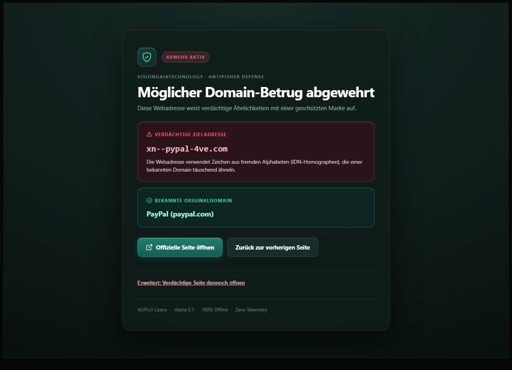
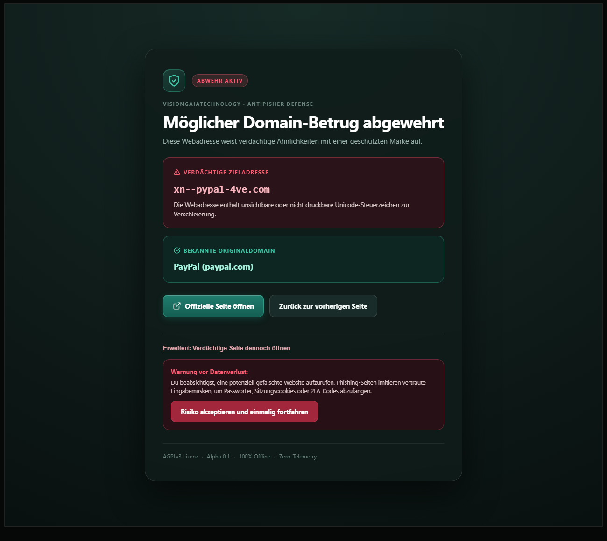
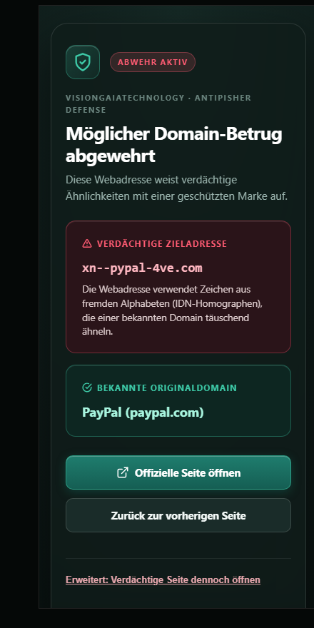
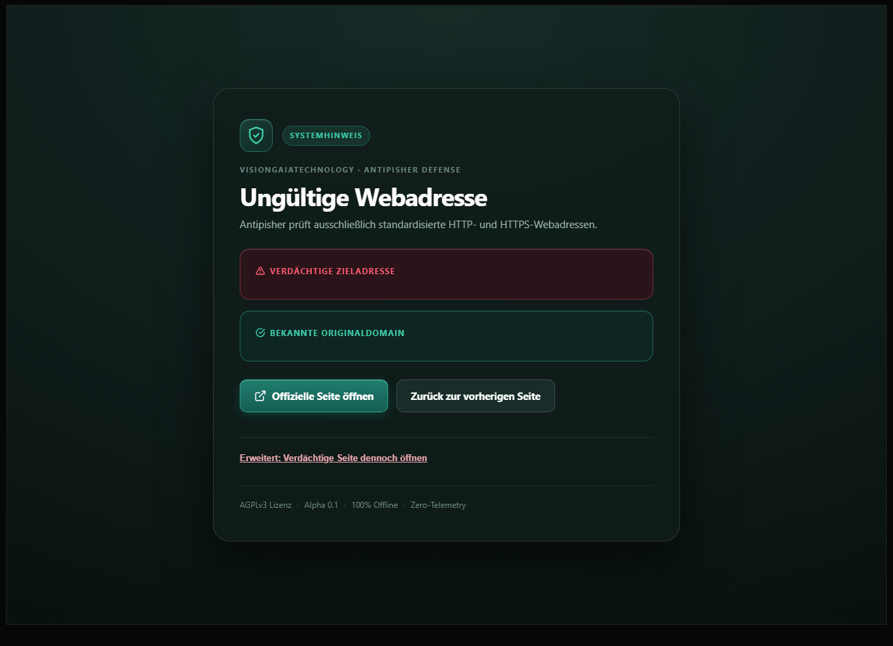
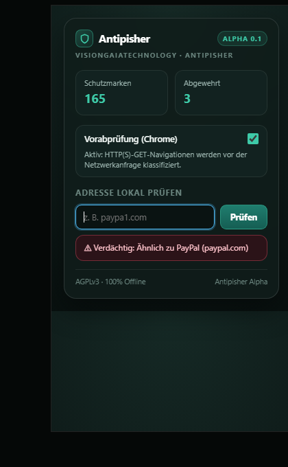
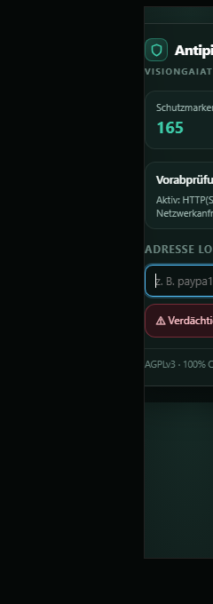

# UX-/Design-, Release- und Dokumentations-Audit — Antipisher 0.1 (Alpha)

**AUDIT_ONLY** — keine Quellcode-Änderungen. Alle Schreiboperationen dieses Audits liegen ausschließlich unter
`audit/ux-release/`. Prüfzeitraum: 2026-10-18, ~17:19–17:40 Europe/Berlin.

```text
VGT INTELLIGENCE MASTER V1 — AUDIT HANDOFF
SOURCE_IDENTITY: CONFLICT (kein Git-Repo, kein Commit/Tag; Next.md:11 behauptet CONFIRMED)
SCOPE: Workspace vgt-domainguard-src (44 Dateien), Chrome MV3 + Firefox MV3,
       shared/*, chrome/*, firefox/*, Manifeste, README.md, Next.md, SECURITY.md, build.py, build_sites.py,
       sites-100.json, icons/, tests/
QUALITY_STATUS: SILBER [UNVERIFIED_CLASSIFICATION für E2E, Performance, Zielplattform, visuelle QA]
RELEASE_GATE: BLOCKED (Chrome Web Store), BLOCKED (Firefox/AMO), Build-/Doku-Gates BLOCKED
CHANGELOG: keine Quellcode-Änderungen (Audit only)
SECURITY: nicht Gegenstand dieses Audits (sec-auditor); release-relevante Sicherheits-/Vertrauensaspekte
          (WAR-Fingerprinting, Interstitial-Verhalten, Privacy-Disclosure) sind enthalten.
UX: GLASS-2100-Teilumsetzung belegt; 33 statische A11y-/UX-FAILs, 7 WCAG-Kontrast-FAILs,
    7 reale Chromium-Renders (simulierte Zustände), echter Extension-E2E NOT_TESTED.
PERFORMANCE: NOT_TESTED (keine Messung; „<1 ms"-Behauptung unbelegt)
TEST_LEDGER: 13/13 Node-Tests PASS; 5/5 node --check PASS; Build-Reproduzierbarkeit FAIL;
             Headless-Render PASS; Extension-E2E NOT_TESTED
NEXT_MD: NOT_REQUIRED (Audit ohne Schreibrecht; Korrekturvorschläge als PENDING_WRITE in §4.3)
NEXT_STEP: P0-Blocker aus §5 abarbeiten: Firefox-WAR + data_collection_permissions, Chrome-DNR-Muster
           im echten Browser verifizieren, Privacy/Listing-Assets, Build-Determinismus, Doku-Korrekturen.
```

---

## 0. Auftrag, Methode, Grenzen

### 0.1 Auftrag

Bewertung von (a) UI/UX und Design-DNA gegen den VGT-Standard (GLASS 2100 + VGT UI/UX Supreme), (b)
Chrome-/Firefox-Release-Gate anhand offizieller Doku, (c) Build-/Release-Engineering, (d)
Dokumentationsintegrität inkl. `SOURCE_IDENTITY_CONFLICTS`, (e) priorisierte P0/P1/P2-Empfehlungen.

### 0.2 Methode / Werkzeuge (alle Checks im Ordner `checks/`)

| Werkzeug | Zweck | Ergebnisdatei |
|---|---|---|
| `checks/contrast_check.py` | WCAG-2.2-Kontrastrechner mit Alpha-Compositing über den echten Gradient-/Glas-Hintergründen | `checks/contrast_results.json`, `checks/logs/contrast_check.log` |
| `checks/ui_static_check.py` | statischer UI-/A11y-/Token-/Theme-/Mikrocopy-Check (59 Findings) | `checks/ui_static_results.json`, `checks/logs/ui_static_check.log` |
| `checks/manifest_check.py` | Release-Gate Chrome/Firefox + Store-Assets + Build/Doku (50 Findings, Quellen verlinkt) | `checks/release_gate_results.json`, `checks/logs/manifest_check.log` |
| `checks/detector_probe.cjs` | 26 Verhaltens-Probes gegen Doku-Behauptungen (Engine real ausgeführt) | `checks/detector_probe_results.json`, `checks/logs/detector_probe.log` |
| `checks/docs_identity_check.py` | 25 Doku-Behauptungen + `SOURCE_IDENTITY_CONFLICTS` | `checks/docs_identity_results.json`, `checks/logs/docs_identity_check.log` |
| `checks/reproducibility_check.py` | Build-Test in temporären Kopien (echter `build.py`, mehrfach) | `checks/reproducibility_results.json`, `checks/logs/reproducibility_check.log` |
| `checks/render_harness.py` | 7 echte Chromium-Renders (headless, iframe mit exakten Viewports) + Layout-/Fokus-Metriken | `screenshots/`, `checks/render_metrics.json`, `checks/logs/render_harness.log` |
| `checks/artifact_identity.json` | ZIP-Inhalt vs. Quellstände, Legacy-Duplikate, Repo-Zustand | `checks/logs/artifact_identity.log` |

### 0.3 Harte Grenzen dieses Audits

- **Kein echter Browser-E2E-Test der Erweiterung.** Chrome 155.0.8059.85 war für die statischen Renders
  verfügbar; ein `--load-extension`-E2E-Versuch schlug fehl bzw. die headless-Umgebung wurde instabil
  (parallele Chrome-Last, Timeouts). Details: `checks/logs/e2e_attempt.log`. Daraus folgt:
  `EXTENSION_E2E = NOT_TESTED`.
- **Screenshots sind STATIC_RENDER_HARNESS**, kein Produkt-„Live"-Render: Kopien von
  `shared/guard.html`/`shared/popup.html`, Zustände per Inline-Script simuliert, in einem iframe mit exakt
  390/1267/350/175 px Viewport. Das belegt CSS, Layout, Fokusindikator, Overflow und Farbwirkung, **nicht**
  das Verhalten der Erweiterung im Browser.
- **Store-/Policy-Aussagen** sind aus offizieller Doku zitiert (Links in §3). Aussagen ohne Browser-Beleg
  sind als `NOT_TESTED` markiert.

### 0.4 Positiv verifiziert (damit der Bericht nicht nur Fehler listet)

- `node --test tests/*.test.cjs`: **13/13 PASS**, 0 fail, 385 ms (`checks/logs/tests.log`).
- `node --check` für alle 5 JS-Dateien: PASS (`checks/logs/node_check.log`).
- 165 Marken in `shared/sites.js` und `sites-100.json`: **bestätigt**, 257 Domains, 165 unique brands/names.
- „100 % Offline / Zero-Telemetry": **bestätigt** — kein `fetch`/XHR/WebSocket/sendBeacon, keine externen
  Assets/Fonts in `shared/`, `chrome/`, `firefox/`; System-Font-Stack.
- Chrome deklariert `guard.html` korrekt als `web_accessible_resources` — das ist für den DNR-Redirect
  **technisch erforderlich** (Chrome-Doku, §3.1).
- Guard-Seite bringt `prefers-reduced-transparency`, `prefers-reduced-motion`, `forced-colors`,
  `@supports`-Blur-Fallback und 3px-Fokusring mit; Interstitial-Hierarchie ist grundsätzlich richtig
  (primär: offizielle Seite, sekundär: zurück, tertiär: Risiko-Disclosure).
- Die Dokumente sind an mehreren Stellen **ehrlich selbstkritisch** (README:45 „Technik-Prototyp",
  README:62 „kein End-to-End-Browser-Lauf", SECURITY.md:3 „keine externe Zertifizierung").

---

## 1. Top-Findings (Executive Summary)

| # | Schwere | Kurzfassung | Beleg |
|---|---|---|---|
| T1 | **P0** | **Firefox-Build ist funktional blockiert:** `firefox/background.js` leitet Main-Frame-Requests auf `moz-extension://…/guard.html` um, aber `firefox/manifest.json` deklariert **kein `web_accessible_resources`**. MDN verlangt das ausdrücklich für Redirects auf Erweiterungsseiten. | `firefox/manifest.json:1-44`, `firefox/background.js:14-15`; [MDN onBeforeRequest](https://developer.mozilla.org/en-US/Add-ons/WebExtensions/API/webRequest/onBeforeRequest) |
| T2 | **P0** | **AMO-Einreichung wird abgelehnt:** `browser_specific_settings.gecko.data_collection_permissions` fehlt. Laut MDN ist der Schlüssel für neue AMO-Einreichungen **seit 2025-11-03 Pflicht**. | `firefox/manifest.json:33-38`; [MDN browser_specific_settings](https://developer.mozilla.org/en-US/docs/Mozilla/Add-ons/WebExtensions/manifest.json/browser_specific_settings) |
| T3 | **P0** | **Chrome-Store-Gate blockiert:** keine Privacy-Policy, keine Limited-Use-Disclosure für Browsing-Aktivität, keine Store-Screenshots/Promo-Assets/Support-Kontakt/Homepage. CWS verlangt Policy-URL + Assets; „missing screenshots → rejected". | `checks/release_gate_results.json` (Chrome-MV3 FAILs); [CWS Program Policies](https://developer.chrome.com/docs/webstore/program-policies/policies) |
| T4 | **P0 (Runtime)** | **DNR-Redirect-Muster nicht durch offizielle Doku gedeckt und nicht browser-verifiziert:** `regexSubstitution` auf `chrome-extension://…/guard.html#<url>`. Offizielle Doku zeigt für Extension-Ziele nur `redirect.extensionPath`; Browser-Verhalten = `NOT_TESTED`. | `chrome/background.js:27-39`; [Chrome DNR](https://developer.chrome.com/docs/extensions/reference/api/declarativeNetRequest) |
| T5 | **P1 (UI!)** | **„hidden" wirkt nicht:** `.danger-panel { display:flex }` (`shared/guard.css:135-140`) überschreibt das `hidden`-Attribut. Der reale Chromium-Render des Skip-/Invalid-Zustands zeigt **sichtbare, leere Gefahren-Karten und funktionslose Buttons**. | [screenshots/guard-invalid-1280x900.png](screenshots/guard-invalid-1280x900.png), `checks/render_metrics.json` (`rects.danger = {h:316}`, `focusables` sichtbar) |
| T6 | **P1 (A11y)** | **7 WCAG-AA-Kontrast-FAILs**, alle beim Token `--vgt-text-muted #6b857f` (4,29–4,33:1 < 4,5:1) auf Glas/Fallback. Betroffen: Kicker, Footer, Popup-Section-Title. Fix: `#78938c` (≥ 5,1:1). | `checks/contrast_results.json` |
| T7 | **P1 (A11y, empirisch)** | Der Fokusring des Popup-Suchfelds wird durch `outline:none` (Spezifität 0,1,1) überschrieben; real im Chromium gemessen: `matchesFocusVisible=true`, `outlineStyle=none`, nur `box-shadow: rgba(82,194,255,.25)` (2.4.11-Risiko). | `checks/render_metrics.json` (`focusTest`), `shared/popup.html:206-213` |
| T8 | **P1** | **Doku-Widersprüche:** „Manifest-Fingerprinting geschlossen" trotz WAR `guard.html`; „lückenloser Subdomain-Schutz" (6 Gegenbeispiele); „reproduzierbare Builds" (widerlegt); „PLATIN VGT SUPREME" ohne Beleg; referenzierte `ARCHITECTURE_AND_SECURITY_REVIEW.md` fehlt; `SOURCE_IDENTITY_CONFIRMED` ohne Git. | §4, `checks/docs_identity_results.json` |
| T9 | **P2 (Chromium-Render)** | Popup hat feste `body{width:350px}`; bei simuliertem 200-%-Zoom (175 px Viewport) horizontaler Overflow: `scrollWidth 350 > 175`. | [screenshots/popup-zoom-sim-200pct-175x620.png](screenshots/popup-zoom-sim-200pct-175x620.png), `checks/render_metrics.json` |
| T10 | **P2** | Design-DNA: solide, ruhige Security-Materialität (dunkles Mineral/Graphit + Salbeigrün) — aber **kein Signature-Element**, generisches Schild-mit-Häkchen-Icon, Blur ohne sichtbare Funktion (hinter der Fläche liegt nur ein glatter Gradient), KPI-Kachelmuster im Popup. | Screenshots, `checks/ui_static_results.json` |

---

## 2. UX-/Design-Audit

### 2.1 GLASS-2100 / VGT-UI-UX-Gate

Bewertung nach `GLASS_2100_DESIGN.md` §8 (Visual Evidence Gate) und `VGT_UI_UX_SUPREME_ORIGINAL.md`.
`NOT_TESTED` wird nicht als bestanden gewertet.

| Gate | Status | Beleg / Begründung |
|---|---|---|
| 1. Product DNA vorhanden, eigenständiger Markeneindruck | **PASS (schwach)** | Security-DNA (dunkles Mineral, Salbeigrün, Bronze/Signalrot nur für Zustände) entspricht GLASS-2100-Tabelle „GeDefense/Security"; eigenständig ist die Komposition aber kaum (§2.3, Signature fehlt) |
| 2. Keine dekorativen Hintergrundgitter/Dot-Grids | **PASS** | Nur radialer Tonwertverlauf (`shared/guard.css:51`, `shared/popup.html:48`); Screenshots bestätigen |
| 3. Glas-Materialsprache konsistent, keine Karteninflation | **FAIL (P2)** | Konsistente Fill/Stroke-Sprache, aber Blur ohne Funktion (§2.1a); Popup dupliziert Token mit abweichenden Werten; 2 KPI-Kacheln + Optionskachel im Popup = KPI-Muster |
| 4. Farbtheorie, Kontrast, Light/Dark geprüft | **FAIL (P1)** | 7 Kontrast-FAILs; nur Dark, keine `prefers-color-scheme`-Regel, `data-theme="dark"` ist totes Attribut |
| 5. Primärer Fokus, Lesefluss, Makro-Hierarchie | **PASS** | Screenshot `guard-danger-1280x900.png`: H1 → Befund → Original → Aktionen klar; ein primärer Fokus |
| 6. Mouse/Touch/Keyboard erreichbar | **FAIL (P1)** | Guard: PASS (native Buttons, 3px-Fokusring); Popup: Fokusring des Suchfelds unterdrückt (empirisch), Checkbox-Target 16 px |
| 7. Desktop + Tablet + Mobile tatsächlich geprüft | **PARTIAL / NOT_TESTED** | Desktop 1267 px + Mobile 390 px als Chromium-Static-Render geprüft; kein echtes Gerät/Browser-Extension-Lauf; Tablet NOT_TESTED |
| 8. Empty/Loading/Error/Permission/Disabled/Success/Offline sinnvoll | **FAIL (P1)** | Kein Ladezustand; Skip-Zustand = Dead End; Engine-Fehler = stumme Seite/Top-Level-Throw; keine Degraded-/Permission-/Offline-Zustände |
| 9. Motion reduziert/deaktivierbar | **PASS Guard / FAIL Popup** | Guard: `prefers-reduced-motion` vorhanden; Popup: fehlt (nur 0,15 s-Transitions → geringer Impact) |
| 10. Performancebudget eingehalten | **NOT_TESTED** | Keine Messung; „<1 ms" (Next.md:33) unbelegt; Blur auf statischem Gradient = reine GPU-Kosten ohne sichtbaren Nutzen |
| 11. Ohne Blur/Gradient/Shadow/3D attraktiv und benutzbar | **PASS (strukturell)** | Silhouette trägt (Karten-Grenzen, Typo-Hierarchie); ohne Glas bleibt die Struktur verständlich — aber generisch |
| 12. Screenshots/Previews + Korrekturrunde | **PARTIAL** | 7 echte Chromium-Renders vorhanden (dieser Audit) = Baseline-Nachweis; **keine Korrekturrunde** im Produkt, keine echten Produkt-Screenshots im Repo |

#### 2.1a Materialkritik (GLASS 2100 §3: „Blur nur auf tatsächlich überlagernden Flächen")

Hinter beiden Glasflächen liegt ausschließlich ein glatter `radial-gradient` (`guard.css:51`, `popup.html:48`).
`backdrop-filter: blur(18px)` auf einer bereits weichen Fläche erzeugt **keinen wahrnehmbaren Materialeffekt**,
sondern nur GPU-Kosten. Die Glaswirkung entsteht ausschließlich aus Fill/Stroke/Highlight; der
Ohne-Blur-Fallback ist dadurch optisch identisch (im Screenshot sichtbar: die Karte wirkt wie eine opake
dunkle Fläche). Empfehlung: entweder echten Inhalt hinter dem Interstitial zulassen (dann trägt Blur),
oder Blur streichen und Materialität über Tonwertkanten/Highlight/Lichtkante definieren.

### 2.2 Anti-Slop-/Design-DNA-Befund

**Stärken**

- Ruhige, dunkle Mineralfläche ohne Grid/Neon/Hacker-Klischee; keine Dauerrot-Färbung (GLASS 2100 §7,
  VGT-UI-UX §38). Danger-Farbe nur für echten Verdacht.
- Klare Typo-Rollen (H1, Kicker, Eyebrow, Body, Mono für Domain) und funktional begründete Karten
  (Befund vs. Originaldomain = zwei getrennte Datenquellen).
- Semantische Buttons, kein Icon-only-Handeln, konkrete Button-Labels.

**Schwächen**

- **Kein Signature-Element** (VGT-UI-UX §26). Ohne Logo nicht wiedererkennbar — Shield + Glass-Card +
  Teal ist das generische Security-Template. Vorschlag: **Character-Diff** als Signatur (siehe §5).
- **Icon-Semantik widerspricht dem Zustand:** Das Header-Symbol ist ein Schild **mit Häkchen** („geprüft/
  sicher") — genau im Modus „Möglicher Domain-Betrug abgewehrt" (Screenshot). Auch das Toolbar-Icon
  `icons/icon128.png` ist ein Schild mit Häkchen auf dunklem App-Icon-Quadrat (kein transparentes
  Toolbar-Glyph, kein 32-/96-px-Satz).
- **Popup = KPI-Kachelmuster** („Schutzmarken 165 / Abgewehrt 3") — GLASS-2100-Negativmuster
  „Standard-KPI-Quartett"; die Kacheln beantworten nicht die eigentliche Nutzerfrage „Bin ich geschützt?".
- **Punycode-Trust-Lücke:** Im Render wird `xn--pypal-4ve.com` gezeigt (`shared/guard.js:60`,
  `detector.js:205`) — für Nutzer unlesbar, ohne dekodierte Darstellung und ohne Zeichen-Vergleich zum
  Original. Das ist die zentrale Vertrauenskomponente eines Anti-Phishing-Interstitials.
- Symmetrische Center-Komposition ist für ein Modal okay, für eine „Security-Konsole" aber ohne
  Eigenständigkeit.

### 2.3 Screenshots (reale Chromium-Renders, simulierter Zustand)

**Guard — Verdachtsfall (Desktop):**



- Hierarchie klar; primärer CTA „Offizielle Seite öffnen" korrekt zuerst.
- Kicker/Footer sehr klein und kontrastschwach (numerisch bestätigt: 4,29:1).
- Glass wirkt opak (Blur no-op); Header-Schild mit Häkchen im Warnkontext.
- Punycode-Host als einzige „Beweisdarstellung".

**Guard — Warnbestätigung (Desktop):**



- Warnblock inhaltlich klar, aber ohne `role="alert"/"alertdialog"`; Tastaturfokus springt nicht in den
  Block; Escape schließt nicht (`shared/guard.js:74-79`).
- Der rote „Risiko akzeptieren"-Button konkurriert visuell mit dem primären CTA; als tertiärer
  Risikopfad ist die Platzierung korrekt, die Farbintensität aber zu nah am Primärfokus.

**Guard — Mobile (390 px):**



- Responsive PASS: Buttons gestapelt, keine horizontale Überbreite (`scrollWidth 375 ≤ 390`), Inhalt
  scrollt (`scrollHeight 984 > 844`) — kein Layoutbruch.
- Kicker bricht auf zwei Zeilen; Footer unter dem Fold.

**Guard — Skip-/Invalid-Zustand (Beweis für T5):**



- Erwartet: Nur Titel/Erklärung (kein Gefahrenpanel, kein Aktionsbereich).
- Tatsächlich: leere Gefahren-/Originaldomain-Karten, aktive wirkende Buttons, „Erweitert"-Disclosure —
  **und alle Buttons sind ohne Event-Listener** (guard.js kehrt im Skip-Zweig vor der Registrierung zurück,
  `shared/guard.js:43-48`). Der CSS-Fehler: `.danger-panel { display:flex }` überstimmt `[hidden]`
  (`shared/guard.css:135-140` vs. `shared/guard.html:26`). Das Security-Interstitial zeigt damit im Fehlerfall
  wirkungslose Call-to-Actions — vertrauensschädlich.
- Zusätzlich: derselbe Effekt erzeugt auf der Safe-Route (Auto-Redirect) einen kurzen Render des leeren
  Gefahrenpanels.

**Popup — Verdachtsfall (350 px):**



- Informationshierarchie: Marke → KPI → Toggle → Suche → Ergebnis. Der technische Toggle-Text
  („Vorabprüfung (Chrome)", „HTTP(S)-GET-Navigationen…") dominiert eine Hauptzeile.
- Kein Gesamtstatus „Schutz aktiv", kein Datenschutz-/Policy-Link, kein „Fehlalarm melden".
- Emoji-Glyphen `⚠/✓` als Statusmarker (`shared/popup.js:40,43`).

**Popup — 200-%-Zoom-Simulation (175 px):**



- Reale Messung: `horizontalOverflow = true`, `scrollWidth 350 > 175` — Inhalte werden rechts
  abgeschnitten. Reflow-Ziel (WCAG 1.4.10, 320 CSS-px) ist damit verletzt, sobald der effektive
  Viewport durch Zoom/HiDPI/Oberflächenskalierung schrumpft.

### 2.4 Informationshierarchie, Entscheidungsführung, Vertrauen

| Dimension | Bewertung | Details |
|---|---|---|
| Primärer Fokus | PASS | H1 „Möglicher Domain-Betrug abgewehrt", ein Fokus |
| Entscheidungsführung | PASS | Offizielle Seite zuerst, Zurück zweitens, Risiko nur als Disclosure |
| Vertrauensaufbau | **FAIL (P1)** | Kein dekodierter Host/Zeichen-Diff; kein „Warum bin ich hier?"; keine Evidenz-Darstellung; kein Melde-/Fehlalarm-Pfad; kein Kontakt/Datenschutzlink im Interstitial |
| Ursache/Zeitbezug | **FAIL (P2)** | Grund nur als ein Satz aus `reasonNames`; `userinfo`-Fälle (detector.js:207-223) fehlen in `reasonNames` (guard.js:6-13) → Fallback „Verdächtige Domain-Manipulation erkannt." |
| Originaldomain | PASS | „PayPal (paypal.com)" klar getrennt |
| Fehlalarm-/Recovery-Pfad | **FAIL (P1)** | Kein „Das ist ein Fehlalarm"-Pfad, keine Ausnahme pro Domain, kein Support-Link |
| Zahlen/Status im Popup | **FAIL (P2)** | „Schutzmarken" (die Liste enthält Dienste, Banken, Carrier), „Abgewehrt" ohne Zeitraum/Bezug; bei fehlendem Skript bleibt 0 stehen (popup.js:6-8) |

### 2.5 Alert-Fatigue und Interstitial-Verhalten

- **Alert-Fatigue im engeren Sinne: PASS** — Warnung erscheint nur bei `status === 'block'`; kein
  Dauerfeuer, keine `role="alert"`-Inflation.
- **Navigations-Fatigue im Chrome-Build: FAIL (P1)** — Die DNR-Regel leitet **jede** Top-Level-GET-
  Navigation zunächst auf die Erweiterungsseite um (`chrome/background.js:24-40`), die bei „safe" sofort
  wieder weiterleitet (`shared/guard.js:50-54`). Folge: Flash/Mehrfach-Render jeder Seite, History-/
  Referer-Änderung, zusätzliche Latenz; README:45 nennt es selbst „Technik-Prototyp". Im Firefox-Build
  wird nur bei Verdacht eingegriffen (`firefox/background.js:7-16`) — d. h. **inkonsistentes
  Sicherheits-/UX-Modell zwischen den Plattformen**.
- **Zähler-Semantik inkonsistent (P2):** Firefox zählt jeden Block (`firefox/background.js:12-13`),
  Chrome zählt nur bei „Risiko akzeptieren" (`chrome/background.js:96-99`); „Abgewehrt" bedeutet je nach
  Browser etwas anderes.

### 2.6 Onboarding, Erststart, Fehlalarme

- **FAIL (P1):** Kein Onboarding (`onInstalled` öffnet nichts; keine `options_ui`), keine Erklärung von
  Zweck, lokalem URL-Zugriff, Nicht-Datenübertragung und Fehlalarm-Meldung. Popup ist die einzige
  Erklärung.
- **FAIL (P1):** Fehlalarm-Pfad fehlt vollständig (weder Melde-Button noch Kopier-/Exportfunktion noch
  Kontakt).

### 2.7 Zustände (Design for States, GLASS 2100 §8 / VGT-UI-UX §24)

| Zustand | Vorhanden? | Befund |
|---|---|---|
| initial | PASS | Guard zeigt „Adresse wird überprüft"; Popup initial neutral |
| loading | **FAIL (P3)** | Kein Lade-/Progress-Zustand; Popup prüft synchron im Popup |
| loaded/safe | **FAIL (P2)** | Auto-Redirect ohne sichtbaren Fortschritt; bei `sendMessage`-Fehler nur Fehlerbanner ohne Retry/Back |
| empty (Popup-Eingabe leer) | PASS | Ergebnis wird ausgeblendet |
| invalid/skip | **FAIL (P1)** | Dead End + sichtbare tote Buttons (T5) |
| error (Engine fehlt) | **FAIL (P1)** | `guard.js:18-19`/`popup.js:35-36` rufen `engine.classify` ohne Guard; Top-Level-Throw → Seite bleibt stumm auf „Adresse wird überprüft"; Popup bleibt bei 0 |
| storage error | **FAIL (P2)** | `.catch(()=>{})` schluckt Fehler (popup.js:10-13) |
| permission denied | **FAIL (P2)** | Nicht berücksichtigt |
| degraded (kein DNR/keine Regeln) | **FAIL (P1)** | Kein Zustand „Schutz eingeschränkt/nicht aktiv" |
| success (allow-once) | PASS | Freigabe + Navigation; Fehlerfall ohne Recovery |
| offline | n/a | 100 % offline by design |

### 2.8 Accessibility (WCAG 2.2 AA)

#### a) Rechnerische Kontrastprüfung (`checks/contrast_results.json`)

41 Fälle, **34 PASS / 7 FAIL**. Geprüft wurde auf der tatsächlich zusammengesetzten Hintergrundfarbe
(Glas-Fill über drei Stützfarben des Environment-Gradienten, danach Karten-/Confirm-/Error-Fill), jeweils
der schlechteste Wert.

| Element | Vordergrund | effektiver Hintergrund (worst case) | Ist | Soll | Status |
|---|---|---|---|---|---|
| Guard Kicker (11 px, 700) | `#6b857f` | `rgba(16,28,26,.82)` über `#162a26` → `#111f1c` | **4,29:1** | 4,5:1 | **FAIL** |
| Guard Footer (12 px) | `#6b857f` | wie oben | **4,29:1** | 4,5:1 | **FAIL** |
| Guard Footer, Reduced-Transparency-Fallback | `#6b857f` | `#111e1c` | **4,31:1** | 4,5:1 | **FAIL** |
| Popup Kicker (10 px) | `#6b857f` | Popup-Glas über `#162a26` | **4,33:1** | 4,5:1 | **FAIL** |
| Popup Section-Title (12 px, uppercase) | `#6b857f` | Popup-Glas | **4,33:1** | 4,5:1 | **FAIL** |
| Popup Footer (10,5 px) | `#6b857f` | Popup-Glas | **4,33:1** | 4,5:1 | **FAIL** |
| Popup Footer, Fallback | `#6b857f` | `#111e1c` | **4,31:1** | 4,5:1 | **FAIL** |
| übrige 34 Fälle (H1, Body, Danger/Official, Karten, Buttons, Popup-Ergebnisse, Fokusring) | — | — | 4,98–18,56:1 | 3,0/4,5:1 | PASS |

**Fix:** `--vgt-text-muted` von `#6b857f` auf **`#7f9a93`** (≥ 5,6:1 auf `#111e1c`, ≥ 5,62:1 auf Glas) oder
mindestens `#78938c` (≥ 5,1:1). Kontrastrechner: `checks/contrast_check.py`.
Hinweis: `#url`-Platzhalter hat keine eigene `::placeholder`-Farbe → UA-Standard = `NOT_TESTED`,
empfohlen `::placeholder { color: #93a8a3 }` + Label (Input hat `aria-label`, aber kein sichtbares Label).

#### b) Fokus / Tastatur / Screenreader

| Prüfpunkt | Status | Beleg |
|---|---|---|
| `:focus-visible`-Stil Guard (3 px Outline, Offset 3 px) | PASS | `shared/guard.css:329-332` |
| Fokusring der Popup-Suchfelds | **FAIL (P1, empirisch)** | Render-Metrik: `matchesFocusVisible: true`, `outlineStyle: "none"`, nur `box-shadow: rgba(82,194,255,.25) 0 0 0 2px`; Ursache `outline:none` (Spezifität 0,1,1) vs. `:where(...):focus-visible` (0,1,0), `shared/popup.html:206-213,274-277` |
| Tab-Reihenfolge Guard | PASS | `safe → back → reveal → (confirm) proceed`; confirm ist `hidden`, bis Disclosure geöffnet |
| Tab-Reihenfolge Popup | PASS | `strict → url → check` (DOM-Reihenfolge) |
| Fokus-Trap im Confirm-Dialog | n/a (kein Modaldialog) / **FAIL wartbar** | `.confirm-dialog` ist Inline-Disclosure ohne `role`, ohne Fokus-Transfer, ohne Escape; Warnung wird bei Tastaturbedienung nicht angekündigt (`shared/guard.html:73-80`, `guard.js:74-79`) |
| `aria-live="assertive"` auf großem Panel mit Buttons | **FAIL (P2)** | `shared/guard.html:26` — zu viel Inhalt für assertive Region; besser kurze `role="alert"`-Zeile + statischer Rest |
| `aria-expanded`/`aria-controls` | PASS | `guard.html:70`, `guard.js:77` |
| Landmarks/Bezeichner | PASS (Guard) / n/a (Popup) | `<main aria-labelledby>`; Popup ohne Landmark, für ein Popup akzeptabel |
| Heading-Hierarchie | **FAIL (P2)** | nur H1; Karten/Abschnitte sind `span.eyebrow`/`div.section-title` → keine H2-Navigation |
| Buttons/Icons dekorativ markiert | PASS | alle funktionalen SVGs `aria-hidden="true"`; Buttons mit Text |
| Status nicht nur per Farbe | PASS | Text-Eyebrows + Textlabels, Badge-Text wechselt mit |
| Touch-Targets ≥ 24 px (2.5.8 AA) | **FAIL (P2)** | Popup-Checkbox 16×16 in ~18 px hoher Label-Zeile (`shared/popup.html:168-173`) |
| Zoom/Reflow 200 % | **FAIL (P2)** | Popup-Overflow (T9); Guard statisch reflow-fähig, echter Textzoom NOT_TESTED |
| `user-scalable=no` | PASS | nicht gesetzt |
| Reduced Motion | PASS Guard / **FAIL Popup** | `guard.css:357-362`; Popup ohne Regel |
| Reduced Transparency | PASS Guard / **FAIL Popup** | `guard.css:346-355`; Popup ohne Regel |
| Forced Colors | PASS Guard / **FAIL Popup** | `guard.css:364-373`; Popup ohne Regel |

#### c) Theme

Nur Dark. `data-theme="dark"` ist hart verdrahtet, wird von keiner CSS-Regel gelesen, `prefers-color-scheme`
existiert nicht. Für ein Security-Produkt ist Dark-only legitim (GLASS-2100-Tabelle „Security"), aber dann
muss es bewusst dokumentiert werden; das tote `data-theme`-Attribut und die „Light/Dark/System"-Erwartung
aus dem Designstandard bleiben unerfüllt (**P1/P2**).

### 2.9 Mobile / Zoom / kleines Popup

- Guard responsiv: PASS (Chromium-Render 390 px; Buttons gestapelt, kein horizontaler Overflow, Inhalt scrollt).
- Popup: feste 350-px-Breite, kein Breakpoint → bei 175 px effektiver Breite (≈200 % Zoom) Overflow (FAIL).
- Firefox-Android ist nicht Zielplattform (`gecko_android` fehlt → nur Desktop); das ist nirgends
  dokumentiert (**P3**).
- Popup-Maximumhöhe (Chrome ~600 px) und Scrollverhalten: NOT_TESTED.

### 2.10 Mikrocopy und i18n

**FAIL (P1) Jargon/Implementierungsdetails:**

| Fundstelle | Text | Vorschlag |
|---|---|---|
| `shared/popup.html:311` | „Aktiv: HTTP(S)-GET-Navigationen werden vor der Netzwerkanfrage klassifiziert." | „Aktiv: Jede neue Seite wird vor dem Laden lokal geprüft." |
| `shared/popup.js:25` | „Inaktiv: Nur best-effort Erkennung via webNavigation ohne präventive Blockade." | „Aus: Seiten werden erst nach dem Laden geprüft — weniger Schutz, aber keine Umleitung." |
| `shared/popup.html:308` | Label „Vorabprüfung (Chrome)" | „Seitenprüfung vor dem Laden" + Statuszeile „Schutz aktiv · lokal · keine Datenübertragung" |
| `shared/popup.html:297/301` | „Schutzmarken" / „Abgewehrt" | „Geschützte Marken" / „Seit Installation blockiert" |

**Weitere Mikrocopy-Befunde:**

- Emoji-Glyphen `⚠`/`✓` als Statusmarker (`shared/popup.js:40,43`) → SVG-Icon + Text (P2).
- `reasonNames` deckt `userinfo` nicht ab (P2) → Fallback-Text; Vorschlag: „Die Adresse tarnt sich mit einem
  Benutzernamen-Trick: Der echte Host steht nach dem @-Zeichen."
- Anrede konsistent „Du" in Guard/README/SECURITY: PASS.
- Button-Labels konkret: PASS („Offizielle Seite öffnen", „Zurück zur vorherigen Seite", „Prüfen").

**i18n:** Nur Deutsch, keine `_locales`/`default_locale`, alle Strings hart in HTML/JS. Für eine deutsche
Alpha akzeptabel, aber als Einschränkung dokumentieren und für V2 in einen String-Katalog
(`shared/messages.de.js`) ziehen (P2).

### 2.11 Marke, Icon, Wortmarke

| Befund | Status |
|---|---|
| „VISIONGAIATECHNOLOGY · ANTIPISHER DEFENSE" (Uppercase-Kicker) vs. „VisionGaiaTechnology" (Header) | **FAIL (P2)**, Schreibweise vereinheitlichen |
| Legacy „VGT DomainGuard": `shared/guard.css:2`, `build_sites.py:2`, `shared/detector.js:357` (Alias), `build.py:27,35` (Legacy-ZIPs), Elternordner, `Next.md:7` | REVIEW (P2): Migrationsbezüge okay, aber Produkt-/Artefaktnamen mischen |
| Icon: Schild mit Häkchen auf dunklem App-Icon-Quadrat, nur 16/48/128 (kein 32/96, kein transparentes Toolbar-Glyph) | **FAIL (P2)**; Häkchen-Semantik widerspricht Warnfunktion |
| Keine Wortmarke/Brand-Signature im UI (nur Textkicker) | **FAIL (P2)** |
| Lizenz-/Versions-Footer („AGPLv3 Lizenz · Alpha 0.1 · 100% Offline · Zero-Telemetry") | PASS inhaltlich, aber Kontrast FAIL s. o. |

---

## 3. Release-Gate

### 3.1 Chrome MV3 — technische Konformität

Offizielle Quellen: [Chrome DNR](https://developer.chrome.com/docs/extensions/reference/api/declarativeNetRequest),
[Web Accessible Resources](https://developer.chrome.com/docs/extensions/reference/manifest/web-accessible-resources),
[CWS Program Policies](https://developer.chrome.com/docs/webstore/program-policies/policies).

| Prüfpunkt | Status | Evidenz / Begründung |
|---|---|---|
| `manifest_version: 3` | PASS | `chrome/manifest.json:2` |
| Versionsformat (`0.1.0`, version_name `0.1 Alpha`) | PASS | `chrome/manifest.json:6-7`; CWS-konform |
| `background.service_worker` | PASS | `chrome/manifest.json:19-21`, `chrome/background.js:5` (`importScripts` lokal) |
| DNR-Redirect-Ziel als WAR deklariert | PASS | `chrome/manifest.json:31-41`; Chrome-Doku: „A declarativeNetRequest rule cannot redirect … to a resource that is not web accessible" |
| DNR-Regel: `main_frame`, `requestMethods:['get']`, Prioritäten (redirect 1 / allow 10) | PASS (statisch) | `chrome/background.js:27-40,55-58`; Unit-Test mockt DNR |
| **DNR-Redirect via `regexSubstitution` auf `chrome-extension://…#<url>`** | **NOT_TESTED (P0_Runtime)** | `chrome/background.js:30-38`; offizielle Doku zeigt für Extension-Ziele nur `redirect.extensionPath`; Browser-Validierung (Scheme-Wechsel, Fragmentübergabe an WAR-Seite) nicht verifiziert → vor Store-Submission real testen. Falls nicht unterstützt: stattdessen `extensionPath` + tabbezogene Ziel-URL-Auflösung im Background. |
| `permissions`: storage/tabs/webNavigation/declarativeNetRequest | REVIEW | `chrome/manifest.json:9-14`; Redirect-Action braucht Host-Permissions (DNR gibt implizit nur allow/allowAllRequests/block); „tabs" erzeugt Warnung „Read your browsing history" — prüfen, ob `sender.tab` reicht |
| `host_permissions` alle http/https | REVIEW (funktional begründbar) | `chrome/manifest.json:15-18`; CWS-Policy „narrowest permissions" + Begründung im Dashboard/Privacy nötig |
| Kein Remote-Code / kein eval | PASS | CWS-MV3-Anforderung erfüllt (`chrome/background.js:5`, keine Remote-Imports) |
| Kein „unexpected behavior" durch Redirect-all | **REVIEW (P1)** | jede GET-Navigation läuft über das Interstitial (siehe §2.5); CWS Quality Guidelines verlangen minimale Störung → größtes Review-Risiko |
| WAR-Fingerprinting-Restrisiko | **FAIL (P2, Doku)** | WAR `guard.html` + `matches: http/https` = Fingerprint-Vektor (Chrome-Doku nennt WAR ausdrücklich als solchen); als Restrisiko dokumentieren, nicht als „geschlossen" (Widerspruch zu README:15/Next.md:28) |
| Fehlende Manifest-Metadaten | FAIL (P2) | keine `homepage_url`/`author`/`short_name`-Ergänzungen fürs Listing |

**Chrome-Fazit:** Technisch weitgehend MV3-konform, aber ein **nicht verifizierter Kernmechanismus** (DNR→WAR
Redirect per `regexSubstitution`), ein policy-kritisches Verhalten (Redirect-all) und fehlende
Store-Compliance-Unterlagen. → **BLOCKED**.

### 3.2 Chrome Web Store — Policy-/Asset-Gate

| Anforderung (CWS-Program-Policies) | Status | Befund |
|---|---|---|
| Single Purpose | PASS (inhaltlich) | Anti-Phishing ist ein Zweck; Dashboard-Feld muss präzise gefüllt werden |
| Privacy Policy bei User-Data | **FAIL (P0_Store)** | Extension liest jede Navigations-URL (Browsing-Aktivität) → CWS: „If your Product handles any user data, then you must post an accurate and up to date privacy policy" + Link im Dashboard. Keine `PRIVACY.md`/URL, keine `homepage_url`. |
| Limited Use / Disclosure | **FAIL (P0_Store)** | CWS: Browsing-Aktivität nur zulässig, „to the extent required for a user-facing feature described prominently in the Product's Chrome Web Store page and in the Product's user interface"; weder Listing noch UI beschreiben die URL-Verarbeitung; keine Limited-Use-Affirmative-Statement-Seite. |
| Permission-Justification | REVIEW | Host-Permissions + tabs + webNavigation müssen im Dashboard begründet werden |
| Screenshots / Promo / Icon 128 | **FAIL (P0_Store)** | CWS: „If your product has a blank description field or is missing an icon or screenshots, it will be rejected." — **0 Screenshots**, 0 Promo-Tiles im Repo |
| Beschreibung/Kategorie/Support-Kontakt | **FAIL (P0_Store)** | Keine Listing-Texte, keine Kategorie, kein Support-Kontakt; `SECURITY.md:9` verweist auf einen „privaten Kanal" ohne Adresse |
| Remote-Code/Code-Readability | PASS | kein Remote-Code, keine Obfuskation |
| 2FA/Developer-Account | NOT_TESTED | Organisatorisch, nicht im Repo |

### 3.3 Firefox MV3 / AMO

Offizielle Quellen: [MDN onBeforeRequest](https://developer.mozilla.org/en-US/docs/Mozilla/Add-ons/WebExtensions/API/webRequest/onBeforeRequest),
[MDN background](https://developer.mozilla.org/en-US/docs/Mozilla/Add-ons/WebExtensions/manifest.json/background),
[MDN browser_specific_settings](https://developer.mozilla.org/en-US/docs/Mozilla/Add-ons/WebExtensions/manifest.json/browser_specific_settings),
[MDN permissions](https://developer.mozilla.org/en-US/docs/Mozilla/Add-ons/WebExtensions/manifest.json/permissions),
[AMO Add-on Policies](https://extensionworkshop.com/documentation/publish/add-on-policies/),
[AMO Signing](https://extensionworkshop.com/documentation/publish/signing-and-distribution-overview/).

| Prüfpunkt | Status | Evidenz / Begründung |
|---|---|---|
| `manifest_version: 3` | PASS | `firefox/manifest.json:2` |
| `background.scripts` statt service_worker | PASS | `firefox/manifest.json:18-23`; MDN: Firefox unterstützt `background.service_worker` nicht, aber `background.scripts` |
| `webRequestBlocking` in Firefox MV3 | PASS | `firefox/manifest.json:10-11`; MDN-BCD: in Firefox verfügbar (die Chrome-MV3-Einschränkung gilt nicht für Firefox) |
| **WAR für Redirect auf Erweiterungsseite** | **FAIL (P0_Block)** | `firefox/background.js:14-15` redirected auf `moz-extension://…/guard.html`; `firefox/manifest.json` hat **kein** `web_accessible_resources`. MDN: „If an extension wants to redirect a public URL to an extension page, the extension's manifest.json file must contain a web_accessible_resources key that lists the URL for the extension page." → Warnseite im Firefox-Build voraussichtlich nicht erreichbar; in echtem Firefox verifizieren und WAR ergänzen (siehe §5 P0-2). |
| `browser_specific_settings.gecko.id` (Pflicht für MV3-Signierung) | PASS (Format) / REVIEW | `antipisher@visiongaia.example` matcht `^[a-zA-Z0-9-._]*@[a-zA-Z0-9-._]+$`, nutzt aber reservierte TLD `.example` → ID ist dauerhaft; vor erster AMO-Einreichung auf echte Domain ändern |
| `strict_min_version` | PASS | `128.0` (`firefox/manifest.json:37`); MDN nennt 128.0 als Minimum für die Update-fähige Nicht-ESR-Schiene (ESR: 115.0) |
| **`gecko.data_collection_permissions`** | **FAIL (P0_Store)** | fehlt; MDN: „Must be provided … for new extension submitted to addons.mozilla.org from November 3, 2025." → `required: ["none"]` (keine Übertragung) |
| Firefox for Android | REVIEW (P3) | `gecko_android` fehlt → laut MDN nur Desktop verfügbar; nicht dokumentiert |
| Signatur/XPI/Web-Ext-Lint | **FAIL (P0_Store)** | Nur unsignierte ZIPs; kein `web-ext lint`/`web-ext sign`, keine Signatur, keine Checksummen |
| AMO-Listing + Privacy + Support | **FAIL (P0_Store)** | keine Beschreibung/Screenshots/Privacy-URL/Support-Kontakt |
| „No Surprises"/Informationspflicht | REVIEW (P1) | Firefox blockt nur Verdachtsfälle (gut), aber keine Onboarding-Erklärung/Privacy-URL |

**Firefox-Fazit:** Solide Basis (korrektes Background-Modell, passende Permissions), aber zwei harte
Release-Blocker (WAR, data_collection_permissions) plus fehlende Signatur-/Listing-Artefakte. →
**BLOCKED**.

### 3.4 Store-Assets-Matrix (was komplett fehlt)

| Asset | Chrome CWS | Firefox AMO | Vorhanden? |
|---|---|---|---|
| Icon 128×128 | Pflicht (Icon 128 vorhanden) | vorhanden | ja (`icons/icon128.png`) |
| Screenshots (CWS 1280×800 oder 640×400; AMO Screenshots) | Pflicht | empfohlen | **nein** |
| Small Promo Tile 440×280 (CWS) | empfohlen/üblich | — | **nein** |
| Marquee 1400×560 (CWS) | optional | — | **nein** |
| Kurzbeschreibung/Summary | Pflicht | Pflicht (Existing manifest description 171 Zeichen, AMO-Limit 250) | nur Manifest-`description` |
| Lange Beschreibung | Pflicht | Pflicht | **nein** |
| Kategorie/Tags | Pflicht | Pflicht | **nein** (nicht im Repo dokumentiert) |
| Privacy-Policy-URL + Homepage | Pflicht bei User-Data | Pflicht bei Datenerhebung (hier: „none", aber URL empfohlen) | **nein** |
| Support-Kontakt | Pflicht (Policy) | Pflicht (Distribution Agreement) | **nein** |
| Single-Purpose-Feld | Pflicht | — | **nein** (Dashboard) |
| Data-Usage-Disclosures | Pflicht | `data_collection_permissions` | **nein** |
| CHANGELOG/Release-Notes | empfohlen | empfohlen | **nein** |

### 3.5 Build-/Release-Engineering

| Prüfpunkt | Status | Evidenz |
|---|---|---|
| ZIPs erzeugt (Chrome/Firefox/Source + Legacy-Kopien) | PASS | 6 ZIPs im Elternordner; Inhalte identisch zum aktuellen Quellstand (`checks/artifact_identity.json`) |
| ZIP-Inhalt korrekt (Manifest an Root, Icons/Shared vorhanden) | PASS | Chrome-ZIP: 12 Einträge, `manifest.json` im Root |
| **Reproduzierbarkeit** | **FAIL (P1)** | `checks/reproducibility_results.json`: Rebuild derselben Kopie erzeugt **andere Bytes**; Ursache: `shutil.copyfile` setzt neue mtimes, `zipfile` schreibt sie (2-s-DOS-Zeit), kein `SOURCE_DATE_EPOCH`/keine Normalisierung. Zusätzlich: Source-ZIP-Prefix = Checkout-Ordnername (`vgt-domainguard-src`) → nicht checkout-unabhängig. **Widerlegt Next.md:31.** |
| **Source-ZIP-Hygiene** | **FAIL (P1)** | `build.py:31-34` zippt `ROOT.rglob('*')` ungefiltert (nur `__pycache__` ausgeschlossen) → `audit/…`/Logs landen im Source-Release (im Test reproduziert). |
| Legacy-ZIP-Duplikate | **FAIL (P2)** | `build.py:26-35` erzeugt zusätzlich 3 byte-identische `VGT-DomainGuard-*.zip`; Verwechslungs-/Signierungsrisiko |
| Versionsquelle / Single Source of Truth | **FAIL (P1)** | Version in 2 Manifesten, Popup, Guard, ZIP-Namen (`build.py:20,30`), README, Next.md; nächstes Release driftet zwangsläufig |
| CI/Pipeline, Lint/Test-Gate, Checksummen, SBOM | **FAIL (P0_Store)** | keine `.github/workflows`, keine `*.sha256`, kein SBOM |
| Signierung (AMO-XPI, CWS-Upload) | **FAIL (P0_Store)** | nicht vorhanden; CWS signiert beim Upload, AMO braucht `web-ext sign`/XPI |
| Git-Repo/Dirty-Baseline/Tag | **FAIL (P0_Doc)** | kein `.git`; Source-Identity nicht nachweisbar |
| CHANGELOG/Release-Notes | **FAIL (P2)** | fehlt |

---

## 4. Dokumentationsintegrität

### 4.1 Behauptungen vs. Realität (maschinell geprüft: `checks/docs_identity_results.json`)

25 Behauptungen: 10 CONFIRMED, 14 CONFLICT, 1 NOT_VERIFIABLE.

| # | Behauptung | Datei:Zeile | Realität | Status |
|---|---|---|---|---|
| D1 | „165 fest eingetragene Marken" | `README.md:8` | 165 (sites-100.json und sites.js identisch) | **CONFIRMED** |
| D2 | „Damerau-Levenshtein Distanz 1" | `README.md:9` | Tests decken Transpositionen (`amzaon`, `goolge`, `paypla`) ab; 13/13 PASS | **CONFIRMED** |
| D3 | „Lückenloser Subdomain-Schutz für alle Marken" | `README.md:10`, `Next.md:23` | 6 Gegenbeispiele: `office.`, `target.`, `medium.`, `zoom.`, `notion.`, `line.attacker.com` werden **nicht** geblockt (`detector.js:49` genericSubdomains); dazu False Positives (`apple.stackexchange.com`, `visa.…`, `box.…`, `steam.…`, `signal.…` → block) | **CONFLICT** |
| D4 | Multi-Tenant-Trennung | `README.md:11` | Tests/Probes bestätigen | CONFIRMED |
| D5 | Chrome POST-Schutz | `README.md:13` | DNR filtert GET | CONFIRMED |
| D6 | „VGT GLASS 2100 … adaptive Kontraste, Barrierefreiheit" | `README.md:14` | 7 Kontrast-FAILs, Popup ohne Reduced-Transparency/Motion/Forced-Colors, Fokusring-Fehler | **CONFLICT** |
| D7 | „Manifest-Härtung … Extension-Fingerprinting … verhindern" | `README.md:15` | Skripte entfernt, aber WAR `guard.html` bleibt (DNR-Redirect) = Fingerprint-Vektor | **CONFLICT** |
| D8 | „100 % Offline / Zero-Telemetry" | `README.md:16` | bestätigt | CONFIRMED |
| D9 | „End-to-End-Browserlauf fehlt" (ehrlich) | `README.md:62` | durch Audit bestätigt | CONFIRMED |
| D10 | `SOURCE_IDENTITY_CONFIRMED` | `Next.md:11` | kein Git, kein Commit/Tag, selbst „uncommitted"; Gate 1 nicht erfüllt | **CONFLICT** |
| D11 | Versionierung `0.1.0-alpha` konsistent | `Next.md:21` | `0.1.0-alpha` nur in ZIP-Namen/Next.md; Manifeste 0.1.0, Chrome `version_name: "0.1 Alpha"`, Firefox ohne Alpha-Marker, UI „ALPHA 0.1"/„Alpha 0.1" | **CONFLICT** |
| D12 | „Manifest-Fingerprinting-Vektoren geschlossen" | `Next.md:28` | WAR `guard.html` bleibt | **CONFLICT** |
| D13 | „13/13 PASS" | `Next.md:30,70` | aktueller Lauf 13/13 PASS (385 ms, nicht 422 ms) | **CONFIRMED** (Zahl), Zeitangabe abweichend/nicht reproduzierbar |
| D14 | „Reproduzierbare Build-Artefakte" | `Next.md:31` | Rebuild = andere Bytes; Source-ZIP namensabhängig; audit/ im ZIP | **CONFLICT** |
| D15 | „PLATIN VGT SUPREME" | `Next.md:71` | keine definierte Klasse; kein E2E-/Performance-/Recovery-/Zielplattform-Beweis; SECURITY.md:3 und README:62 widersprechen | **CONFLICT** |
| D16 | `ARCHITECTURE_AND_SECURITY_REVIEW.md` | `Next.md:13,39` | Datei fehlt im Workspace | **CONFLICT** |
| D17 | Historische Testzahlen „9/9 PASS" (TASK-01), „12/12 PASS" (Checkpoint 002) | `Next.md:39,59` | ohne Git-Historie nicht prüfbar; heute 13/13 | NOT_VERIFIABLE |
| D18 | „Diamant VGT Supreme"-Header | `shared/detector.js:4`, `shared/guard.css:3` | Selbstklassifikation ohne belastbaren Nachweis; kollidiert mit SECURITY.md:3 | **CONFLICT** |
| D19 | Security-Kontakt „privater Kanal" | `SECURITY.md:9` | kein Kontakt/keine URL/keine `security.txt` | **CONFLICT** |
| D20 | Produktname vollständig „Antipisher" verankert | `Next.md:19` | Legacy „VGT DomainGuard" in Kommentaren, Aliassen, Legacy-ZIPs, Elternordner | **CONFLICT** |
| D21 | Doku-Behauptungen zur Datenbank (Datei-/Docstring-Namen) | `build_sites.py:3` | Docstring „140+", Datei `sites-100.json`, real 165 | **CONFLICT (P3)** |

### 4.2 SOURCE_IDENTITY_CONFLICTS (Datei:Zeile)

1. **`Next.md:11`** `SOURCE_IDENTITY_CONFIRMED` ↔ kein `.git` im Workspace, kein Commit/Tag/Branch; `Next.md:53` nennt selbst `v0.1.0 uncommitted`. → **SOURCE_IDENTITY: NOT_VERIFIABLE** ist korrekt.
2. **`Next.md:9` / `Next.md:21`** `0.1.0 (Alpha 0.1 / 0.1.0-alpha)` ↔ `chrome/manifest.json:6` `0.1.0` + `:7` `version_name: "0.1 Alpha"`, `firefox/manifest.json:6` `0.1.0` (kein Alpha-Marker), `build.py:20,30` ZIP-Namen `v0.1.0-alpha`, UI „ALPHA 0.1" (`shared/popup.html:291`) / „Alpha 0.1" (`shared/guard.html:89`). Keine Versionsquelle, keine semver-konsistente Aussage.
3. **`Next.md:71`** `PLATIN VGT SUPREME` ↔ definierte Klassen nur `SILBER/GOLD/PLATIN/DIAMANT VGT SUPREME` (`QUALITY_AND_RELEASE.md:7-13`); Nachweise fehlen; `SECURITY.md:3` („keine externe Sicherheitsaudit-Zertifizierung") und `README.md:62` (kein E2E) widersprechen.
4. **`README.md:15` / `Next.md:28`** „Fingerprinting verhindert/geschlossen" ↔ `chrome/manifest.json:31-41` WAR `guard.html` mit `matches: http/https`; Chrome-Doku: WAR ist der Fingerprinting-Vektor, den man sonst vermeidet.
5. **`Next.md:13` / `Next.md:39`** Verweis auf `ARCHITECTURE_AND_SECURITY_REVIEW.md` ↔ Datei existiert nicht.
6. **`shared/detector.js:4`** „Diamant VGT Supreme Quality Gate" und **`shared/guard.css:3`** „Diamant VGT Supreme Design Standards" ↔ keine belastbaren Qualitäts-/Design-Nachweise (kein E2E, keine Performance-Messung, keine visuelle QA-Historie, keine Screenshots im Repo); Widerspruch zu `SECURITY.md:3`.
7. **`README.md:10` / `Next.md:23`** „lückenloser Subdomain-Schutz für alle Marken" ↔ `shared/detector.js:49` (`genericSubdomains`), nicht gelistete Marken, dokumentierte Grenzen (`README.md:57-60`); Belege: `checks/detector_probe_results.json`.
8. **`Next.md:31`** „reproduzierbare Build-Artefakte" ↔ `checks/reproducibility_results.json` (Rebuild ≠ byte-identisch; Source-ZIP checkout-namenabhängig; audit/ wird mitgepackt).
9. **`Next.md:19`** „Produktname in Manifesten, UI, Code und Dokumentation verankert" ↔ Legacy „VGT DomainGuard" (u. a. `shared/guard.css:2`, `shared/detector.js:357`, `build.py:27,35`, Legacy-ZIPs, Elternordner).
10. **`Next.md:8`** hardcodierter Windows-Pfad `c:\Users\Masterboard\…` als „Repository/Workspace" ↔ nicht portabel, keine Repo-Identität.
11. **`SECURITY.md:9`** „privater Kanal" ↔ kein Kontakt/keine URL.
12. **`README.md:86`** „Stand: 18.10.2026 · Version 0.1.0 (Alpha 0.1)" ↔ ZIP-Namen `v0.1.0-alpha`, `Next.md:62` `v0.1.0-alpha` — drei Schreibweisen im selben Release.

### 4.3 Qualitätsklassifikation (VGT-Modell)

| Stufe | Anforderung (`QUALITY_AND_RELEASE.md`) | Erfüllt? |
|---|---|---|
| SILBER | Grundfunktion/Happy Path, wesentliche Lücken | ja — passt |
| GOLD | produktionsfähige Basis mit dokumentierten Restschwächen | nein — Store-Blocker, keine E2E, keine vollständigen Zustände |
| PLATIN | Defense-in-Depth, Grenzen/Negativtests, Stabilitätsbelege | nein — keine Browser-E2E, keine Performance-/Recovery-Belege; Negativtests nur Unit-Ebene |
| DIAMANT VGT SUPREME | Artefakt-, E2E-, Performance-, Recovery-, Zielplattformbeweise | nein |

**Ergebnis: `SILBER` + `UNVERIFIED_CLASSIFICATION`** (für E2E, Performance, Zielplattform, visuelle QA).

**PENDING_WRITE-Vorschlag für `Next.md` (nur Vorschlag, nicht ausgeführt):**

```text
- **Source Identity (VGT-SID-001):** SOURCE_IDENTITY_NOT_VERIFIABLE (kein Git-Repo, kein Commit/Tag)
- **Status:** SILBER [UNVERIFIED_CLASSIFICATION: E2E/Performance/Zielplattform/Visuelle QA]
- **Release-Gate:** BLOCKED — Chrome: Privacy/Listing/Runtime-Verifikation; Firefox: WAR + data_collection_permissions
```

---

## 5. Priorisierte Empfehlungen (P0/P1/P2)

### P0 — Release-Blocker (vor jeder Store-Einreichung)

| # | Maßnahme | Konkreter Vorschlag / Fix |
|---|---|---|
| P0-1 | **Chrome-DNR-Muster real verifizieren** | In echtem Chrome testen: DNR-`redirect` per `regexSubstitution` auf `chrome-extension://<id>/guard.html#<url>`; prüfen, ob Fragment ankommt und die WAR-Seite lädt. Falls nicht: auf `redirect.extensionPath` wechseln und die blockierte URL im Background (z. B. `webNavigation.onBeforeNavigate` + tabId→URL-Map, Session-Rule-Freigabe) auflösen. Ergebnis + Chrome-Version im Repository dokumentieren. |
| P0-2 | **Firefox: `web_accessible_resources` ergänzen und real testen** | `firefox/manifest.json` ergänzen: `"web_accessible_resources": [{"resources": ["guard.html"], "matches": ["http://*/*", "https://*/*"]}]`. Danach echten Firefox-Test (temporär geladen): blockierte URL → Warnseite erscheint; „Offizielle Seite"/„Risiko" funktionieren. |
| P0-3 | **Firefox: `data_collection_permissions` deklarieren** | `"browser_specific_settings": {"gecko": {"id": "antipisher@visiongaiatechnology.<tld>", "strict_min_version": "128.0", "data_collection_permissions": {"required": ["none"]}}}` — `none` ist korrekt, solange keine Daten übertragen/gespeichert werden. ID vorher final festlegen (dauerhaft). |
| P0-4 | **Privacy-Policy + Limited-Use-Disclosure** | Gehostete Datenschutzseite (z. B. `visiongaiatechnology.<tld>/antipisher/privacy`), im CWS-Dashboard verlinken; Satz „The use of information received … adheres to the Chrome Web Store User Data Policy, including the Limited Use requirements."; im Popup prominenter Satz: „Jede Seite wird nur lokal auf diesem Gerät geprüft. Es werden keine URLs, keine Verlaufsdaten und keine Messwerte übertragen." |
| P0-5 | **Store-Assets erstellen** | Chrome: min. 3 Screenshots 1280×800 (Befund-Seite, Originaldomain-Freigabe, Popup), 440×280-Promo-Tile, 128-Icon (vorhanden), Kurz-/Langbeschreibung, Kategorie „Sicherheit", Support-Kontakt, Single-Purpose-Text. Firefox: Summary ≤ 250 Zeichen, Beschreibung, 2–4 Screenshots, Kategorie, Support-E-Mail. |
| P0-6 | **Build deterministisch + hygienisch** | `build.py`: (a) explizite Include-Liste statt `rglob('*')` (audit/, Logs, `__pycache__` ausschließen); (b) `ZipInfo` mit fixem `date_time=(1980,1,1,0,0,0)` schreiben; (c) stabiler Root-Prefix `Antipisher-<version>` statt Checkout-Ordnername; (d) `SHA256SUMS` erzeugen; (e) Legacy-ZIP-Kopien entfernen; (f) `version.json` als einzige Versionsquelle, Build injiziert Manifeste/UI. |
| P0-7 | **CI/Release-Pipeline + Signierung** | GitHub Actions (oder äquivalent): `node --test`, `node --check`, `python build_sites.py --check` (Drift-Check), `web-ext lint`, `web-ext sign` (AMO, unlisted/listed), Artefakte + Checksummen als Release-Anhang. CWS-Upload manuell/über API mit denselben Build-Artefakten. |
| P0-8 | **Doku-Korrekturen (SOURCE_IDENTITY)** | `Next.md:11` → `SOURCE_IDENTITY_NOT_VERIFIABLE`; `Next.md:71` → `SILBER [UNVERIFIED_CLASSIFICATION]`; `README.md:15`/`Next.md:28` ehrlich als „Skripte entfernt, `guard.html` bleibt als notwendiger WAR-Eintrag" formulieren; `README.md:10`/`Next.md:23` auf tatsächlichen Schutzumfang korrigieren; fehlende `ARCHITECTURE_AND_SECURITY_REVIEW.md` entweder anlegen oder Referenzen entfernen; `SECURITY.md:9` mit Kontakt/`SECURITY.md`-Meldeweg (z. B. E-Mail + PGP) versehen. |
| P0-9 | **Chrome-Verhalten entschärfen (Store-Review-Risiko)** | Vor einer CWS-Einreichung prüfen, ob „Redirect-all" als „unexpected behavior" gewertet wird. Empfehlung: Standardmodus = nur bei Block warnen (DNR-block + webNavigation-Warnseite), optionaler „Strenger Modus" (Preflight) mit explizitem Onboarding-Consent. `README.md:45` beschreibt genau dieses Risiko. |
| P0-10 | **Onboarding/Privacy-UI** | `onInstalled` → `onboarding.html` öffnen (3 Bullets + Datenschutz + „Verstanden"), optionaler strenger Modus dort erklären; Popup-Statuszeile „Schutz aktiv · lokal · keine Datenübertragung" + Link zu Datenschutz/Fehlalarm. |

### P1 — Hohe Priorität (UX/A11y/Vertrauen)

| # | Maßnahme | Konkreter Vorschlag |
|---|---|---|
| P1-1 | **`hidden`-Bug beheben** | `shared/guard.css` ergänzen: `[hidden] { display: none !important; }` (oder `.danger-panel[hidden]{display:none}`) — behebt sichtbare leere Panels/tote Buttons. Zusätzlich Skip-/Error-Zustand mit „Zurück"/„Startseite" ausstatten und Event-Listener defensiv registrieren. |
| P1-2 | **Kontrast-Token korrigieren** | `--vgt-text-muted: #7f9a93` (≥5,6:1) in `guard.css` und Popup-Inline-CSS; Footer/Kicker auf ≥ 12 px anheben (optional). |
| P1-3 | **Fokusindikator Popup** | `outline:none` entfernen; `input:focus-visible { outline: 3px solid var(--vgt-focus); outline-offset: 2px; }`; `:where(...)`-Regel durch echte Selektoren ersetzen. |
| P1-4 | **Fehler-/Degraded-Zustände** | `try/catch` um `engine.classify`; bei Fehler: „Schutzprüfung nicht verfügbar" + Buttons „Erneut versuchen"/„Zurück"; Popup: Status-Badge „Schutz aktiv/eingeschränkt/Fehler"; Storage-Fehler sichtbar machen. |
| P1-5 | **Vertrauensaufbau im Guard** | Dekodierten Host anzeigen (`pаypal.com`), Zeichen-Diff gegen Original (`paypal.com`, abweichendes `а` markiert), „Warum diese Warnung?"-Kurzinfo, `reason`-Texte für `userinfo` ergänzen, „Fehlalarm melden"-Button (lokaler Report + Copy-to-Clipboard, kein Netzwerk). |
| P1-6 | **Confirm-Semantik** | Warnung als `role="alert"` (oder `alertdialog`), `aria-describedby` auf Proceed, Fokus auf `#proceed` beim Öffnen, `Escape` schließt und fokussiert `#reveal`; zusätzlich `aria-live` von `#danger` entfernen und kurze Statuszeile mit `role="alert"` einführen. |
| P1-7 | **Popup-Jargon/Status/Metrik** | Texte aus §2.10; Gesamtstatus ergänzen; Zähler semantisch angleichen (Chrome/Firefox) und labeln; KPI-Kacheln durch Statuszeile + „Details"-Disclosure ersetzen. |
| P1-8 | **Popup-Reflow + Touch** | `body{width:min(350px,100vw)}`; `.search-row{flex-wrap:wrap}`; `input{min-width:0}`; `.toggle-row{min-height:32px}` und Checkbox/Toggle ≥24 px; `@media (max-width: 300px)`-Regeln. |
| P1-9 | **Reduced-Transparency/-Motion/Forced-Colors im Popup** | Dieselben drei Media-Queries wie im Guard ergänzen (Fallback-Fläche, `transition:none`, `Canvas/CanvasText`). |
| P1-10 | **Firefox/Chrome-Parität dokumentieren** | Unterschiedliches Interstitial-Verhalten (Redirect-all vs. block-only) sichtbar in README + Popup-Erklärung; kein UI-Toggle für Firefox ausblenden ohne Erklärung („nur Chrome: strenge Vorabprüfung"). |
| P1-11 | **Versions-/Artefakt-Doku** | Einheitliche Schreibweise `0.1.0 Alpha` in Manifest/UI/Doku/ZIP; `CHANGELOG.md` mit 0.1.0-Eintrag; `web-ext lint`-Ergebnis im Release dokumentieren. |

### P2 — Mittlere Priorität (Design-System/Polish)

| # | Maßnahme | Konkreter Vorschlag |
|---|---|---|
| P2-1 | **Signature-Element** | Character-Diff-Komponente als Produkt-Signatur (Host vs. Original, markierte Homoglyphen, „Warum?"-Erklärung), in Guard + Popup; ersetzt das generische „Schild+Häkchen"-Selbstbild. |
| P2-2 | **Icon** | Transparentes Toolbar-Glyph ohne Häkchen (z. B. Schild mit Bruchkante), 16/32/48/96/128 erzeugen; Favicon-Konsistenz. |
| P2-3 | **Token-Zentralisierung** | `shared/tokens.css` + `shared/popup.css` statt 270 Zeilen Inline-CSS; Popup-Radien/Blur/Fill an Guard angleichen (24/14/10, 18 px Blur oder Blur entfernen). |
| P2-4 | **Blur entfernen oder begründen** | Da hinter der Fläche nur ein Gradient liegt: `backdrop-filter` streichen (Performance/A11y) und Materialität über Fill/Stroke/Highlight definieren — oder Inhalt hinter dem Interstitial zulassen (dann trägt Blur). |
| P2-5 | **Heading-Hierarchie** | Karten/Sektionen mit H2 (visuell als Eyebrow gestylt) statt `span`/`div`; Screenreader-Navigation verbessern. |
| P2-6 | **Icons statt Emoji** | `⚠/✓` durch Inline-SVG (danger/success) ersetzen, `aria-hidden` + Text. |
| P2-7 | **i18n-Vorbereitung** | String-Katalog `shared/messages.de.js`; optional `_locales/de/messages.json`; Store-Listing-Sprache dokumentieren. |
| P2-8 | **Marken-/Wortmarke** | „VisionGaiaTechnology" als Eigenschreibweise, „Antipisher" als Produktname; Legacy-Strings nur in Migrationshinweis; Legacy-ZIPs entfernen. |
| P2-9 | **Doku-Hygiene** | `build_sites.py:3` auf 165 aktualisieren; `sites-100.json` in `sites.json` umbenennen (oder Anzahl im Namen erklären); README-Version/Stand aus `version.json` generieren. |
| P2-10 | **Popup-Abschluss** | Sichtbares Label über dem Eingabefeld (statt nur `aria-label`), `::placeholder`-Farbe ≥4,5:1, Ergebnis-Zeile mit `role="status"` und Icon, Leerzustand mit Beispiel-Hosts. |

---

## 6. Test-Ledger

Alle Kommandos wurden aus dem Workspace-Root ausgeführt; Logs unter `audit/ux-release/checks/logs/`.

| # | Kommando / Aktion | Ergebnis | Exit | Log |
|---|---|---|---|---|
| 1 | `node --test tests/*.test.cjs` | 13 tests, 13 pass, 0 fail, 385 ms | 0 | `checks/logs/tests.log` |
| 2 | `node --check chrome/background.js` | ok | 0 | `checks/logs/node_check.log` |
| 3 | `node --check firefox/background.js` | ok | 0 | `checks/logs/node_check.log` |
| 4 | `node --check shared/detector.js` | ok | 0 | `checks/logs/node_check.log` |
| 5 | `node --check shared/guard.js` | ok | 0 | `checks/logs/node_check.log` |
| 6 | `node --check shared/popup.js` | ok | 0 | `checks/logs/node_check.log` |
| 7 | `python audit/ux-release/checks/contrast_check.py` | 41 Fälle, 34 PASS, 7 FAIL | 0 | `checks/logs/contrast_check.log` |
| 8 | `python audit/ux-release/checks/ui_static_check.py` | 59 Findings: 23 PASS, 33 FAIL, 3 NOT_TESTED | 0 | `checks/logs/ui_static_check.log` |
| 9 | `python audit/ux-release/checks/manifest_check.py` | 50 Findings; Gate-Summary in JSON | 0 | `checks/logs/manifest_check.log` |
| 10 | `node audit/ux-release/checks/detector_probe.cjs` | 26 Probes, 14 MATCH, 12 CONFLICT | 0 | `checks/logs/detector_probe.log` |
| 11 | `python audit/ux-release/checks/docs_identity_check.py` | 25 Behauptungen: 10 CONFIRMED, 14 CONFLICT, 1 NOT_VERIFIABLE | 0 | `checks/logs/docs_identity_check.log` |
| 12 | `python audit/ux-release/checks/reproducibility_check.py` (echter `build.py` in Temp-Kopien) | Rebuild nicht byte-identisch; Source-ZIP checkout-namenabhängig; audit/ im ZIP; Legacy-Duplikate identisch | 0 | `checks/logs/reproducibility_check.log` |
| 13 | `python audit/ux-release/checks/render_harness.py` (Chrome 155.0.8059.85, headless) | 7 Renders + Metriken erzeugt | 0 | `checks/logs/render_harness.log` |
| 14 | Chrome-Extension-E2E (`--load-extension` + DNR) | **NOT_TESTED** (kein belastbarer Lauf) | — | `checks/logs/e2e_attempt.log` |
| 15 | Firefox-Extension-E2E (webRequestBlocking + WAR) | **NOT_TESTED** | — | `checks/logs/e2e_attempt.log` |

**Umgebung:** Windows, Node v24.13.0, Python 3.14.2, Chrome 155.0.8059.85 (headless), kein Git-Repo,
kein echter Browser-E2E. Quellcode-Hashes vor/nach dem Audit identisch (keine Änderung).

---

## 7. NOT_TESTED / Restrisiken

- **Extension-E2E Chrome:** DNR-Redirect inkl. `regexSubstitution`/Fragment, POST-/History-/Referer-
  Verhalten, Popup im echten Browser, Latenz des Preflight-Gate.
- **Extension-E2E Firefox:** Redirect auf `moz-extension://…/guard.html` (WAR-Frage), Verhalten von
  `webRequestBlocking` im Event-Page-Modus, Popup-Rendering.
- **Store-Submission:** tatsächliche CWS-/AMO-Review-Ergebnisse (Single Purpose, Redirect-all-Bewertung,
  Permission-Justification, Privacy-Felder).
- **Performance:** „<1 ms"-Behauptung (Next.md:33) nicht gemessen; Blur-/Render-Kosten nicht profiliert.
- **Mobile/Tablet:** kein echtes Gerät; Tablet-Viewport nicht gerendert.
- **200-%-Textzoom Guard:** nur statisch/Reflow-Analyse, kein echter Textzoom-Lauf.
- **Post-Redirect-Erlebnis:** unklar, ob Nutzer nach „Offizielle Seite öffnen" eine sinnvolle
  Rückkehr-/History-Erfahrung bekommen (kein E2E).
- **Docker/CI/Release-Signierung:** existiert nicht; Aussagen dazu beziehen sich auf Abwesenheit.

---

## 8. Handoff-Block (VGT-Handoff-Format)

```text
VGT INTELLIGENCE MASTER V1
SOURCE_IDENTITY: CONFLICT
SCOPE: Antipisher 0.1 / Workspace vgt-domainguard-src (44 Dateien, kein Git-Repo), Audit-Outputs nur unter audit/ux-release/
QUALITY_STATUS: SILBER [UNVERIFIED_CLASSIFICATION: E2E/Performance/Zielplattform/Visuelle QA]
RELEASE_GATE: BLOCKED (Chrome: Privacy/Listing + DNR-Runtime-Verifikation; Firefox: WAR + data_collection_permissions;
              Build/Doku: CI, Signierung, Source-Identity)
CHANGELOG: keine Quellcode-Änderungen (AUDIT_ONLY: UX_RELEASE.md, checks/, screenshots/)
SECURITY: nicht im Scope dieses Audits; release-relevante Aspekte: WAR-Fingerprinting-Restrisiko,
          Redirect-all-Verhalten, Privacy-/Limited-Use-Pflicht, keine Signatur/Checksummen
UX: GLASS-2100-Teilumsetzung; 7 reale Chromium-Renders; 33 A11y/UX-FAILs, 7 Kontrast-FAILs,
    hidden-Bug im Guard, Fokusring-Fehler Popup, Popup-Reflow-Fehler, kein Signature-Element
PERFORMANCE: NOT_TESTED
TEST_LEDGER: 13/13 node --test PASS; 5/5 node --check PASS; Kontrast 34/41 PASS; UI 23 PASS/33 FAIL;
             Release-Gate 50 Findings; Doku 10 CONFIRMED/14 CONFLICT/1 NOT_VERIFIABLE;
             Repro FAIL; Extension-E2E NOT_TESTED
NEXT_MD: PENDING_WRITE (Audit ohne Schreibrecht; Vorschlag in §4.3)
NEXT_STEP: P0-2/P0-3 (Firefox WAR + data_collection_permissions) fixen, P0-1 (Chrome-DNR-Muster) im echten
           Browser verifizieren, dann P0-4/P0-5 (Privacy + Store-Assets) und P0-6/P0-7 (deterministischer
           Build + CI/Signierung) nachziehen.
```

---

### Anhang — Verzeichnis der Audit-Artefakte

```text
audit/ux-release/
├── UX_RELEASE.md                     (dieser Bericht)
├── screenshots/                      (7 reale Chromium-Renders, simulierter Zustand)
│   ├── guard-danger-1280x900.png
│   ├── guard-danger-390x844.png
│   ├── guard-confirm-1280x1120.png
│   ├── guard-invalid-1280x900.png
│   ├── popup-danger-350x620.png
│   ├── popup-safe-350x620.png
│   └── popup-zoom-sim-200pct-175x620.png
└── checks/
    ├── contrast_check.py / contrast_results.json
    ├── ui_static_check.py / ui_static_results.json
    ├── manifest_check.py / release_gate_results.json
    ├── detector_probe.cjs / detector_probe_results.json
    ├── docs_identity_check.py / docs_identity_results.json
    ├── reproducibility_check.py / reproducibility_results.json
    ├── render_harness.py / render_metrics.json / render/*.html
    ├── artifact_identity.json
    └── logs/ (tests, node_check, contrast, ui_static, manifest, detector, docs_identity,
               reproducibility, render_harness, artifact_identity, e2e_attempt)
```
